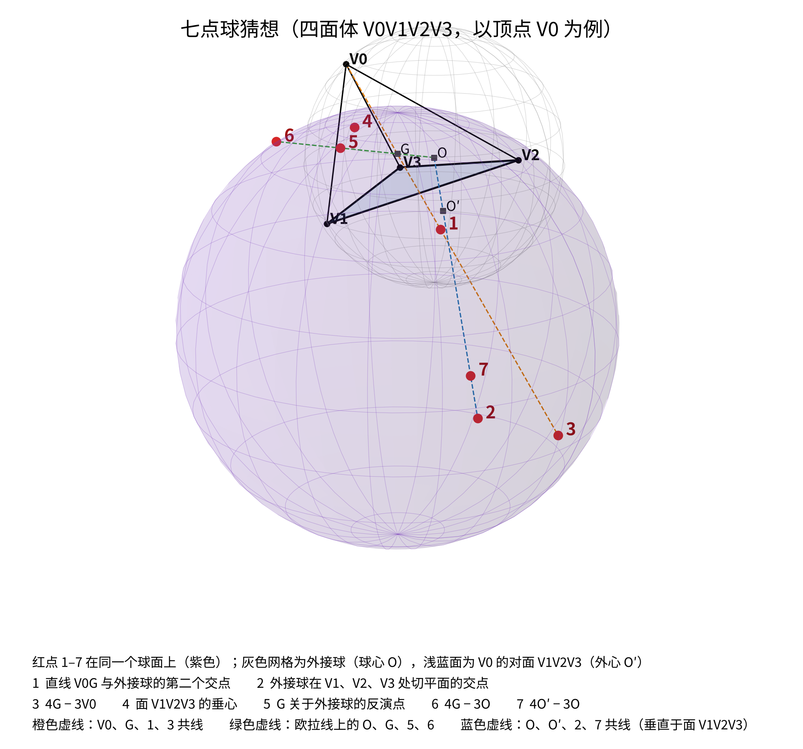
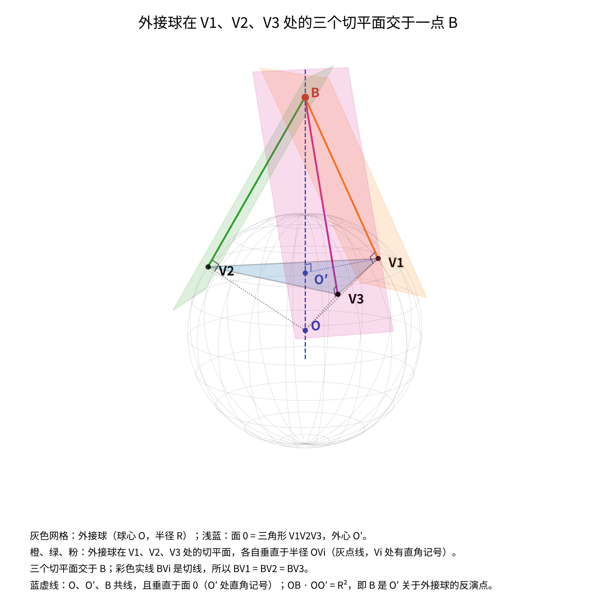
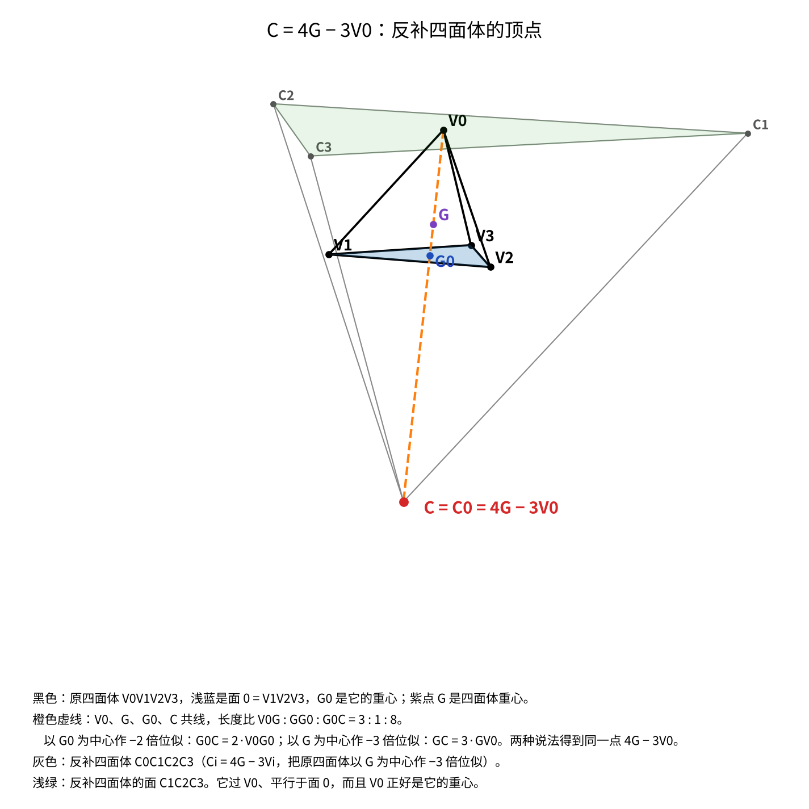
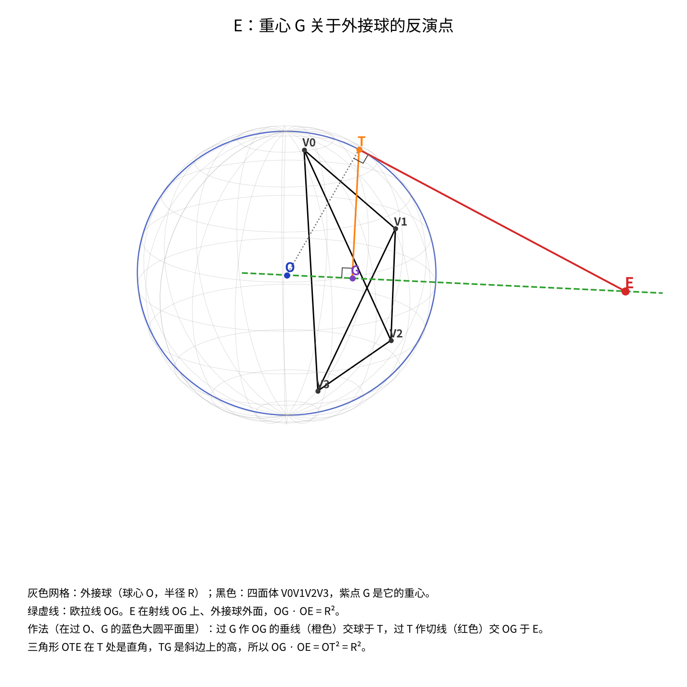

# 七点球定理

一般四面体上的一条共球定理：每个顶点给出七个共球的点。它是《[一般四面体定理扫描](一般四面体定理扫描.md)》共球一层筛到最后唯一剩下的关系（见该文 5.3 节），随后被证明。本文从那篇扫描报告中独立出来，整理于 2026 年 10 月 20 日。

可交互的三维图见专题页 `explore/nine-point.html#sevenpoint`。

<b>记号</b>：四面体 V0V1V2V3，外接球球心 O、半径 R，重心 G。对顶点 V0，记它的对面 V1V2V3 为面 0，面 0 的外心为 O′、垂心为 H′。

## 定理

对任意四面体和它的任一个顶点 V0，下面七点共球：

| | 点 | 作法 |
|---|---|---|
| 1 | A | 直线 V0G 与外接球的第二个交点 |
| 2 | B | 外接球在 V1、V2、V3 处的三个切平面的交点（切线四面体的顶点，也是面 0 所在平面关于外接球的极点） |
| 3 | C | 4G − 3V0（V0 关于面 0 的重心、按 −2 倍位似的像，即反补四面体的顶点） |
| 4 | H′ | 面 0 的垂心 |
| 5 | E | G 关于外接球的反演点 |
| 6 | D | 4G − 3O：以 O 为中心、把 G 放大 4 倍得到的点（反补四面体的外心） |
| 7 | F | 4O′ − 3O：以 O 为中心、把面 0 的外心 O′ 放大 4 倍得到的点 |

四个顶点各给出一个这样的球。

图：以 V0 为例的七点球（紫色）。灰色网格是外接球（球心 O），浅蓝面是 V0 的对面 V1V2V3（外心 O′）。红点 1–7 依次是表中的 A、B、C、H′、E、D（= 4G−3O）、F（= 4O′−3O）。三条虚线正对应证明里用到的三条共线关系：橙色是 V0、G、A、C 共线（G 把中线分成 3:1，这给出条件 (iii)）；绿色是欧拉线上的 O、G、E、4G−3O（E 与 4G−3O 是反演 J 的一对，给出条件 (i)）；蓝色是 O、O′、B、4O′−3O 共线且垂直于面 V1V2V3（B 与 4O′−3O 是 J 的另一对，给出条件 (ii)）。三条线各交出一个线性方程，球心就定下来了，H′ 和 A 随之自动落在球上。

图：表中第 2 点 B 的作法。外接球在 V1、V2、V3 处各有一个切平面（橙、绿、粉），切平面垂直于对应的半径 OVi。<b>三个平面交于一点 B</b>：若一点同时落在两个切平面上，它到这两个切点的切线长相等，所以交点满足 BV1 = BV2 = BV3，这样的点构成过面 0 的外心 O′ 且垂直于面 0 的那条直线（图中蓝虚线），三个平面都含这条线上的同一点，交点因此存在且唯一。由切线长相等还得 OB · OO′ = R²，即 <b>B 是 O′ 关于外接球的反演点</b>——这正是证明中条件 (ii) 用的形式；等价地，B 是面 0 所在平面关于外接球的<b>极点</b>，也是切线四面体（四个面都与外接球相切）在 V0 一侧的顶点。四个顶点各给出一个这样的 B。

图：表中第 3 点 C 的作法。设面 0 的重心为 G0，则 V0、G、G0、C 共线（橙色虚线），长度比 V0G : GG0 : G0C = 3 : 1 : 8。C 有两个等价的说法：<b>以 G0 为中心把 V0 作 −2 倍位似</b>（G0C = 2 · V0G0），或<b>以四面体重心 G 为中心作 −3 倍位似</b>（GC = 3 · GV0）。后一种说法对四个顶点一起用，就得到灰色的<b>反补四面体</b> C0C1C2C3（Ci = 4G − 3Vi），C = C0 是它在 V0 一侧的顶点；它的面 C1C2C3（浅绿）过 V0、平行于面 0，而 V0 正好是这个面的重心——这就是「反补」一词的来历，和三角形里反补三角形的关系完全平行。证明中条件 (iii) 用的就是 C = 4G − 3V0 这个代数形式。

图：表中第 5 点 E 的作法。E 是重心 G 关于外接球的<b>反演点</b>：它在射线 OG 上（绿虚线即欧拉线 OG），满足 OG · OE = R²。因为 G 在球内，E 必在球外。尺规作法就是圆里那套：在过 O、G 的大圆平面内，过 G 作 OG 的垂线交球面于 T，过 T 作切线交 OG 于 E；直角三角形 OTE 中 TG 是斜边上的高，于是 OG · OE = OT² = R²。

E 在证明里以条件 (i) 出现，作用是把球钉在正交条件上：取 J 为以 O 为心、半径 2R 的反演，则 J(E) = 4G，所以 E 与 4G 是 J 的一对，过这一对的球必与 S(O, 2R) 正交——表中第 6 点 D = 4G − 3O（归一化后就是 4G）正是 E 的 J-像，两者在球上是成对出现的。G 与 O 重合时（等面四面体）E 退到无穷远，对应下面「退化情形」里球变成平面的那一支。

## 证明

（Claude Code，2026-10-19）把外接球归一化：取 O 为原点、R = 1。记 s = V1 + V2 + V3，于是 G = (V0 + s)/4；O′ 是 O 在面 0 上的投影，H′ = s − 2O′。

关键一步是先固定球的形状族。设 J 是以 O 为心、半径 2R 的反演，J(X) = 4X/|X|²。注意 E = inv(G)、B = inv(O′)，其中 inv 是关于外接球的反演（极点就是垂足的反演像，|OB|·|OO′| = R²）；直接验证 J(E) = 4G、J(B) = 4O′。过一对 J 对应点的球必与 S(O, 2R) 正交，所以要找的球 Σ 与 S(O, 2R) 正交，等价于 O 对 Σ 的幂等于 4，即

> Σ：|X|² − 2c·X + 4 = 0，　c 为球心。

这样未知数只剩 c，而「X 在 Σ 上」是关于 c 的一个<b>线性</b>方程：2c·X = |X|² + 4。七个点给出：

- <b>E = inv(G)</b> 在 Σ 上 ⟺ 2c·G = 4|G|² + 1　(i)　（代入 E = G/|G|²，两边乘 |G|² 即得；等价地 4G 在 Σ 上）
- <b>B = inv(O′)</b> 在 Σ 上 ⟺ 2c·O′ = 4|O′|² + 1　(ii)　（同理；等价地 4O′ 在 Σ 上）
- C = 4G − 3V0 在 Σ 上，用 (i) 消去后 ⟺ 2c·V0 = 8G·V0 − 3　(iii)
- 4G、4O′ 分别是 E、B 在 J 下的像，而 Σ 与 S(O, 2R) 正交即 J-不变，所以它们自动在 Σ 上。

取 c 为 (i)(ii)(iii) 这三个线性方程的解（三个方程三个未知数，一般位置下唯一）。剩下两点自动成立：

<b>H′。</b>代入 (i)(ii)(iii)，所需等式化简为 s·O′ = 3|O′|²。而 V1、V2、V3 都落在过 O′ 且垂直于 OO′ 的平面上，故 (Vi − O′)·O′ = 0，即 Vi·O′ = |O′|²，三式相加即得。

<b>A。</b>写 A = V0 + t(G − V0)，由 |A| = 1 且 |V0| = 1 得 t = 2(1 − G·V0)/|G − V0|²。于是

> 2c·A = 2c·V0 + t(2c·G − 2c·V0) = (8G·V0 − 3) + t · 4|G − V0|² = (8G·V0 − 3) + 8(1 − G·V0) = 5，

而 |A|² + 4 = 1 + 4 = 5，两边相等。∎

换句话说，Σ 就是<b>过 E、B、C 三点且与 S(O, 2R) 正交的那个球</b>（球有 4 个自由度，三点加正交恰好 4 个条件），而 4G、4O′ 是 E、B 的 J-像，A 和 H′ 则由上面两段计算自动落上。原先缺的那一步（球为什么还过 4O′ − 3O）在这个写法下不再是额外条件：它就是定出球心的三个方程之一。

Σ 必为实球：球上有 A 这样的实点，故半径² = |A − c|² ≥ 0。

## 验证

按 (i)(ii)(iii) 解出 c 再代回，300 个随机四面体上七点全部满足方程；另取 15 个顶点坐标全为有理数的四面体（用勾股四元组放在单位球上），105 次代入<b>精确为 0</b>。

扫描阶段另有两项独立验证：

- 数值：在 9 个随机四面体上成立，误差 10⁻¹⁶ 量级；作为对照，换成随机点，误差在 10⁻² 量级。
- 精确：取 7 个坐标全为有理数的四面体（外心放在原点，R = 1，用勾股数和球极投影参数化），七点中任取五点的 21 个行列式全部严格等于 0。

## 退化情形

球心 c 由三个线性方程定出，系数矩阵是 2[G; O′; V0]（以 O 为原点）。所以构形退化当且仅当

> <b>det[G, O′, V0] = 0</b>，即 O、G、O′、V0 四点共面。

两种特殊情形都包含在内：G = O（外心与重心重合，此时 E 在无穷远、4G − 3O 退回 O）；O′ = O（某个面所在平面过外心，即该面的外接圆是大圆，此时极点 B 在无穷远）。

退化不是定理失效，而是球变成平面。沿一族四面体把 det 推向 0，球半径按 1/det 发散，而七点的共面程度同比例趋于 0：

| det | 球半径 / R | 七点共面程度 σ₃/σ₁ |
|---|---|---|
| 8.9 × 10⁻⁴ | 118 | 5.6 × 10⁻³ |
| 8.9 × 10⁻⁵ | 1195 | 5.6 × 10⁻⁴ |
| 8.9 × 10⁻⁶ | 11965 | 5.6 × 10⁻⁵ |

所以在把球与平面同等看待的意义下（Möbius 几何），定理对所有四面体成立：七点共球或共面。

## 球上恰好是这七个点；四个球的关系

<b>没有第八个点。</b>把 1096 个库点逐一代入 V0 的七点球，6 个四面体上都落在球上的恰好是 5 个库点——T171 = inv(G)（即 E）、L4.0 面垂心（H′）、L33.0 重心的外接球塞瓦点（A）、L37.0 切线四面体顶点（B）、L38.0 反补四面体顶点（C）——加上库外的 4G − 3O 和 4O′ − 3O，正好七个。另外试过十几个库外的自然候选（Monge 点、面重心、十二点球心、面的九点圆心、2O′、3G − 2V0、V0 关于面 0 的镜像等），没有一个在球上。

<b>四个球有一个共同的正交球。</b>证明的第一步对四个顶点一视同仁，所以四个七点球<b>都与以 O 为心、半径 2R 的球正交</b>。于是 O 对四个球的幂都等于 4R²：

> <b>推论</b>：四个七点球两两的根面都经过外心 O，O 是它们的根心。

300 个随机四面体上，O 对四球的幂彼此之差恒为 0。四个球心一般既不共线也不共面（σ₂/σ₁、σ₃/σ₁ 的中位数分别是 0.38、0.13），所以四球不共轴，除了共同的正交球之外没有更强的关系。

## 和三角形的关系

定理里的 B（面所在平面关于外接球的极点）和 H′（面的垂心）在三角形里都没有直接对应，所以这是一个三维特有的结构，不是三角形定理的简单推广。

## 文献检索

2026-10-19 查过以下方向，<b>没有找到这条定理</b>：

- 英文术语组合（seven-point sphere、pole of the face plane、orthocenter of the opposite face、inverse of the centroid、anticomplementary / tangential tetrahedron 与 circumsphere 的各种搭配）；
- 中文（四面体、七点共球、外接球、反演、切线四面体）；
- arXiv 与 Forum Geometricorum 方向的四面体中心、Monge 点、欧拉线、十二点球相关文章；
- 经典文献：Altshiller-Court《Modern Pure Solid Geometry》（1935，第九章「recent geometry of the tetrahedron」是最可能收录的地方）。Internet Archive 有藏本但受借阅限制，全文检索不可用，只核对了目录与章节描述。

检索中出现的同名对象是另一回事：文献里的「七点球」指垂心四面体中过棱中点等点的球（通常称 24 点球），与一般四面体无关；十二点球（过四个面重心与四个 Monge 三等分点）是已知结果，本轮扫描中也被找到。「垂心四面体的极球与十二点球正交」在结构上与本定理的「与以 O 为心、半径 2R 的球正交」相近，但对象限于垂心四面体。

<b>第二轮（2026-10-19，按「完全相同 / 等价 / 更一般」三层口径）。</b>

<b>(a) 第 6 点已有名字。</b>Cheung、Ko 与 Cheung《Old and New Generalizations of Classical Triangle Centres to Tetrahedra》（Hang Lung Mathematics Awards, Vol. 8 (2018), pp. 173–230）的定义 21 与定理 22 引入<b>反补四面体</b>（antimedial tetrahedron，各面过对应顶点且与原面平行）及其外心 J，称为<b>反补外心</b>（antimedial circumcentre），并证明以 O 为原点时 j = 4g = v₀+v₁+v₂+v₃，且 J 在欧拉线上。这正是本文的第 6 点 4G − 3O。今后检索应直接用 antimedial circumcentre 这个名字。该文系统整理了四面体中心，但<b>全文几乎没有共球结果</b>（仅一处 concyclic 出现在某个证明中），未见本文定理。

<b>(b) Coolidge 全文已检索。</b>J. L. Coolidge《A Treatise on the Circle and the Sphere》（1916）全书同时出现 tetrahedron 与 sphere 的句子共 21 处，逐句核过：定理 30（外心与「四个过三顶点的大圆球」的根心互为等角共轭，即十六点球那套）、定理 31–32（十二点球，后者限于正交四面体）、定理 34（正交四面体四个面的九点圆共球）、定理 37（四球共点），以及若干关于自共轭球的命题——没有一条是本文定理。全书未出现 anticomplementary 与 tangential tetrahedron。值得一提的是 Coolidge 自己写道：「四面体几何远远落后于三角形，两个最主要的欠缺就在于共球点的定理链和接触定理。」

<b>(c) Altshiller-Court 的切线四面体确认为本文的 B。</b>该书 §319（第 102 页）定义切线四面体，其与顶点 V₀ 对应的顶点正是在另三个顶点处切平面的交点，即面 0 的极点。随后的 §320–324 只给出这些面与棱的交线构成 hyperbolic group 一类的结果，<b>没有涉及球</b>。

<b>(d) 排除一条「更一般定理」的路径。</b>反补四面体的外心是 4G、外接半径为 3R，其十二点球恰是原外接球（数值核实）。但本文的球与「反补四面体的十二点球」「原四面体的十二点球」都不是同一个球；更根本的是，本文的球<b>依赖于所选顶点</b>（四个顶点给出四个不同的球），而十二点球对整个四面体唯一，结构上不可能由后者推出。

<b>第三轮：zbMATH Open（2026-10-20）。</b>zbMATH 经由《数学进展年鉴》（Jahrbuch über die Fortschritte der Mathematik）收录 1868 年以来的文献，包括 Mathesis、Nouvelles Annales、Journal de Mathématiques Élémentaires 等。取得 3338 条记录：MSC 51 类中所有关于四面体的英、法、德文条目；所有同时涉及四面体与球的条目；1868–1945 年的全部四面体条目；以及提到 Monge 点、十二点球、Feuerbach 球、切线四面体、反补四面体、垂心四面体或七点球的条目。按定理的要素（球、反演、极点、Monge 点、切线与反补四面体、面的垂心、重心、外接球、正交与根心）给书评打分，高分的约 70 条逐条细读，<b>均不含本定理</b>。最接近的是：

- Thébault（1936–37）：四面体的 de Longchamps 型球，每个四面体一个，球心是 Monge 点关于内心的对称点；
- Zbl 0060.34002（1942）：把十二点球关于外接球反演得到的两个球，球心为 G 与 Monge 点；
- Neuberg（1885）：在等动力四面体中使用切线四面体；
- Zbl 1302.51014（2011）：把 Vi 映为直线 GVi 与外接球第二交点（即本文的 A）的迭代，作为动力系统研究；
- Zbl 1315.51010（2015）：Thébault 的若干猜想。

约 830 条记录没有可读的书评，从标题看都与四面体的初等几何无关。

<b>尚未排除的范围：</b>MathSciNet（需要订阅）；未被 zbMATH 收录或只有标题的十九世纪法语、德语文献；Third (1898)、Robinson (1929)、Court (1942) 等专论四面体球系的早期论文的正文。因此<b>只能说「目前未检索到」，不能给出原创性的可靠判断</b>。

<b>「没查到」不等于「新的」</b>：纸本期刊、Hyacinthos／AoPS 未被收录的帖子、未被索引的 PDF 都在检索覆盖之外，立体几何的经典结果恰恰大量散落在这些地方。要进一步确认，还需检索 MathSciNet，并请做立体几何的人看一看。
