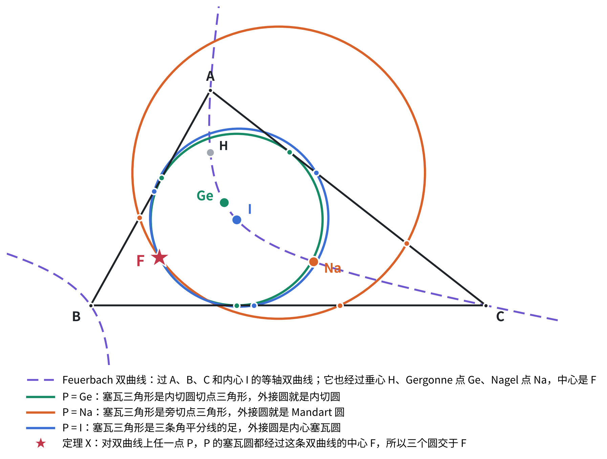
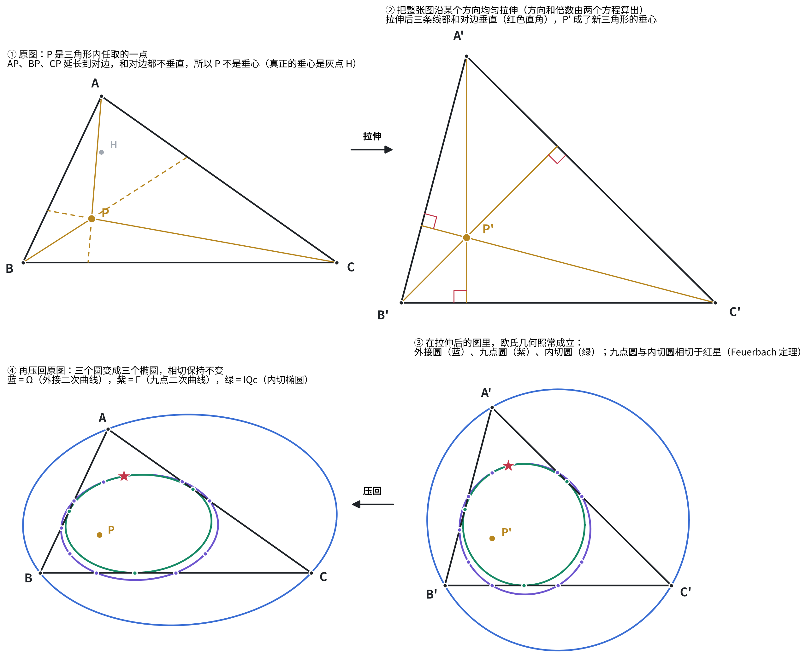
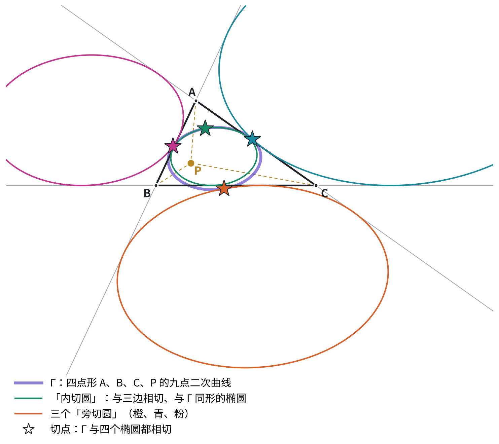
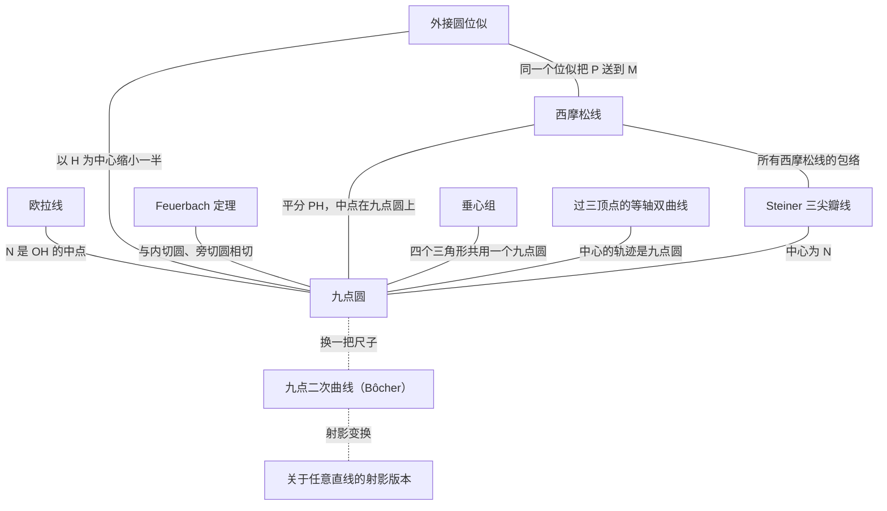
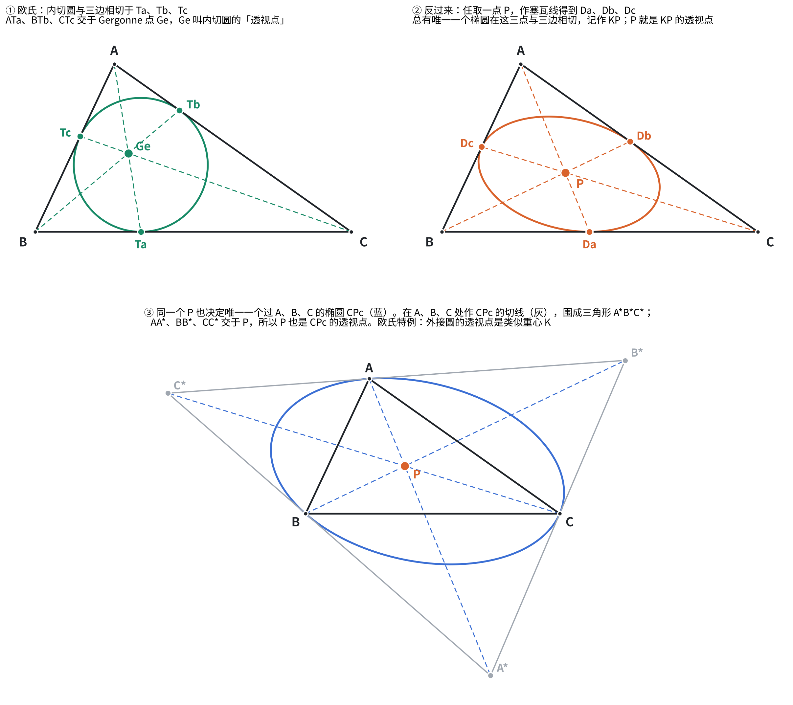

# 九点圆定理系统

以九点圆为中心的一组三角形定理，以及它们之间的联系。整理于 2026 年 10 月。

## 更新（2026-10-18）：三轮数值试探

用最简单的机械方法「数值试探」跑了三轮：列出构型里的名点和名曲线，在几十个随机构型上全部算出来，检查所有三点组合是否共线、所有四点组合是否共圆、每个点是否落在每条曲线上，只保留在全部构型上都成立的关系。关键结果用 40–50 位精度复核。

### 第一轮：三角形的 35 个名点

（之前说的「38 个」是我数错了，程序里实际是 35 个。）

<b>做法。</b>取 25 个随机三角形（排除太扁、太小的），把下表 35 个点都按公式算出坐标。检查所有三点组合是否共线、所有四点组合是否共圆，只保留在 25 个三角形里<b>全部</b>成立的，再把有公共点的组合并成最大的共线组、共圆组。

#### 表 1：35 个点

前 11 个是 ETC（三角形中心百科全书）里的中心，按 ETC 编号排列；X(9) 等编号这一轮没有用到。

| | 记号 | 名称 | 怎么作 | ETC 编号 |
|---|---|---|---|---|
| 1 | I | 内心 | 三条内角平分线交点 | X(1) |
| 2 | G | 重心 | 三条中线交点 | X(2) |
| 3 | O | 外心 | 三边中垂线交点 | X(3) |
| 4 | H | 垂心 | 三条高交点 | X(4) |
| 5 | N | 九点圆心 | OH 中点 | X(5) |
| 6 | K | 类似重心 | 见附录 A | X(6) |
| 7 | Ge | Gergonne 点 | 见附录 A | X(7) |
| 8 | Na | Nagel 点 | 见附录 A | X(8) |
| 9 | Sp | Spieker 点 | 见附录 A | X(10) |
| 10 | F | Feuerbach 点 | 见附录 A | X(11) |
| 11 | L | de Longchamps 点 | 见附录 A | X(20) |
| 12–14 | A、B、C | 三顶点 | | |
| 15–17 | Ia、Ib、Ic | 旁心 | 见附录 A | |
| 18–20 | Ma、Mb、Mc | 三边中点 | | |
| 21–23 | Ha、Hb、Hc | 三个垂足 | 高与对边的交点 | |
| 24–26 | Ea、Eb、Ec | Euler 点 | AH、BH、CH 的中点 | |
| 27–29 | Ta、Tb、Tc | 内切圆切点 | 内切圆与三边的切点 | |
| 30–32 | Ua、Ub、Uc | 旁切圆切点 | 每个旁切圆与它所对的那条边的切点 | |
| 33–35 | Aa、Ab、Ac | 对径点 | A、B、C 关于 O 的对称点 | |

记号约定：小写字母表示「属于哪个顶点或哪条边」，如 Ma 是边 a（即 BC）的中点，Ia 是 A 所对的旁心。

表 1 里有四个点的作法放在附录 A，这里先画出来。

Gergonne 点 Ge

内切圆与三边切于 Ta、Tb、Tc。同一个顶点引出的两条切线等长（图中红、蓝、黄三组），代入 Ceva 定理比值乘积为 1，所以 A–Ta、B–Tb、C–Tc 三线共点，交点就是 Gergonne 点 Ge。

Nagel 点 Na

三个旁切圆（圆心 Ia、Ib、Ic）各与一条边及另两边的延长线相切，与所对的边切于 Ua、Ub、Uc。A–Ua、B–Ub、C–Uc 三线交于 Nagel 点 Na。每条这样的线都平分周长：A 沿 B 走到 Ua 与 A 沿 C 走到 Ua 的路程相等，都等于半周长。

Spieker 点 Sp

中点三角形 MaMbMc 的内切圆叫 Spieker 圆，圆心就是 Spieker 点 Sp。它还有一个力学解释：把三条边看成均匀细棒，质量集中在各自中点，这三个质点的重心也是 Sp。灰色虚线圆是 ABC 的内切圆，Spieker 圆是它缩小一半的像，这正是下文「欧拉线和 Nagel 线是同一个位似」里右栏的内容。

Feuerbach 点 F

Feuerbach 定理：九点圆与内切圆相切，切点就是 Feuerbach 点 F。切点必在连心线上，所以 N、I、F 共线，且 NI = R/2 − r。表 1 把 F 按定义取在九点圆上，第一轮查出的「F 在内切圆上」就是这条定理。

#### 表 2：找到的共线（共 37 组）

<b>没有新的共线定理。</b>37 组全部已知。真正有内容的只有前三条；第 4–6 行（9 组）由位似或中点关系直接得到；第 7–15 行（25 组）按作法成立。

| | 共线的点 | 名称 | 说明 |
|---|---|---|---|
| 1 | O、G、H、N、L | <b>欧拉线</b> | OG : GH = 1 : 2；N 是 OH 中点；O 是 HL 中点 |
| 2 | I、G、Sp、Na | <b>Nagel 线</b> | IG : GNa = 1 : 2；Sp 是 I–Na 中点。和欧拉线是同一个位似（见下文） |
| 3 | I、Ge、L | <b>Soddy 线</b> | 也过两个 Soddy 圆的圆心（这一轮没列这两个点） |
| 4 | Aa、Ea、G（共 3 组） | | 以 G 为中心、比例 −1/2 的位似把 Aa 变成 Ea |
| 5 | Aa、H、Ma（共 3 组） | | Ma 是 H 与 Aa 的中点（H 关于 Ma 的对称点在外接圆上） |
| 6 | Ea、Ma、N（共 3 组） | | EaMa 是九点圆的直径 |
| 7 | A、B、Hc、Mc、Tc、Uc（共 3 组） | 三条边 | 中点、垂足、两种切点本来就取在边上 |
| 8 | A、O、Aa（共 3 组） | 外接圆直径 | Aa 定义为 A 关于 O 的对称点 |
| 9 | A、G、Ma（共 3 组） | 中线 | G 在中线上 |
| 10 | A、Ea、H、Ha（共 3 组） | 高 | Ea 是 AH 中点，Ha 是高的垂足 |
| 11 | A、I、Ia（共 3 组） | 内角平分线 | 旁心 Ia 也在 A 的内角平分线上 |
| 12 | A、Ib、Ic（共 3 组） | 外角平分线 | Ib、Ic 都在 A 的外角平分线上 |
| 13 | A、Ge、Ta（共 3 组） | Gergonne 点的塞瓦线 | Ge 就是这三条线的交点 |
| 14 | A、Na、Ua（共 3 组） | Nagel 点的塞瓦线 | Na 就是这三条线的交点 |
| 15 | F、I、N | 连心线 | 两圆相切，切点在连心线上；程序里 F 本来就取在 NI 上 |

图：Nagel 线一侧的全部对象。绿色实线是内切圆（圆心 I，切点 Ta、Tb、Tc），绿色虚线是中点三角形的内切圆即 Spieker 圆（圆心 Sp）；淡蓝是三条中线，交于重心 G；橙色是顶点连对边上的旁切圆切点 Ua、Ub、Uc，交于 Nagel 点 Na。紫色粗线即 Nagel 线，I、G、Sp、Na 四点共线，IG : GNa = 1 : 2，Sp 是 I 与 Na 的中点，即表 2 第 2 行。这三个比例关系都来自同一个位似，见下文「欧拉线和 Nagel 线是同一个位似」。

图：Soddy 线，表 2 第 3 行。以 A、B、C 为圆心、半径 s−a、s−b、s−c 的三个圆两两外切（蓝色），切点正是内切圆切点 Ta、Tb、Tc。与这三个圆都相切的圆有两个，即内、外 Soddy 圆，圆心记作 S1、S2（绿色；S1 在右下放大图里）。S1、S2 的连线就是 Soddy 线，它同时经过内心 I、Gergonne 点 Ge，以及 de Longchamps 点 L——L 是垂心 H 关于外心 O 的对称点，所以它也在欧拉线上。表 2 第 3 行把这条线记作 I、Ge、L 共线，当时没有把两个 Soddy 圆心列进点表，这张图把它们补上了。

#### 表 3：找到的共圆（共 25 个圆）

<b>没有新的共圆定理。</b>25 个圆全部已知：有内容的 3 个是已知定理（九点圆、Feuerbach 定理、Mandart 圆过 F），其余平凡。

程序的共圆判据对共线的点也成立，所以另有 8 组「共圆」其实是表 2 里的直线，已剔除。

| | 共圆的点 | 名称 | 说明 |
|---|---|---|---|
| 1 | Ma、Mb、Mc、Ha、Hb、Hc、Ea、Eb、Ec、F | <b>九点圆</b> | 九点圆定理本身；F 是按定义取在九点圆上的 |
| 2 | Ta、Tb、Tc、F | <b>内切圆</b> | 有内容的是「F 在内切圆上」，即 Feuerbach 定理 |
| 3 | Ua、Ub、Uc、F | <b>Mandart 圆</b> | 旁切圆三切点的外接圆也过 F；第二轮的定理 X 解释了它 |
| 4 | A、B、C、Aa、Ab、Ac | 外接圆 | 按作法成立 |
| 5 | A、B、I、Ic（共 3 个） | | 以 IIc 为直径：内、外角平分线互相垂直 |
| 6 | A、B、Ia、Ib（共 3 个） | | 以 IaIb 为直径，理由同上 |
| 7 | A、B、Ha、Hb（共 3 个） | | 以 AB 为直径（直角所对） |
| 8 | A、H、Hb、Hc（共 3 个） | | 以 AH 为直径 |
| 9 | A、Mb、Mc、O（共 3 个） | | 以 AO 为直径 |
| 10 | A、I、Tb、Tc（共 3 个） | | 以 AI 为直径 |
| 11 | Ab、Ac、Ta、Ua（共 3 个） | | 等腰梯形：Ta、Ua 关于 Ma 对称 |

类似重心 K 在这一轮里没有出现在任何共线或共圆中。

图：Mandart 圆，表 3 第 3 行。三个旁切圆与三边分别切于 Ua、Ub、Uc（图中旁切圆只画出一部分），这三点连成旁切点三角形，它的外接圆就是 Mandart 圆（棕色）。图里同时画了内切圆（绿）与九点圆（紫）：两者相切于 Feuerbach 点 F，而 F 也落在 Mandart 圆上——这就是表 3 第 3 行那条。它和「F 在内切圆上」看似无关，第二轮的定理 X 说明两者是同一条定理的两个特例。

#### 欧拉线和 Nagel 线是同一个位似

以 G 为中心、比例 −1/2 的位似把三角形变成它的中点三角形。它同时给出两串点：

| | 欧拉线 | Nagel 线 |
|---|---|---|
| 起点 | 垂心 H | Nagel 点 Na |
| 位似一次 | 外心 O | 内心 I |
| 再位似一次 | 九点圆心 N | Spieker 点 Sp |
| 对应的圆 | 外接圆 → 九点圆 | 内切圆 → Spieker 圆（中点三角形的内切圆） |

位似中心、点、像三者共线，所以这两条线是同一个事实的两个特例，在网络里算一个节点。

#### 第一轮小结

找到的关系全部已知，分三层：

1. <b>按作法成立的</b>：大部分共线和外接圆；
2. <b>一个位似解释的</b>：欧拉线、Nagel 线，以及表 2 的第 4–6 行；
3. <b>真正有内容的</b>：九点圆、Soddy 线、F 在内切圆上（Feuerbach）、F 在 Mandart 圆上。

### 第二轮：三角形加任意点 P

<b>做法。</b>在三角形之外再任取一点 P，取 30 个随机构型（排除 P 太靠近三边的情况）。在 34 个点、5 条曲线上检查所有共线、共圆，以及每个点是否落在每条曲线上，只保留在全部 30 个构型里都成立的关系。重点看三角形的对象和 P 派生出的对象之间有没有「混合」关系。

（程序原本列了 35 个点，其中 Y4 和 Poncelet 点 Po 是同一个点，合并后为 34 个。修正前的输出曾把三条不同的曲线误并成一个「14 点圆」，以下数字均为修正后的。）

#### 表 4：第二轮的点

| 类别 | 记号 | 名称 | 怎么作 |
|---|---|---|---|
| 三角形的点 | A、B、C | 三顶点 | |
| | O、H、G、N、I | 外心、垂心、重心、九点圆心、内心 | 同表 1 |
| | Ma、Mb、Mc | 三边中点 | |
| | Ha、Hb、Hc | 三个垂足 | |
| P 派生的点 | P | 任意点 | |
| | Ka、Kb、Kc | P 与顶点连线的中点 | Ka 是 AP 的中点 |
| | Da、Db、Dc | 塞瓦点（对角点） | Da 是 AP 与 BC 的交点；Da、Db、Dc 组成 P 的塞瓦三角形 |
| | Fa、Fb、Fc | P 的垂足 | Fa 是 P 在 BC 上的投影；Fa、Fb、Fc 组成 P 的垂足三角形 |
| | G4 | 四点重心 | A、B、C、P 的平均 |
| | Q | P 的补点 | 以 G 为中心、比例 −1/2 的位似下 P 的像 |
| | aP | P 的反补点 | 以 G 为中心、比例 −2 的位似下 P 的像 |
| | P* | P 的等角共轭点 | 见附录 A |
| | Piso | P 的等截共轭点 | 见附录 A |
| | Po | Poncelet 点 | 过 A、B、C、P 的等轴双曲线的中心，见附录 A |
| | Pr | P 关于 O 的对称点 | |
| | PH、PO | 中点 | P 与 H 的中点、P 与 O 的中点 |
| 曲线的交点 | X4 | 第 4 交点 | Ω 与外接圆除 A、B、C 外的第 4 个交点 |
| | Y4 | 第 4 交点 | Γ 与九点圆除三边中点外的第 4 个交点；<b>就是 Po</b> |

图：表 4 里三个要看图才清楚的作法。(a) 从每个顶点经过 P 画塞瓦线，交对边于 Da、Db、Dc，三点组成 P 的塞瓦三角形；把 A、B、C、P 看成四点时，这三个就是对角点。(b) 把每个塞瓦足关于所在边的中点对称过去，得到的三个新点与对应顶点的连线交于等截共轭点 Piso（Gergonne 点与 Nagel 点就互为等截共轭）。(c) 把 AP、BP、CP 各自关于该角的角平分线对称过去，三条线交于等角共轭点 P*（外心与垂心、重心与类似重心互为等角共轭）。P* 与 Piso 的定义原在附录 A。

图：表 4 里另外三个由 P 导出的点。(a) 以重心 G 为中心作位似，比例 −1/2 把 P 变成补点 Q，比例 −2 把 P 变成反补点 aP；四点共线，取 GP = 1 则 GQ = 1/2、GaP = 2，Q 与 aP 都落在 G 的另一侧。同一个位似把 ABC 变成中点三角形（蓝色虚线），正是第一轮里那个把欧拉线和 Nagel 线统一起来的位似。(b) Pr 是 P 关于外心 O 的对称点，O 是 P 与 Pr 的中点；欧氏情形取 P = H 时，Pr 就是 de Longchamps 点 L，也就是 Soddy 线上的那个点。

图：表 4 里的 Poncelet 点 Po，两个等价定义。

先说什么是等轴双曲线。双曲线有两条渐近线，一般情况下它们斜交；两条渐近线互相垂直的那种双曲线就叫等轴双曲线。「等轴」是因为此时实轴与虚轴等长（方程可化成 x² − y² = a²），离心率恒为 √2。过平面上一般位置的四个点，二次曲线不止一条而是一整族（椭圆、双曲线、抛物线都可能出现），而其中渐近线互相垂直的恰好只有一条——这个唯一性正是 Po 能被良好定义的原因。

(a) 紫色就是过 A、B、C、P 的那条等轴双曲线（有两支），两条渐近线（紫色虚线）互相垂直，交点即双曲线的中心，这就是 Po。绿色是三角形 ABC 的九点圆，Po 恰好落在它上面——这是表 7 第 1 行。(b) 等价定义：A、B、C、P 四个点组成 ABC、PBC、PCA、PAB 四个三角形，它们的四个九点圆交于同一点，这个点就是 Po。欧氏情形取 P = 内心 I 时，Po 就是 Feuerbach 点 F。

#### 表 5：5 条曲线

| 记号 | 曲线 | 定义 |
|---|---|---|
| Γ | 九点二次曲线 | 过 Ma、Mb、Mc、Ka、Kb 的二次曲线，见附录 B |
| Ω | 外接二次曲线 | Γ 以 P 为中心放大 2 倍；经过 A、B、C |
| | 外接圆 | |
| | 九点圆 | |
| | P 的垂足圆 | 过 Fa、Fb、Fc 的圆 |

图：表 5 里 Γ 与 Ω 的关系。淡紫色是九点二次曲线 Γ 及其上的 9 个点，从 P 出发经过每个点并延长一倍（灰色虚线），得到的红色曲线就是外接二次曲线 Ω。Ka、Kb、Kc 本是 AP、BP、CP 的中点，放大一倍后正好回到 A、B、C，所以 Ω 必过三个顶点；其余 6 点的像记作 Ma′、Da′ 等。Ω 的中心是 Q = (A+B+C−P)/2，即 P 的补点。P 取垂心 H 时，Γ 就是九点圆、Ω 就是外接圆、Q 就是外心——第一轮那条「以 H 为中心把外接圆缩一半得九点圆」正是这张图的欧氏特例。

#### 表 6：找到的共线（共 25 组）

<b>没有新的共线定理。</b>25 组全部已知。有内容的只有欧拉线；第 2–11 行（12 组）由位似或中点关系直接得到；第 12–15 行（12 组）按作法成立。

| | 共线的点 | 说明 |
|---|---|---|
| 1 | O、H、G、N | <b>欧拉线</b> |
| 2 | G、Po、X4 | 以 G 为中心、比例 −1/2 的位似把外接圆变成九点圆、把 Ω 变成 Γ，所以把 X4 变成 Po |
| 3 | P、G、G4、Q、aP | 都是 P 与 G 的线性组合：G4 = (3G + P)/4，Q = (3G − P)/2，aP = 3G − 2P。这是欧拉线的一般形式，见表 11 |
| 4 | P、O、Pr、PO | Pr、PO 按定义在直线 PO 上 |
| 5 | P、H、PH | PH 是 P 与 H 的中点 |
| 6 | O、G4、PH | G4 是 O 与 PH 的中点 |
| 7 | H、Q、Pr | Q 是 H 与 Pr 的中点 |
| 8 | G、Pr、PH | 以 G 为中心、比例 −1/2 的位似把 Pr 变成 PH |
| 9 | N、G4、PO | G4 是 N 与 PO 的中点 |
| 10 | N、Q、PH | N 是 Q 与 PH 的中点 |
| 11 | Ma、Ka、G4（共 3 组） | 四边形的对边中点连线交于 G4，并被它平分。这是「九点圆直径」的一般形式，见表 11 |
| 12 | A、B、Mc、Dc、Fc、Hc（共 3 组） | 三条边：中点、塞瓦点、垂足本来就取在边上 |
| 13 | A、P、Ka、Da（共 3 组） | 塞瓦线。这是「高」的一般形式，见表 11 |
| 14 | A、H、Ha（共 3 组） | 高 |
| 15 | A、G、Ma（共 3 组） | 中线 |

#### 表 7：找到的共圆（共 19 个圆）

<b>本轮没有发现任何新的共圆定理。</b>19 个圆分三类：已知定理 3 个，可由已知定理换标号得到 3 个，平凡 13 个。

| | 共圆的点 | 名称 | 类别 | 说明 |
|---|---|---|---|---|
| 1 | Ma、Mb、Mc、Ha、Hb、Hc、Po | 九点圆 | 已知定理 | 「Po 在九点圆上」是 Poncelet 点的基本性质（维基百科） |
| 2 | Ma、Kb、Kc、Fa、Po（共 3 个） | 三角形 PBC、PCA、PAB 的九点圆 | 第 1 行换标号 | Ma、Kb、Kc、Fa 共圆只是九点圆定理用在三角形 PBC 上；Po 对 A、B、C、P 对称，把 P 与 A 对调，第 1 行就变成这一行 |
| 3 | Da、Db、Dc、Po | P 的塞瓦圆 | 已知定理 | 即定理 X，见于维基百科「Poncelet point」条目 |
| 4 | Fa、Fb、Fc、Po | P 的垂足圆 | 已知定理 | 维基百科「Poncelet point」条目 |
| 5 | A、B、C、X4 | 外接圆 | 平凡 | X4 按定义取在外接圆上 |
| 6 | A、B、Ha、Hb（共 3 个） | | 平凡 | 以 AB 为直径（直角所对） |
| 7 | A、P、Fb、Fc（共 3 个） | | 平凡 | 以 AP 为直径 |
| 8 | A、O、Mb、Mc（共 3 个） | | 平凡 | 以 AO 为直径 |
| 9 | A、H、Hb、Hc（共 3 个） | | 平凡 | 以 AH 为直径 |

去掉换标号的重复后，有内容的只是 3 条已知定理：Po 在九点圆上、在塞瓦圆上、在垂足圆上。

图：表 7 第 4 行。从 P 向三边作垂线，垂足 Fa、Fb、Fc 组成 P 的垂足三角形，它的外接圆叫垂足圆（蓝色）。Poncelet 点 Po 落在这个圆上——Po 的定义是过 A、B、C、P 的等轴双曲线（灰色虚线）的中心，和垂足圆看不出关系，但两者确实相交于此。它和第 1 行「Po 在九点圆上」、第 3 行「Po 在塞瓦圆上」是同一个点的三条性质；P 取垂心 H 时垂足圆就退化成九点圆，三条合为一条。

#### 表 8：点在哪些曲线上

| 曲线 | 经过的点 | 说明 |
|---|---|---|
| 九点二次曲线 Γ | Ma、Mb、Mc、Ka、Kb、Kc、Da、Db、Dc、Po | 前 9 点即九点二次曲线定理（Bôcher 1892）。Po 在上面是平凡的：Γ 正是所有过 A、B、C、P 的二次曲线的中心的轨迹，Po 是其中一条（等轴双曲线）的中心 |
| Ω | A、B、C、X4 | 按定义 |
| 外接圆 | A、B、C、X4 | 按定义 |
| 九点圆 | Ma、Mb、Mc、Ha、Hb、Hc、Po | 同表 7 第 1 行 |
| P 的垂足圆 | Fa、Fb、Fc、Po | 同表 7 第 4 行 |

内心 I、P 的等角共轭点 P*、等截共轭点 Piso 在这一轮里没有出现在任何关系中。

#### 讨论：第二轮的对象与第一轮欧氏对象的对应

第二轮的四个点 A、B、C、P，是第一轮「三角形 ABC 加垂心 H」的一般化。前面第 10 条说过：任给一点 P，总能换一把尺子（换一个二次型），使 P 成为垂心。在这把新尺子下，第二轮里只由 A、B、C、P 作出的对象，每一个都变成第一轮的某个欧氏对象；反过来，把 P 取成 H，第二轮的对象就回到第一轮。下面三张表列出这种对应。

左栏是欧氏情形（P 就是垂心 H），右栏是一般情形（P 任意）。

<b>表 9：点的对应</b>

| 欧氏（P = H） | 一般（P 任意） | 说明 |
|---|---|---|
| 垂心 H | 任意点 P | 在新尺子下，P 就是垂心 |
| 垂心组 A、B、C、H | 四点形 A、B、C、P | |
| 三个垂足 Ha、Hb、Hc | 三个对角点 Da、Db、Dc | 高 AH 与 BC 的交点，对应 AP 与 BC 的交点 |
| Euler 点 Ea、Eb、Ec（AH 等的中点） | Ka、Kb、Kc（AP 等的中点） | |
| 三边中点 Ma、Mb、Mc | 三边中点 Ma、Mb、Mc | 中点不依赖尺子，不变 |
| 重心 G | 重心 G | 不变 |
| 九点圆心 N | 四点重心 G4 = (A + B + C + P)/4 | 欧氏里 N = (A + B + C + H)/4。G4 是九点二次曲线 Γ 的中心 |
| 外心 O | 补点 Q = (A + B + C − P)/2 | 欧氏里 O = (A + B + C − H)/2。Q 是 Ω 的中心 |
| de Longchamps 点 L | 反补点 aP = A + B + C − 2P | 欧氏里 L = A + B + C − 2H |
| 对径点 Aa | 点 B + C − P（不在第二轮点表里） | 欧氏里 Aa = B + C − H |
| 无对应（P = H 时不唯一） | Poncelet 点 Po | P = H 时，过四点的二次曲线全是等轴双曲线，中心铺满整个九点圆 |

<b>表 10：曲线的对应</b>

| 欧氏（P = H） | 一般（P 任意） | 说明 |
|---|---|---|
| 九点圆 | 九点二次曲线 Γ | 9 点对应 9 点：3 个中点不变；3 个 Euler 点对应 Ka、Kb、Kc；3 个垂足对应 Da、Db、Dc |
| 外接圆 | Ω | 外接圆是九点圆以 H 为中心放大 2 倍；Ω 是 Γ 以 P 为中心放大 2 倍 |
| 以 G 为中心、比例 −1/2 的位似把外接圆变成九点圆 | 同一个位似把 Ω 变成 Γ | 这就是表 6 第 2 行（G、Po、X4 共线）的来源 |
| 圆 | 同形椭圆（四点 A、B、C、P 成凹四边形）或同形双曲线（成凸四边形） | 新尺子下的「圆」 |
| 过 A、B、C、H 的二次曲线全是等轴双曲线，中心都在九点圆上 | 过 A、B、C、P 的二次曲线有一整族，中心都在 Γ 上 | Brianchon–Poncelet（1821）的一般形式 |

<b>表 11：共线的对应</b>

| 欧氏（P = H） | 一般（P 任意） | 说明 |
|---|---|---|
| 欧拉线 H、G、N、O、L（表 2 第 1 行） | P、G、G4、Q、aP（表 6 第 3 行） | 比例完全一样：HG : GN : NO = PG : GG4 : G4Q |
| 高 A、Ea、H、Ha（表 2 第 10 行） | 塞瓦线 A、Ka、P、Da（表 6 第 13 行） | |
| 九点圆的直径 Ea、N、Ma（表 2 第 6 行） | Ka、G4、Ma（表 6 第 11 行） | EaMa 是九点圆的直径；KaMa 是 Γ 的直径 |
| Aa、Ea、G（表 2 第 4 行） | B + C − P、Ka、G | 以 G 为中心、比例 −1/2 的位似 |
| Aa、H、Ma（表 2 第 5 行） | B + C − P、P、Ma | Ma 是中点 |
| 三条边、三条中线 | 不变 | |

<b>这三张表说明了什么。</b>

1. <b>表 6 里标为「平凡」的第 3、11、13 行，其实是欧拉线、九点圆直径、高的一般形式。</b>在一般情形下，它们只是 P 和 G 的线性组合，所以平凡。反过来看，欧拉线在欧氏几何里的全部内容，就是「外心 O 恰好等于 (A + B + C − H)/2」这一个事实；其余都是线性代数。
2. <b>第二轮的对象有两类。</b>一类只由 A、B、C、P 作出，比如中点、对角点、G4、Q、Γ、Ω，它们都是第一轮欧氏对象的一般形式，彼此之间的关系就是欧氏定理换了尺子，不会有新内容。另一类用到原来的尺子，比如 O、H、N、ABC 的九点圆、外接圆、P 的垂足 Fa 和垂足圆，它们和 P 的关系是「两把尺子之间」的混合关系。
3. <b>第二轮有内容的结果，全部属于混合关系：</b>Po 在 ABC 的九点圆上、在塞瓦圆上、在垂足圆上（表 7 第 1、3、4 行）。这三条都是已知定理。

#### 第二轮小结

<b>第二轮没有发现新定理，所有结果都是已知的或平凡的。</b>

- 共线 25 组：只有欧拉线有内容（第一轮已有），其余都由线性关系或作法得到。
- 共圆 19 个：有内容的是 3 条已知定理（Po 在九点圆、塞瓦圆、垂足圆上），另有 3 个是这些定理换标号的结果，其余 13 个平凡。
- 曲线上的点：九点二次曲线定理是已知定理（Bôcher 1892），其余按定义或平凡。

这一轮的价值不在发现，而在两点：一是验证了方法能把已知结果完整地重新找出来；二是暴露了过滤器要补的规则，即交换 A、B、C、P 角色后相同的关系只算一次。

### 意外得到的结构：一条上游定理统一三条事实

<b>定理 X：</b>P 的塞瓦三角形的外接圆经过 A、B、C、P 的 Poncelet 点（即表 7 第 3 行）。这条定理已知，见于维基百科「Poncelet point」条目。

已知 Feuerbach 双曲线（过 A、B、C、H、I 的等轴双曲线）的中心是 Feuerbach 点 F，并且经过 Gergonne 点和 Nagel 点。把 P 取成这条双曲线上的点：

#### 表 12：定理 X 的特例

| P 取 | 塞瓦三角形的外接圆 | 推出 |
|---|---|---|
| Gergonne 点 | 内切圆 | F 在内切圆上 |
| Nagel 点 | Mandart 圆 | F 在 Mandart 圆上（第一轮找到的那条） |
| 内心 | 内心塞瓦三角形的外接圆 | F 也在这个圆上（已数值验证，是否已有记载待查） |

图：表 12 的三行画在一起。紫色虚线是 Feuerbach 双曲线——过 A、B、C 和内心 I 的等轴双曲线，它也经过垂心 H、Gergonne 点 Ge、Nagel 点 Na，中心是 Feuerbach 点 F。定理 X 说：双曲线上任取一点 P，P 的塞瓦圆都经过这条双曲线的中心，也就是 F。于是取 P = Ge 得内切圆（绿）、取 P = Na 得 Mandart 圆（橙）、取 P = I 得内心塞瓦圆（蓝），三个圆都过 F，在图上交于同一点。

第一轮里看似孤立的 Mandart 圆，和 Feuerbach 切点在内切圆上，是同一条定理的两个特例。

### 第三轮：把「圆」推广成同形的椭圆和双曲线

#### 一、这一轮要回答什么

第二轮让 P 当垂心，只推广了九点圆一条：九点圆变成九点二次曲线 Γ。第一轮还找到了另外 24 个共圆和 37 组共线，其中有内容的包括：

- Feuerbach 定理：九点圆与内切圆相切；
- Mandart 圆经过 Feuerbach 点；
- 欧拉线、Nagel 线、Soddy 线。

第二轮没有碰这些。第三轮要回答的是：

1. 把 P 当垂心以后，第一轮的每一条共圆、共线定理变成什么样子？
2. 「圆」变成椭圆时，这些定理成立吗？变成双曲线时，还成立吗？
3. Feuerbach 定理在二次曲线上是什么样子？

#### 二、预备知识

##### 1. 「换尺子」是什么意思

「尺子」指的是量长度、量角度的方法。欧氏几何的尺子是 x² + y²：两点距离的平方是 Δx² + Δy²，两个方向垂直是指 u₁v₁ + u₂v₂ = 0。

把 x² + y² 换成另一个二次式 px² + 2qxy + ty²（数学上叫二次型 S），就换了一把尺子。新尺子下，「长度的平方」是 uᵀSu，「垂直」是 uᵀSv = 0。

<b>让 P 成为垂心的尺子。</b>任给三角形 ABC 和一点 P，要求新尺子下 AP ⊥ BC、BP ⊥ CA：

- (B − C)ᵀ S (A − P) = 0；
- (C − A)ᵀ S (B − P) = 0。

S 有 p、q、t 三个未知数，这是两个线性方程，所以 S 在相差一个倍数的意义下唯一确定。第三个条件 CP ⊥ AB 自动成立。于是在新尺子下，P 就是三角形 ABC 的垂心。

<b>直观理解（S 正定时）。</b>这时换尺子等价于把整张图沿某个方向均匀拉伸：拉伸后 P 成为普通意义下的垂心。拉伸不改变中点、直线、交点、比例和相切，只改变角度和长度。示意图见下图：

- ① 原图里 P 不是垂心；
- ② 拉伸后 P′ 是垂心；
- ③ 在拉伸后的图里，九点圆与内切圆照常相切；
- ④ 压回原图，三个圆变成三个椭圆，相切保持。

<b>S 不定时</b>（有的方向「长度平方」为正，有的为负），无法用实际的拉伸实现。这时的几何是闵可夫斯基式的，圆变成双曲线，后面会专门讲。

##### 2. 同形二次曲线

一般的二次曲线 ax² + bxy + cy² + dx + ey + f = 0 有 6 个系数，相差一个倍数，所以有 5 个自由度，要 5 个点才能确定。任给 4 个点，经过它们的二次曲线有无数条（一个一维的曲线族）。所以「四点共一条二次曲线」对任意 4 点都成立，不是定理。

圆的方程是 x² + y² + dx + ey + f = 0。最高次的三项固定为 x² + y²，只剩 d、e、f 三个自由度，所以 3 点定一个圆，第 4 个点落上去才是真条件。

把最高次三项固定成另一组 ax² + bxy + cy²，只让 d、e、f 变化，得到的一族曲线叫<b>同形二次曲线</b>：形状和朝向相同，只有大小和位置不同。它和圆一样 3 点确定一条，所以「4 点共一条同形曲线」是「四点共圆」的正确推广。

| 同形的一族 | 例子 | 共同点 |
|---|---|---|
| 圆 | x² + y² = 1，(x − 3)² + (y − 1)² = 5 | 都是圆 |
| 同形椭圆 | x²/4 + y² = 1，(x − 3)²/4 + (y − 1)² = 5 | 长宽比 2 : 1，长轴水平 |
| 同形双曲线 | x² − y² = 1，(x − 2)² − (y + 1)² = 3，(x − 2)² − (y + 1)² = −3 | 两条渐近线都是 45° 方向 |

反例：

- x²/4 + y² = 1 与 x² + y²/4 = 1 不同形，长轴方向不同；
- x²/4 + y² = 1 与 x²/9 + y² = 1 不同形，长宽比不同；
- x² − y² = 1 与 x² − 4y² = 1 不同形，渐近线方向不同。

<b>同形曲线就是新尺子下的圆。</b>新尺子 S 下的「圆」是 (x − c)ᵀ S (x − c) = ρ，最高次项就是 S，固定不变。所以在这一轮里，「同形」都是指最高次项等于 S 的曲线，也就是和九点二次曲线 Γ 同形。

##### 3. 无穷远点：射影几何的说法

- <b>平行线交于无穷远点。</b>射影几何里约定平行线在无穷远处交于一点。每个方向对应一个无穷远点，所有无穷远点组成无穷远直线。
- <b>双曲线经过两个实的无穷远点。</b>双曲线的两支沿渐近线跑向无穷远，所以它经过两个无穷远点，就是两条渐近线方向对应的点。同形双曲线的渐近线方向相同，所以经过同样的两个无穷远点。
- <b>椭圆经过两个虚的无穷远点。</b>椭圆不跑到无穷远，但在代数上它也和无穷远直线交于两点，只是坐标是复数。同形椭圆经过同样的一对虚点。所有的圆经过同一对虚点 I = (1 : i : 0)、J = (1 : −i : 0)，叫<b>圆点</b>。

所以：

> <b>同形 = 经过同样两个无穷远点。</b>
> <b>四点共圆 = 这 4 点加上圆点 I、J，6 点共一条二次曲线。</b>

欧氏几何里 I、J 是白送的，不用写出来，所以只数 4 个点；到了射影几何就要把它们写出来，所以变成 6 个点。

#### 三、什么时候是椭圆，什么时候是双曲线

##### 规则

设 P = uA + vB + wC，u + v + w = 1（重心坐标）。

| 区域 | 重心坐标的符号 | 四点 A、B、C、P | 同形曲线 | 「内切圆」「旁切圆」 |
|---|---|---|---|---|
| 三角形内部 | u、v、w 都 > 0 | 凹四边形（P 在 ABC 内） | 椭圆 | 实的 |
| 三个顶角区域 | 两个 < 0（例如 v、w < 0，此时 u > 1） | 凹四边形（例如 A 在三角形 PBC 内） | 椭圆 | 实的 |
| 三个边区域中，越过反补三角形顶点的部分 | 一个 < 0、另两个 > 1（例如 w < 0，u > 1，v > 1） | 凸四边形 | 双曲线 | 实的 |
| 三个边区域的其余部分 | 一个 < 0，另两个不都 > 1 | 凸四边形 | 双曲线 | 虚的，画不出来 |

名词说明：

- <b>顶角区域：</b>从一个顶点出发、两条边的延长线夹住的区域。例如 A 的顶角区域在 BA、CA 两条延长线之间、A 的外侧。
- <b>边区域：</b>越过一条边、但不在顶角区域里的部分。
- <b>反补三角形：</b>过 A、B、C 分别作对边的平行线围成的大三角形，顶点是 B + C − A、C + A − B、A + B − C。

以越过边 AB 的边区域为例：P 还要同时越过「过 A 平行于 BC 的直线」（u > 1）和「过 B 平行于 CA 的直线」（v > 1），也就是落在反补三角形顶点 A + B − C 外侧的那个角里，「内切圆」才是实的。

##### 推导

用符号计算（sympy）解第二节里的两个方程，可以得到以下结果。

- <b>曲线类型：</b>det S 的符号与 uvw 相同。所以椭圆 ⟺ uvw > 0，也就是「全正」或「两负一正」。这与经典结论一致：四点中有一点在另三点的三角形内时，九点二次曲线是椭圆；四点成凸四边形时是双曲线（主文档第 8 条已列出）。
- <b>「内切圆」是否为实：</b>新尺子下三边「长度」的平方分别与 u(1 − u)、v(1 − v)、w(1 − w) 成正比，比例系数是同一个。和三边都相切的同形曲线要是实的，三边的长度平方必须同号。所以：

> 「内切圆」是实的 ⟺ u(1 − u)、v(1 − v)、w(1 − w) 同号。

- <b>椭圆情形总是实的。</b>全正时三者都 > 0；两负一正时三者都 < 0。双曲线情形（一负两正）里，那个负的坐标对应的乘积 < 0，所以另外两个也必须 < 0，即另外两个坐标都 > 1。

<b>数值核对：</b>在一个固定三角形上按网格扫描 P，分类结果与上述规则一致（个别格点落在边界附近，有数值噪声）。

<b>更正：</b>主文档第二轮表 10 和附录 B 写的「P 在三角形内是椭圆、在外是双曲线」不准确。P 在顶角区域（三角形外）时也是椭圆。

#### 四、做法

<b>点。</b>第一轮的 35 个点（主文档表 1）全部在新尺子下重新作出来：

1. 用新尺子量三边「长度」：a² = (B − C)ᵀ S (B − C)，b、c 同理。S 只确定到一个倍数，先把它调到三边长度平方为正，再开平方得到 a、b、c。
2. 照搬欧氏公式（重心坐标），把 a、b、c 换成新尺子的值：
   - 内心 (a : b : c)；
   - 旁心 (−a : b : c) 等；
   - 类似重心 (a² : b² : c²)；
   - Gergonne 点 (1/(s − a) : …)；
   - Nagel 点 (s − a : …)；
   - Spieker 点 (b + c : …)；
   - 切点 Ta = B + (s − b)/a · (C − B) 等，Ua = B + (s − c)/a · (C − B) 等。
3. 外心：解「到 A、B、C 的新尺子距离相等」的线性方程。垂心 = A + B + C − 2O，九点圆心 = (O + H)/2，de Longchamps 点 = 2O − H。
4. 垂足：新尺子下的投影。Euler 点、对径点照定义。
5. Feuerbach 点：从九点圆心 N 沿 N→I 方向，走新尺子下的长度 R/2。

<b>核对：</b>每个构型都检查新尺子下作出的垂心 H 等于 P，误差 < 10⁻⁷。

<b>构型。</b>

- 椭圆情形：25 个随机三角形，P 在三角形内随机取（Dirichlet 分布）。
- 双曲线情形：25 个随机三角形，P 在 [−25, 25]² 中随机取，只保留 det S < 0 且「内切圆」为实的。
- 两种情形都排除坐标过大（> 10⁴）的构型。

<b>检查。</b>

- <b>共线：</b>所有三点组合，叉积归一化后 < 10⁻⁸。
- <b>共同形曲线：</b>所有四点组合。每个点 X 写成一行 (XᵀSX, x, y, 1)，4 行组成 4×4 矩阵，各列归一化后行列式 < 10⁻⁸。含三点共线的四点组先剔除，那是退化情形。
- 只保留在全部 25 个构型上都成立的关系，再合并：共线组有 2 个公共点就合并，共曲线组有 3 个公共点就合并。

<b>Feuerbach 相切。</b>另取椭圆、双曲线情形各 30 个构型：

1. 求出和三边都相切的 4 条同形曲线（一条「内切」、三条「旁切」）；
2. 检查 Γ 与每一条是否相切。

两条同形曲线相减是一条直线（根轴），相切等价于这条直线与其中一条曲线相切，用判别式检验。

<b>代码</b>在 `docs/code/九点圆/round3/`（全部代码见 `docs/code/九点圆/README.md`）：

- geo.py：新尺子下作点；
- scan.py：扫描；
- feucheck.py：相切检查；
- region.py：区域分类；
- feu_core.py：求同形内切、旁切曲线。

#### 五、结果

<b>总结果：</b>两种情形都是共线 37 组、同形共曲线 25 条，与第一轮的表 2、表 3 完全一一对应。没有多出新的，也没有一条失效。

##### 表 13：点的对应

左栏是第一轮的欧氏点，也就是 P = H 的情形。带 ′ 的点要用新尺子的边长才能作出，其余只用 A、B、C、P 的中点和交点。

| 第一轮的点 | 第三轮的对应点 | 怎么作 |
|---|---|---|
| A、B、C | A、B、C | |
| 垂心 H | P | |
| 重心 G | G | 不变 |
| 外心 O | P 的补点 Q | (A + B + C − P)/2；Ω 的中心 |
| 九点圆心 N | 四点重心 G4 | (A + B + C + P)/4；Γ 的中心 |
| de Longchamps 点 L | P 的反补点 aP | A + B + C − 2P |
| 三边中点 Ma、Mb、Mc | Ma、Mb、Mc | 不变 |
| 垂足 Ha、Hb、Hc | 对角点 Da、Db、Dc | AP 与 BC 的交点，等等 |
| Euler 点 Ea、Eb、Ec | Ka、Kb、Kc | AP、BP、CP 的中点 |
| 对径点 Aa、Ab、Ac | Aa′、Ab′、Ac′ | B + C − P、C + A − P、A + B − P |
| 内心 I | I′ | 新尺子下的内心 |
| 旁心 Ia、Ib、Ic | Ia′、Ib′、Ic′ | 新尺子下的旁心 |
| 内切圆切点 Ta、Tb、Tc | Ta′、Tb′、Tc′ | 「内切圆」与三边的切点 |
| 旁切圆切点 Ua、Ub、Uc | Ua′、Ub′、Uc′ | 「旁切圆」与对应边的切点 |
| 类似重心 K | K′ | 新尺子下的类似重心 |
| Gergonne 点 Ge | Ge′ | ATa′、BTb′、CTc′ 的交点 |
| Nagel 点 Na | Na′ | AUa′、BUb′、CUc′ 的交点 |
| Spieker 点 Sp | Sp′ | I′ 的补点 |
| Feuerbach 点 F | F′ | Γ 与「内切圆」的切点 |

前 9 行和尺子无关，第二轮已经出现过。后 9 行要用新尺子量长度，是第三轮新加的，就是三角形几何里「内切圆」那一支。

##### 表 14：共线（37 组）

| | 共线的点 | 第一轮的名称 | 说明 |
|---|---|---|---|
| 1 | Q、G、P、G4、aP | 欧拉线 | 比例与欧氏欧拉线相同；这几点都是 P 与 G 的线性组合 |
| 2 | I′、G、Sp′、Na′ | Nagel 线 | 以 G 为中心、比例 −1/2 的位似 |
| 3 | I′、Ge′、aP | Soddy 线 | 有内容：新尺子下的内心、Gergonne 点、de Longchamps 点共线 |
| 4 | Aa′、Ka、G（共 3 组） | | 以 G 为中心、比例 −1/2 的位似 |
| 5 | Aa′、P、Ma（共 3 组） | | Ma 是 P 与 Aa′ 的中点 |
| 6 | Ka、Ma、G4（共 3 组） | | KaMa 是 Γ 的直径 |
| 7 | A、B、Mc、Dc、Tc′、Uc′（共 3 组） | 三条边 | 按作法 |
| 8 | A、Q、Aa′（共 3 组） | 外接圆直径 | 按作法 |
| 9 | A、G、Ma（共 3 组） | 中线 | 按作法 |
| 10 | A、Ka、P、Da（共 3 组） | 高 | 塞瓦线，按作法 |
| 11 | A、I′、Ia′（共 3 组） | 内角平分线 | 新尺子下的角平分线 |
| 12 | A、Ib′、Ic′（共 3 组） | 外角平分线 | 同上 |
| 13 | A、Ge′、Ta′（共 3 组） | Gergonne 点的塞瓦线 | 按作法 |
| 14 | A、Na′、Ua′（共 3 组） | Nagel 点的塞瓦线 | 按作法 |
| 15 | F′、I′、G4 | 连心线 | 两条同形曲线相切，切点在连心线上；F′ 按作法取在这条线上 |

组数：第 1–3、15 行各 1 组，第 4–14 行各 3 组，合计 4 + 33 = 37 组。

##### 表 15：同形共曲线（25 条）

| | 共曲线的点 | 第一轮的名称 | 说明 |
|---|---|---|---|
| 1 | Ma、Mb、Mc、Da、Db、Dc、Ka、Kb、Kc、F′ | 九点圆 → <b>九点二次曲线 Γ</b> | 前 9 点是九点二次曲线定理（Bôcher 1892）；F′ 按作法取在 Γ 上 |
| 2 | Ta′、Tb′、Tc′、F′ | 内切圆 → <b>「内切圆」</b> | 有内容的是「F′ 在『内切圆』上」，即 <b>Feuerbach 定理的推广</b> |
| 3 | Ua′、Ub′、Uc′、F′ | Mandart 圆 → <b>「Mandart 圆」</b> | 有内容：F′ 在旁切点三角形的同形外接曲线上 |
| 4 | A、B、C、Aa′、Ab′、Ac′ | 外接圆 → <b>Ω</b> | 按作法 |
| 5 | A、B、I′、Ic′（共 3 条） | | 以 I′Ic′ 为直径（新尺子下内、外角平分线垂直） |
| 6 | A、B、Ia′、Ib′（共 3 条） | | 以 Ia′Ib′ 为直径 |
| 7 | A、B、Da、Db（共 3 条） | | 以 AB 为直径（新尺子下的直角） |
| 8 | A、P、Db、Dc（共 3 条） | | 以 AP 为直径 |
| 9 | A、Mb、Mc、Q（共 3 条） | | 以 AQ 为直径 |
| 10 | A、I′、Tb′、Tc′（共 3 条） | | 以 AI′ 为直径 |
| 11 | Ab′、Ac′、Ta′、Ua′（共 3 条） | | 「等腰梯形」：Ta′、Ua′ 关于 Ma 对称 |

条数：第 1–4 行各 1 条，第 5–11 行各 3 条，合计 4 + 21 = 25 条。

<b>「以 XY 为直径」</b>在新尺子下的意思是：以 XY 中点为中心、经过 X 和 Y 的同形曲线；曲线上任一点 Z 满足 ZX ⊥ ZY（新尺子下的垂直）。第 7、8 行很能说明问题：「A、B、Da、Db 共一条同形曲线」在原图里看不出任何直角，但在新尺子下 ADa ⊥ BC、BDb ⊥ CA，就是「直角所对的是直径」。

##### 表 16：Feuerbach 相切

| | 椭圆情形 | 双曲线情形 |
|---|---|---|
| Γ 与「内切圆」相切 | 成立 | 成立 |
| Γ 与三个「旁切圆」相切 | 成立 | 成立 |
| 数值误差（各 30 个构型，最大值） | 约 10⁻¹¹ | 约 10⁻¹¹ |

图：椭圆情形。P = (1.4, 0.9) 在三角形 A(1.6, 3.4)、B(0, 0)、C(6.4, 0) 内，所以这一组同形曲线都是椭圆。紫色粗线是九点二次曲线 Γ，绿色是与三边相切、与 Γ 同形的「内切圆」，橙、青、粉三条是对应的三个「旁切圆」。四个星是切点：Γ 与这四条椭圆都相切——这就是 Feuerbach 定理（九点圆与内切圆、三个旁切圆相切）的二次曲线版本。

双曲线情形的数值结果见上表：取三角形 A(2.6, 1.4)、B(0, 0)、C(6.4, 0)，P = (2.6, −7.057) 在下方很远处，Γ 和「内切圆」都成为双曲线，渐近线都是 45° 方向，相切照样成立。

<b>射影的统一说法：</b>

> 四点形 A、B、C、P 的九点二次曲线 Γ 与无穷远直线交于两点 I′、J′（椭圆情形是一对虚点，双曲线情形是渐近线方向的两个实点）。过 I′、J′ 且与三边所在直线都相切的二次曲线有 4 条，Γ 与这 4 条都相切。

P = H 时，I′、J′ 就是圆点 I、J，4 条曲线就是内切圆和三个旁切圆，回到原来的 Feuerbach 定理。

#### 六、为什么全都成立

<b>椭圆情形。</b>新尺子是正定的，等价于把整张图沿某个方向拉伸。拉伸后 P 成为普通的欧氏垂心，第一轮的定理照常成立，再压回原图即可。拉伸保持共线、相切和「同形」，所以第一轮的每一条都原样搬过来。

<b>双曲线情形。</b>新尺子是不定的，不能用拉伸实现。但第一轮的这些定理，本质上都是关于 a²、b²、c² 的代数恒等式，证明里没有用到「长度平方是正数」，所以换成不定的尺子照样成立。区别只在要开平方的对象（内心、切点、Gergonne 点、Nagel 点、Feuerbach 点）：三边长度平方不同号时，它们是虚的，这就是第三节表里「虚的」那一行。

<b>所以这一轮在原理上不可能有新定理。</b>换尺子就像换一种语言，整本书翻译过去，句子一一对应，内容一句不多、一句不少。扫描的作用是确认这个对应完整无误，并且把每条定理的二次曲线版本明确写出来。

<b>为什么二次曲线更大的自由度帮不上忙：</b>

1. 一般二次曲线比圆多 2 个自由度，但同形曲线把这 2 个自由度固定了，固定它们的就是 P（P 决定尺子）。对每个具体的 P，同形曲线仍然只有 3 个自由度，和圆一样。
2. 定理是「巧合」：本来不必共线、共曲线的点偏偏共线、共曲线。自由度越大，巧合越难出现。一般二次曲线要 5 点确定，第 6 点恰好落上去比第 4 点落在圆上更难，所以定理只会更少。

#### 七、小结

<b>第三轮没有发现新定理。</b>第一轮的 37 组共线、25 个共圆，在 P 当垂心以后一一推广成共线和同形共曲线，椭圆、双曲线两种情形都成立。

这一轮的收获：

1. <b>讲清楚了「四点共椭圆、共双曲线」在什么意义下是定理：</b>曲线必须同形，也就是经过同样两个无穷远点。
2. <b>Feuerbach 定理的二次曲线版本：</b>Γ 与 4 条同形的内切、旁切二次曲线都相切；射影的说法把圆、椭圆、双曲线统一成一句话。
3. <b>椭圆与双曲线的分界、「内切圆」何时为实，有了明确规则（第三节）。</b>
   - 曲线类型的规则是经典的。
   - 「内切圆」为实的条件（u(1 − u)、v(1 − v)、w(1 − w) 同号，双曲线情形要越过反补三角形的顶点）是这一轮推出来的。它很初等，应该早有人知道，但没有查到出处。

#### 八、新定理可能在哪里

这一轮只看新尺子内部的关系，所以必然是旧定理的翻译。新东西只可能出现在「翻译不过来」的地方：

1. <b>两把尺子的混合关系。</b>原来的欧氏对象（外接圆、内切圆、F、I）和新尺子的对象（Γ、「内切圆」、F′、I′）之间有没有关系？
   - 第二轮唯一有内容的结果（Poncelet 点在九点圆、塞瓦圆、垂足圆上）全部来自这种混合。
   - 第三轮把内切圆一支加进来以后，这种混合还没有扫过。
2. <b>P 动起来，看轨迹。</b>例如：P 沿一条直线或一个圆移动时，F′ 走出什么曲线？I′ 呢？Γ 什么时候与原来的内切圆相切？
3. <b>6 点共任意二次曲线的扫描。</b>
   - 前三轮都只查了已知曲线和同形曲线，没有搜索过任意二次曲线。
   - 过三顶点的结果，可以换算成「另外三点的等角共轭点共线」（等角共轭把直线变成过三顶点的二次曲线），要先用这一点筛掉。
   - Kiepert、Jerabek、Feuerbach 双曲线等已知结果会大量出现。

### 结论

1. <b>三轮都没有找到新定理。</b>第一轮（三角形的名点）、第二轮（三角形加一点，P 当垂心）、第三轮（第一轮的全部共线、共圆推广成同形椭圆、双曲线，包括 Feuerbach 相切）的结果，全部是已知的、平凡的，或者是已知定理换了尺子的一般形式。表 12 第三行（F 在内心塞瓦圆上）未在标准资料中查到，但它是定理 X 的直接特例，不算新发现。
2. <b>方法本身可靠：</b>已知结果被完整重新发现。第三轮把第一轮的全部共线、共圆推广成同形椭圆、双曲线，包括 Feuerbach 相切，椭圆与双曲线两种情形都成立，说明「先推广、再扫描」这条路是通的。
3. <b>三角形与圆的名点之间，共线、共圆已被前人挖尽。</b>几百年的人工研究加上 ETC 的计算机扫描，这块地不太可能再有简单的新结果。
4. <b>真正的产出是结构：</b>散落的已知事实可以挂到同一条上游定理之下。系统地做这件事（把一般定理里的 P 依次换成名点，列出特例并与已知事实对照），是网络的主要建设方式。
5. <b>找新定理要换地方：</b>四边形、四面体，二次曲线与三次曲线之间的关系，Cayley–Klein 平面（双曲、闵可夫斯基几何）中的对应版本。网络的作用是指方向：三角形里的某个结构，在这些地方有没有对应物。

## 记号

三角形 ABC。O 为外心，R 为外接圆半径；G 为重心；H 为垂心；I 为内心，r 为内切圆半径；N 为九点圆圆心。

## 关系图

实线表示两条定理之间有不平凡的联系；虚线表示只差一次变换，在网络里算作同一个节点。

## 一、核心定理

### 1. 九点圆

三角形三边的中点、三条高的垂足、垂心到三个顶点连线的中点，这九个点共圆。

- 历史：Brianchon 与 Poncelet 1821 年证明；Feuerbach 1822 年独立得到。
- 层次：欧氏（相似）层。

### 2. 欧拉线

外心 O、重心 G、垂心 H 三点共线，且 OG : GH = 1 : 2。九点圆圆心 N 是 OH 的中点。

- 历史：Euler，1765 年。
- 与九点圆的联系：九点圆圆心落在欧拉线上，且平分 OH。

### 3. 外接圆与九点圆的位似

以垂心 H 为中心、比例 1/2 的位似，把外接圆变成九点圆，同时把 A、B、C 送到 AH、BH、CH 的中点。以重心 G 为中心、比例 −1/2 的位似也把外接圆变成九点圆。

- 推论：九点圆半径是 R/2。
- 作用：外接圆上任一点 P，经这个位似变成 PH 的中点 M，所以 M 在九点圆上。

### 4. Feuerbach 定理

九点圆与内切圆内切，与三个旁切圆外切。

- 历史：Feuerbach，1822 年。
- 定量形式：NI = R/2 − r。
- 说明：九点圆最深的一个性质，传统证明需要较高技巧。

### 5. 西摩松线

外接圆上任一点 P 到三边（所在直线）的三个垂足共线，这条线叫 P 的西摩松线。

- 历史：以 Robert Simson 命名，实际最早由 William Wallace 于 1797 年发表。
- 与九点圆的联系：P 的西摩松线平分线段 PH，中点 M 落在九点圆上。
- 进一步：P 绕外接圆一周，所有西摩松线的包络是一条三尖瓣线（Steiner 三尖瓣线），中心是 N。

<b>证明（复数法）。</b>以外心为原点、外接圆半径为 1，记 A、B、C、P 为单位圆上的复数 a、b、c、p。

1. 垂心 h = a + b + c，所以 PH 的中点 M = (p + a + b + c)/2。
2. P 到 BC 的垂足 d = (p + b + c − bc/p)/2，所以 d − M = −(ap + bc)/(2p)。
3. 同理，P 到 CA 的垂足 e 满足 e − M = −(bp + ca)/(2p)。
4. 比值 (ap + bc)/(bp + ca) 在单位圆上取共轭后不变，因此是实数，d、e、M 共线。

对第三个垂足同样成立。这一次计算同时证明了：三个垂足共线（西摩松定理），这条线经过 PH 的中点。

### 6. 垂心组

A、B、C、H 中任取三点组成三角形，共四个三角形，每个三角形的垂心是剩下的那个点，四个三角形的九点圆是同一个。

### 7. 过三顶点的等轴双曲线

过 A、B、C 的等轴双曲线一定经过垂心 H；过 A、B、C、H 四点的二次曲线都是等轴双曲线。这些等轴双曲线的中心都落在九点圆上。

- 历史：Brianchon 与 Poncelet 1821 年的论文研究的就是这类双曲线，九点圆正是作为它们中心的轨迹出现的。

## 二、往上升：九点二次曲线

### 8. 九点二次曲线

任取平面上四点 A、B、C、P，两两连线得 6 条线段。这 6 条线段的中点，加上 3 个「对角点」（AP 与 BC、BP 与 CA、CP 与 AB 的交点），共 9 个点，总在同一条二次曲线上。

- 历史：Bôcher，1892 年；Gates（1894）、Minthorn（1912，证明它是过四点的所有二次曲线中心的轨迹）等继续研究。
- P 取垂心时，就是九点圆。
- 曲线类型：四点中有一点落在另三点的三角形内时是椭圆；四点围成凸四边形时是双曲线。
- P 在外接圆上时，是等轴双曲线。

### 9. 射影版本

把「中点」换成「关于直线 ℓ 的调和共轭点」，对任意直线 ℓ，九点仍共二次曲线。ℓ 取无穷远直线时，就是第 8 条。

### 10. Erlangen 视角：九点二次曲线就是换了尺子的九点圆

对任意 P，可以选一个二次型（一把「尺子」），使 PA ⊥ BC、PB ⊥ CA，于是 PC ⊥ AB 自动成立，P 成为垂心。中点是仿射概念，换尺子不变；三个对角点变成三条高的垂足。九点圆定理的证明只用到代数恒等式，对任何非退化二次型都成立，所以 9 个点在新尺子的「圆」上：

- 新尺子是正定的，它的「圆」看起来是椭圆；
- 新尺子是不定的（闵可夫斯基式），它的「圆」看起来是双曲线。

结论：第 8、9 条和第 1 条只差一次变换，在网络里算同一个节点，不算新定理。

## 三、待补充

- 九点圆其他邻居的推广：Feuerbach 定理的推广已完成（第三轮：Γ 与 4 条同形的内切、旁切二次曲线都相切）。西摩松线、垂心组、等轴双曲线各有什么对应版本？
- 6 点共任意二次曲线的扫描：前三轮只查了已知曲线和同形曲线，没有搜索过任意二次曲线。过三顶点的结果可换算成「另外三点的等角共轭点共线」，要先用这一点筛掉；Kiepert、Jerabek、Feuerbach 双曲线等已知结果会大量出现。
- 几何图形：各条定理的示意图。
- 每条定理的出处和原始文献。

## 附录 A：不常见的点

<b>旁心 Ia、Ib、Ic 与旁切圆。</b>A 的内角平分线和 B、C 的外角平分线交于一点 Ia，叫 A 所对的旁心。以 Ia 为圆心的圆与边 BC 相切，并与 AB、AC 的延长线相切，叫旁切圆，它在三角形外面、BC 一侧。三角形有三个旁切圆。

<b>Euler 点 Ea、Eb、Ec。</b>顶点和垂心连线的中点。九点圆的「九点」里就有这三个。

<b>对径点 Aa、Ab、Ac。</b>A 在外接圆上的对径点，即 A 关于外心 O 的对称点。

<b>Gergonne 点 Ge。</b>内切圆与三边的切点是 Ta、Tb、Tc。连 ATa、BTb、CTc，三线交于一点。理由：从一个顶点到内切圆的两条切线等长，所以 BTa = BTc = s − b 等（s 是半周长），代入 Ceva 定理乘积为 1。

<b>Nagel 点 Na。</b>把内切圆切点换成旁切圆切点：Ua 是 A 所对旁切圆与 BC 的切点，连 AUa、BUb、CUc，三线交于一点。Ua 有个简单刻画：从 A 出发沿三角形周长走半圈，停下的点就是 Ua（所以 AUa 也叫「平分周长线」）。

<b>Spieker 点 Sp。</b>中点三角形 MaMbMc 的内心。另一种看法：把三角形的三条边看成密度均匀的细棒，整个「周长框」的重心就是 Sp。它是 I 与 Na 的中点。

<b>类似重心 K。</b>把三条中线分别关于同一顶点的角平分线对称过去，得到的三条线（叫类似中线）交于一点。也说 K 是 G 的等角共轭点。它到三边的距离与边长成正比。

<b>de Longchamps 点 L。</b>垂心 H 关于外心 O 的对称点，在欧拉线上。它还是三角形「力矩圆」的根心：分别以 A、B、C 为圆心、对边长 a、b、c 为半径作三个圆，它们的根心是 L。

<b>Feuerbach 点 F。</b>九点圆与内切圆的切点（Feuerbach 定理说两者内切）。在程序里 F 是这样算的：从 N 出发，沿 N→I 方向走九点圆半径 R/2。所以「F 在九点圆上、F 在 NI 上」是按作法成立的；「F 在内切圆上」才是 Feuerbach 定理。

<b>等角共轭点 P\*。</b>把 AP、BP、CP 分别关于 A、B、C 的角平分线作对称，得到的三条线交于一点，就是 P 的等角共轭点。例如重心的等角共轭点是类似重心 K，外心和垂心互为等角共轭。

<b>等截共轭点。</b>设 AP 交 BC 于 Da，在 BC 上取 Da 关于中点 Ma 的对称点，同样处理另外两边，得到的三条塞瓦线交于一点，就是 P 的等截共轭点。例如 Gergonne 点和 Nagel 点互为等截共轭。

<b>补点、反补点。</b>以重心 G 为中心、比例 −1/2 的位似叫「取补点」，比例 −2 叫「取反补点」。例如 O 是 H 的补点，H 是 O 的反补点。

<b>塞瓦三角形。</b>AP、BP、CP 分别交对边于 Da、Db、Dc，三角形 DaDbDc 叫 P 的塞瓦三角形，它的外接圆叫 P 的塞瓦圆。

<b>垂足三角形。</b>P 在三边上的投影 Fa、Fb、Fc 组成的三角形，它的外接圆叫 P 的垂足圆。P = O 时垂足圆就是九点圆。

<b>Poncelet 点 Po。</b>对四个点 A、B、C、P，过它们的等轴双曲线（两条渐近线互相垂直的双曲线）恰有一条，它的中心叫 Poncelet 点。等价的定义是：三角形 ABC、PBC、PCA、PAB 的四个九点圆交于一点，这个点就是 Po。P = 内心 I 时，Po 就是 Feuerbach 点 F。

## 附录 B：有名的线和圆

<b>欧拉线。</b>过 O、G、H、N、L。

<b>Nagel 线。</b>过 I、G、Sp、Na。

<b>Soddy 线。</b>给三角形的每个顶点画一个圆，使三个圆两两外切（半径分别是 s − a、s − b、s − c）。和这三个圆都相切的圆有两个，叫内、外 Soddy 圆。两个 Soddy 圆心所在的直线叫 Soddy 线，它过 I、Ge、L。

<b>Mandart 圆。</b>旁切圆三切点 Ua、Ub、Uc 所成三角形（叫旁切点三角形）的外接圆。它过 Feuerbach 点 F。

<b>Spieker 圆。</b>中点三角形的内切圆，圆心 Sp，半径 r/2。它是内切圆在以 G 为中心、比例 −1/2 的位似下的像。

<b>九点二次曲线 Γ。</b>四个点 A、B、C、P 两两连线共 6 条，6 条线段的中点，加上 3 个对角点（AP 与 BC、BP 与 CA、CP 与 AB 的交点），共 9 点在一条二次曲线上（Bôcher 1892）。四点成凹四边形（一点在另三点的三角形内）时是椭圆，成凸四边形时是双曲线；P = H 时就是九点圆。它也是所有过 A、B、C、P 的二次曲线的中心的轨迹。

<b>外接二次曲线 Ω。</b>Γ 以 P 为中心放大 2 倍得到的二次曲线，经过 A、B、C。

## 附录 C：P 当透视点（原第三轮的一部分）

原第三轮里有一条与「换尺子」无关的线索：把 P 当作<b>透视点</b>。它不需要尺子，只用到相切和交点，是仿射概念。这里保留下来。

<b>内切二次曲线 KP。</b>欧氏里，内切圆与三边切于 Ta、Tb、Tc，ATa、BTb、CTc 交于 Gergonne 点 Ge，Ge 叫内切圆的透视点。反过来，任给一点 P，它的三个塞瓦足 Da、Db、Dc 总是某一条内切二次曲线的三个切点，这条曲线记作 KP，P 就是 KP 的透视点。

<b>外接二次曲线 CPc。</b>同一个 P 也唯一决定一条过 A、B、C 的二次曲线 CPc：在 A、B、C 处作 CPc 的切线，围成三角形 A\*B\*C\*，AA\*、BB\*、CC\* 交于 P。欧氏特例是外接圆的透视点为类似重心 K。

记 XP 为 KP 的中心、CP 为 CPc 的中心。原第三轮在这一支上找到三条结果：

| 结果 | 类别 | 说明 |
|---|---|---|
| G、Piso、XP、SpP 共线 | 线性组合 | Nagel 线的一般形式（透视点版本）：XP 是 Piso 的补点，SpP 是 XP 的补点，所以四点都在过 G 的同一条线上，比例 1 : 2。P 取 Gergonne 点时，Piso 是 Nagel 点、XP 是内心、SpP 是 Spieker 点，这正是 Nagel 线 |
| P、XP、CP 共线 | 有内容（仿射） | 透视点、内切二次曲线的中心、外接二次曲线的中心三点共线。P 取类似重心 K 时，外接二次曲线就是外接圆（中心 O），内切二次曲线是 Brocard 内切椭圆（中心 X39），于是 K、X39、O 共线，这是 Brocard 轴的一部分。应为经典结果，未查证 |
| KP 与 CPc 双重接触 | 有内容（仿射） | 以同一点 P 为透视点的内切二次曲线和外接二次曲线，在 P 的三线极线上有两个切点（可能是虚的）。已单独数值核对，应为经典结果，未查证 |

Feuerbach 定理在这一支下<b>没有</b>对应物：Γ 与 KP 不相切。原因是 Feuerbach 同时用到「垂心」和「内切圆」两侧，必须由同一把尺子把两者联系起来，而透视点这条路没有尺子。
