# 九点圆定理系统

以九点圆为中心的一组三角形定理，以及它们之间的联系。整理于 2026 年 10 月。

## 更新（2026-10-18）：三轮数值试探

用最简单的机械方法「数值试探」跑了三轮：列出构型里的名点和名曲线，在几十个随机构型上全部算出来，检查所有三点组合是否共线、所有四点组合是否共圆、每个点是否落在每条曲线上，只保留在全部构型上都成立的关系。关键结果用 40–50 位精度复核。

### 第一轮：三角形的 35 个名点

（之前说的「38 个」是我数错了，程序里实际是 35 个。）

<b>做法。</b>取 25 个随机三角形（排除太扁、太小的），把下表 35 个点都按公式算出坐标。检查所有三点组合是否共线、所有四点组合是否共圆，只保留在 25 个三角形里<b>全部</b>成立的，再把有公共点的组合并成最大的共线组、共圆组。

#### 表 1：35 个点

前 11 个是 ETC（三角形中心百科全书）里的中心，按 ETC 编号排列；X(9) 等编号这一轮没有用到。

| | 记号 | 名称 | 怎么作 | ETC 编号 |
|---|---|---|---|---|
| 1 | I | 内心 | 三条内角平分线交点 | X(1) |
| 2 | G | 重心 | 三条中线交点 | X(2) |
| 3 | O | 外心 | 三边中垂线交点 | X(3) |
| 4 | H | 垂心 | 三条高交点 | X(4) |
| 5 | N | 九点圆心 | OH 中点 | X(5) |
| 6 | K | 类似重心 | 见附录 A | X(6) |
| 7 | Ge | Gergonne 点 | 见附录 A | X(7) |
| 8 | Na | Nagel 点 | 见附录 A | X(8) |
| 9 | Sp | Spieker 点 | 见附录 A | X(10) |
| 10 | F | Feuerbach 点 | 见附录 A | X(11) |
| 11 | L | de Longchamps 点 | 见附录 A | X(20) |
| 12–14 | A、B、C | 三顶点 | | |
| 15–17 | Ia、Ib、Ic | 旁心 | 见附录 A | |
| 18–20 | Ma、Mb、Mc | 三边中点 | | |
| 21–23 | Ha、Hb、Hc | 三个垂足 | 高与对边的交点 | |
| 24–26 | Ea、Eb、Ec | Euler 点 | AH、BH、CH 的中点 | |
| 27–29 | Ta、Tb、Tc | 内切圆切点 | 内切圆与三边的切点 | |
| 30–32 | Ua、Ub、Uc | 旁切圆切点 | 每个旁切圆与它所对的那条边的切点 | |
| 33–35 | Aa、Ab、Ac | 对径点 | A、B、C 关于 O 的对称点 | |

记号约定：小写字母表示「属于哪个顶点或哪条边」，如 Ma 是边 a（即 BC）的中点，Ia 是 A 所对的旁心。

表 1 里有四个点的作法放在附录 A，这里先画出来。

Gergonne 点 Ge

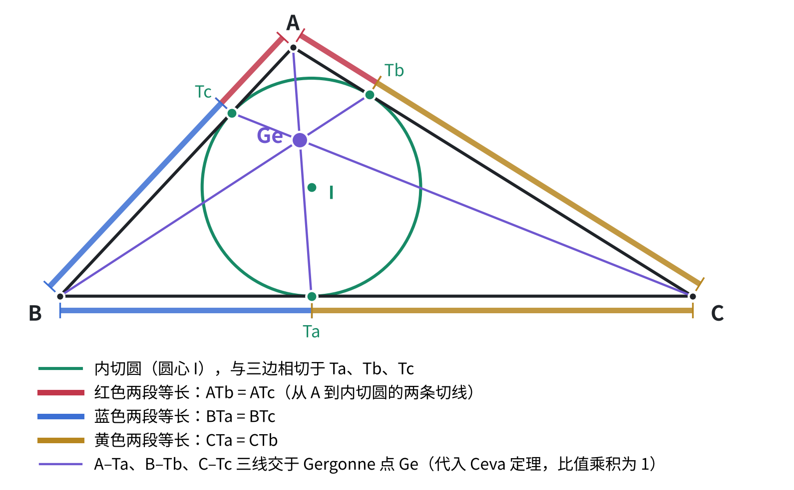

内切圆与三边切于 Ta、Tb、Tc。同一个顶点引出的两条切线等长（图中红、蓝、黄三组），代入 Ceva 定理比值乘积为 1，所以 A–Ta、B–Tb、C–Tc 三线共点，交点就是 Gergonne 点 Ge。

Nagel 点 Na

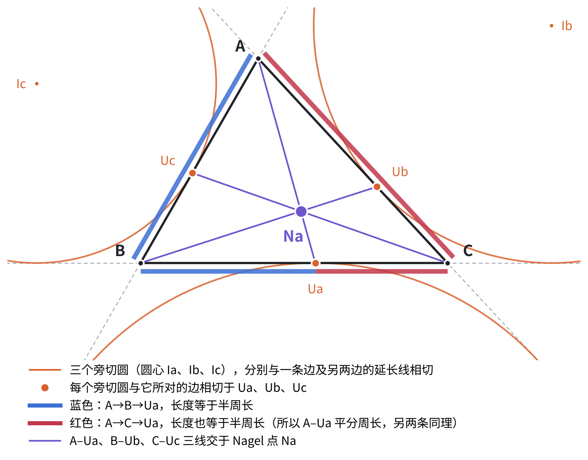

三个旁切圆（圆心 Ia、Ib、Ic）各与一条边及另两边的延长线相切，与所对的边切于 Ua、Ub、Uc。A–Ua、B–Ub、C–Uc 三线交于 Nagel 点 Na。每条这样的线都平分周长：A 沿 B 走到 Ua 与 A 沿 C 走到 Ua 的路程相等，都等于半周长。

Spieker 点 Sp

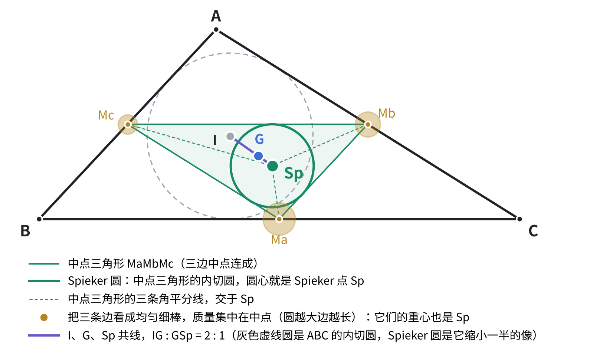

中点三角形 MaMbMc 的内切圆叫 Spieker 圆，圆心就是 Spieker 点 Sp。它还有一个力学解释：把三条边看成均匀细棒，质量集中在各自中点，这三个质点的重心也是 Sp。灰色虚线圆是 ABC 的内切圆，Spieker 圆是它缩小一半的像，这正是下文「欧拉线和 Nagel 线是同一个位似」里右栏的内容。

Feuerbach 点 F

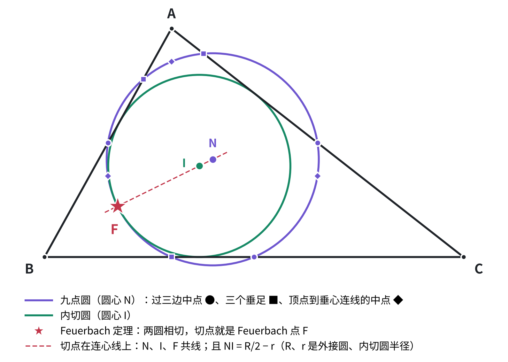

Feuerbach 定理：九点圆与内切圆相切，切点就是 Feuerbach 点 F。切点必在连心线上，所以 N、I、F 共线，且 NI = R/2 − r。表 1 把 F 按定义取在九点圆上，第一轮查出的「F 在内切圆上」就是这条定理。

#### 表 2：找到的共线（共 37 组）

<b>没有新的共线定理。</b>37 组全部已知。真正有内容的只有前三条；第 4–6 行（9 组）由位似或中点关系直接得到；第 7–15 行（25 组）按作法成立。

| | 共线的点 | 名称 | 说明 |
|---|---|---|---|
| 1 | O、G、H、N、L | <b>欧拉线</b> | OG : GH = 1 : 2；N 是 OH 中点；O 是 HL 中点 |
| 2 | I、G、Sp、Na | <b>Nagel 线</b> | IG : GNa = 1 : 2；Sp 是 I–Na 中点。和欧拉线是同一个位似（见下文） |
| 3 | I、Ge、L | <b>Soddy 线</b> | 也过两个 Soddy 圆的圆心（这一轮没列这两个点） |
| 4 | Aa、Ea、G（共 3 组） | | 以 G 为中心、比例 −1/2 的位似把 Aa 变成 Ea |
| 5 | Aa、H、Ma（共 3 组） | | Ma 是 H 与 Aa 的中点（H 关于 Ma 的对称点在外接圆上） |
| 6 | Ea、Ma、N（共 3 组） | | EaMa 是九点圆的直径 |
| 7 | A、B、Hc、Mc、Tc、Uc（共 3 组） | 三条边 | 中点、垂足、两种切点本来就取在边上 |
| 8 | A、O、Aa（共 3 组） | 外接圆直径 | Aa 定义为 A 关于 O 的对称点 |
| 9 | A、G、Ma（共 3 组） | 中线 | G 在中线上 |
| 10 | A、Ea、H、Ha（共 3 组） | 高 | Ea 是 AH 中点，Ha 是高的垂足 |
| 11 | A、I、Ia（共 3 组） | 内角平分线 | 旁心 Ia 也在 A 的内角平分线上 |
| 12 | A、Ib、Ic（共 3 组） | 外角平分线 | Ib、Ic 都在 A 的外角平分线上 |
| 13 | A、Ge、Ta（共 3 组） | Gergonne 点的塞瓦线 | Ge 就是这三条线的交点 |
| 14 | A、Na、Ua（共 3 组） | Nagel 点的塞瓦线 | Na 就是这三条线的交点 |
| 15 | F、I、N | 连心线 | 两圆相切，切点在连心线上；程序里 F 本来就取在 NI 上 |

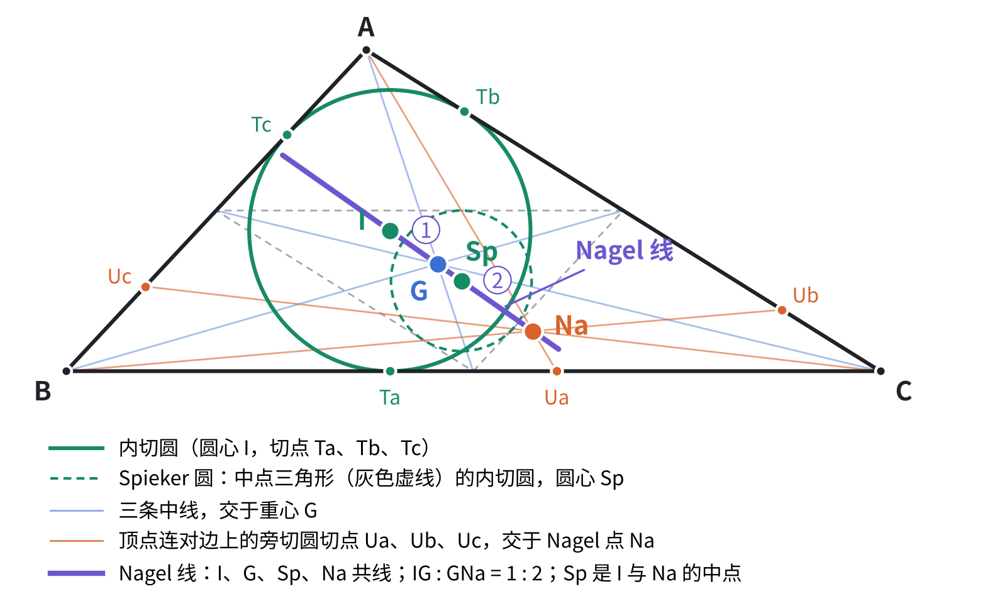

图：Nagel 线一侧的全部对象。绿色实线是内切圆（圆心 I，切点 Ta、Tb、Tc），绿色虚线是中点三角形的内切圆即 Spieker 圆（圆心 Sp）；淡蓝是三条中线，交于重心 G；橙色是顶点连对边上的旁切圆切点 Ua、Ub、Uc，交于 Nagel 点 Na。紫色粗线即 Nagel 线，I、G、Sp、Na 四点共线，IG : GNa = 1 : 2，Sp 是 I 与 Na 的中点，即表 2 第 2 行。这三个比例关系都来自同一个位似，见下文「欧拉线和 Nagel 线是同一个位似」。

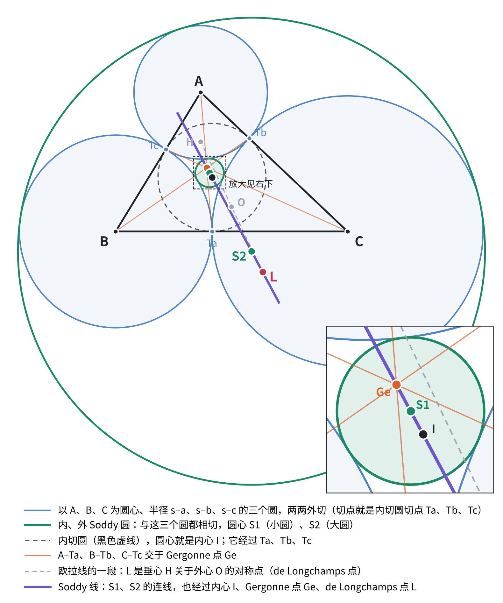

图：Soddy 线，表 2 第 3 行。以 A、B、C 为圆心、半径 s−a、s−b、s−c 的三个圆两两外切（蓝色），切点正是内切圆切点 Ta、Tb、Tc。与这三个圆都相切的圆有两个，即内、外 Soddy 圆，圆心记作 S1、S2（绿色；S1 在右下放大图里）。S1、S2 的连线就是 Soddy 线，它同时经过内心 I、Gergonne 点 Ge，以及 de Longchamps 点 L——L 是垂心 H 关于外心 O 的对称点，所以它也在欧拉线上。表 2 第 3 行把这条线记作 I、Ge、L 共线，当时没有把两个 Soddy 圆心列进点表，这张图把它们补上了。

#### 表 3：找到的共圆（共 25 个圆）

<b>没有新的共圆定理。</b>25 个圆全部已知：有内容的 3 个是已知定理（九点圆、Feuerbach 定理、Mandart 圆过 F），其余平凡。

程序的共圆判据对共线的点也成立，所以另有 8 组「共圆」其实是表 2 里的直线，已剔除。

| | 共圆的点 | 名称 | 说明 |
|---|---|---|---|
| 1 | Ma、Mb、Mc、Ha、Hb、Hc、Ea、Eb、Ec、F | <b>九点圆</b> | 九点圆定理本身；F 是按定义取在九点圆上的 |
| 2 | Ta、Tb、Tc、F | <b>内切圆</b> | 有内容的是「F 在内切圆上」，即 Feuerbach 定理 |
| 3 | Ua、Ub、Uc、F | <b>Mandart 圆</b> | 旁切圆三切点的外接圆也过 F；第二轮的定理 X 解释了它 |
| 4 | A、B、C、Aa、Ab、Ac | 外接圆 | 按作法成立 |
| 5 | A、B、I、Ic（共 3 个） | | 以 IIc 为直径：内、外角平分线互相垂直 |
| 6 | A、B、Ia、Ib（共 3 个） | | 以 IaIb 为直径，理由同上 |
| 7 | A、B、Ha、Hb（共 3 个） | | 以 AB 为直径（直角所对） |
| 8 | A、H、Hb、Hc（共 3 个） | | 以 AH 为直径 |
| 9 | A、Mb、Mc、O（共 3 个） | | 以 AO 为直径 |
| 10 | A、I、Tb、Tc（共 3 个） | | 以 AI 为直径 |
| 11 | Ab、Ac、Ta、Ua（共 3 个） | | 等腰梯形：Ta、Ua 关于 Ma 对称 |

类似重心 K 在这一轮里没有出现在任何共线或共圆中。

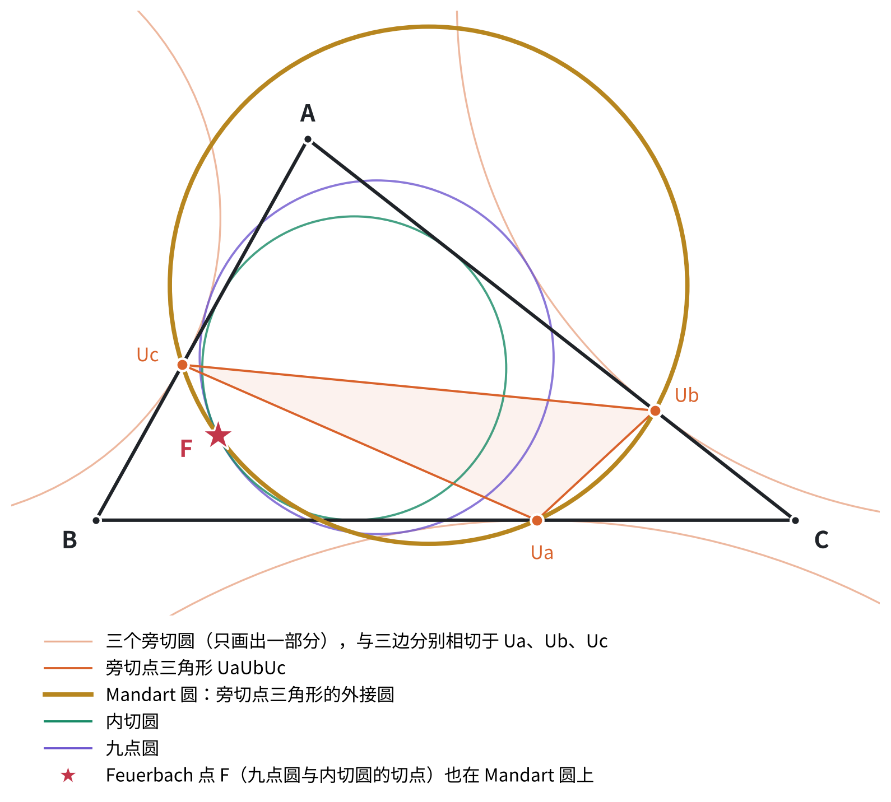

图：Mandart 圆，表 3 第 3 行。三个旁切圆与三边分别切于 Ua、Ub、Uc（图中旁切圆只画出一部分），这三点连成旁切点三角形，它的外接圆就是 Mandart 圆（棕色）。图里同时画了内切圆（绿）与九点圆（紫）：两者相切于 Feuerbach 点 F，而 F 也落在 Mandart 圆上——这就是表 3 第 3 行那条。它和「F 在内切圆上」看似无关，第二轮的定理 X 说明两者是同一条定理的两个特例。

#### 欧拉线和 Nagel 线是同一个位似

以 G 为中心、比例 −1/2 的位似把三角形变成它的中点三角形。它同时给出两串点：

| | 欧拉线 | Nagel 线 |
|---|---|---|
| 起点 | 垂心 H | Nagel 点 Na |
| 位似一次 | 外心 O | 内心 I |
| 再位似一次 | 九点圆心 N | Spieker 点 Sp |
| 对应的圆 | 外接圆 → 九点圆 | 内切圆 → Spieker 圆（中点三角形的内切圆） |

位似中心、点、像三者共线，所以这两条线是同一个事实的两个特例，在网络里算一个节点。

#### 第一轮小结

找到的关系全部已知，分三层：

1. <b>按作法成立的</b>：大部分共线和外接圆；
2. <b>一个位似解释的</b>：欧拉线、Nagel 线，以及表 2 的第 4–6 行；
3. <b>真正有内容的</b>：九点圆、Soddy 线、F 在内切圆上（Feuerbach）、F 在 Mandart 圆上。

### 第二轮：三角形加任意点 P

<b>做法。</b>在三角形之外再任取一点 P，取 30 个随机构型（排除 P 太靠近三边的情况）。在 34 个点、5 条曲线上检查所有共线、共圆，以及每个点是否落在每条曲线上，只保留在全部 30 个构型里都成立的关系。重点看三角形的对象和 P 派生出的对象之间有没有「混合」关系。

（程序原本列了 35 个点，其中 Y4 和 Poncelet 点 Po 是同一个点，合并后为 34 个。修正前的输出曾把三条不同的曲线误并成一个「14 点圆」，以下数字均为修正后的。）

#### 表 4：第二轮的点

| 类别 | 记号 | 名称 | 怎么作 |
|---|---|---|---|
| 三角形的点 | A、B、C | 三顶点 | |
| | O、H、G、N、I | 外心、垂心、重心、九点圆心、内心 | 同表 1 |
| | Ma、Mb、Mc | 三边中点 | |
| | Ha、Hb、Hc | 三个垂足 | |
| P 派生的点 | P | 任意点 | |
| | Ka、Kb、Kc | P 与顶点连线的中点 | Ka 是 AP 的中点 |
| | Da、Db、Dc | 塞瓦点（对角点） | Da 是 AP 与 BC 的交点；Da、Db、Dc 组成 P 的塞瓦三角形 |
| | Fa、Fb、Fc | P 的垂足 | Fa 是 P 在 BC 上的投影；Fa、Fb、Fc 组成 P 的垂足三角形 |
| | G4 | 四点重心 | A、B、C、P 的平均 |
| | Q | P 的补点 | 以 G 为中心、比例 −1/2 的位似下 P 的像 |
| | aP | P 的反补点 | 以 G 为中心、比例 −2 的位似下 P 的像 |
| | P* | P 的等角共轭点 | 见附录 A |
| | Piso | P 的等截共轭点 | 见附录 A |
| | Po | Poncelet 点 | 过 A、B、C、P 的等轴双曲线的中心，见附录 A |
| | Pr | P 关于 O 的对称点 | |
| | PH、PO | 中点 | P 与 H 的中点、P 与 O 的中点 |
| 曲线的交点 | X4 | 第 4 交点 | Ω 与外接圆除 A、B、C 外的第 4 个交点 |
| | Y4 | 第 4 交点 | Γ 与九点圆除三边中点外的第 4 个交点；<b>就是 Po</b> |

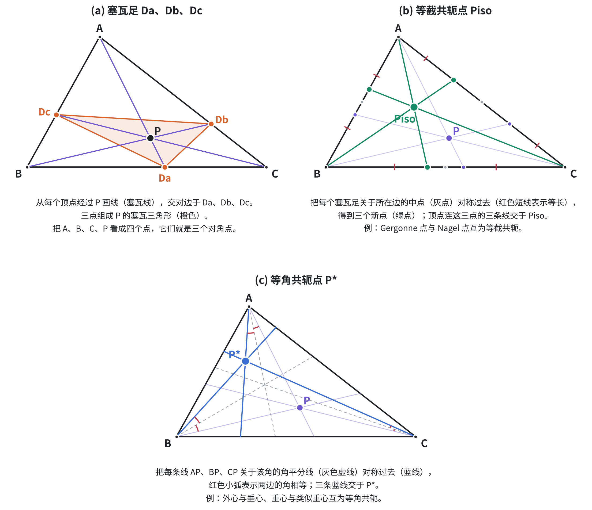

图：表 4 里三个要看图才清楚的作法。(a) 从每个顶点经过 P 画塞瓦线，交对边于 Da、Db、Dc，三点组成 P 的塞瓦三角形；把 A、B、C、P 看成四点时，这三个就是对角点。(b) 把每个塞瓦足关于所在边的中点对称过去，得到的三个新点与对应顶点的连线交于等截共轭点 Piso（Gergonne 点与 Nagel 点就互为等截共轭）。(c) 把 AP、BP、CP 各自关于该角的角平分线对称过去，三条线交于等角共轭点 P*（外心与垂心、重心与类似重心互为等角共轭）。P* 与 Piso 的定义原在附录 A。

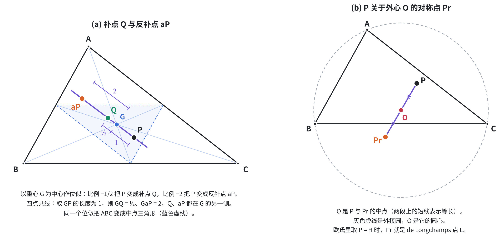

图：表 4 里另外三个由 P 导出的点。(a) 以重心 G 为中心作位似，比例 −1/2 把 P 变成补点 Q，比例 −2 把 P 变成反补点 aP；四点共线，取 GP = 1 则 GQ = 1/2、GaP = 2，Q 与 aP 都落在 G 的另一侧。同一个位似把 ABC 变成中点三角形（蓝色虚线），正是第一轮里那个把欧拉线和 Nagel 线统一起来的位似。(b) Pr 是 P 关于外心 O 的对称点，O 是 P 与 Pr 的中点；欧氏情形取 P = H 时，Pr 就是 de Longchamps 点 L，也就是 Soddy 线上的那个点。

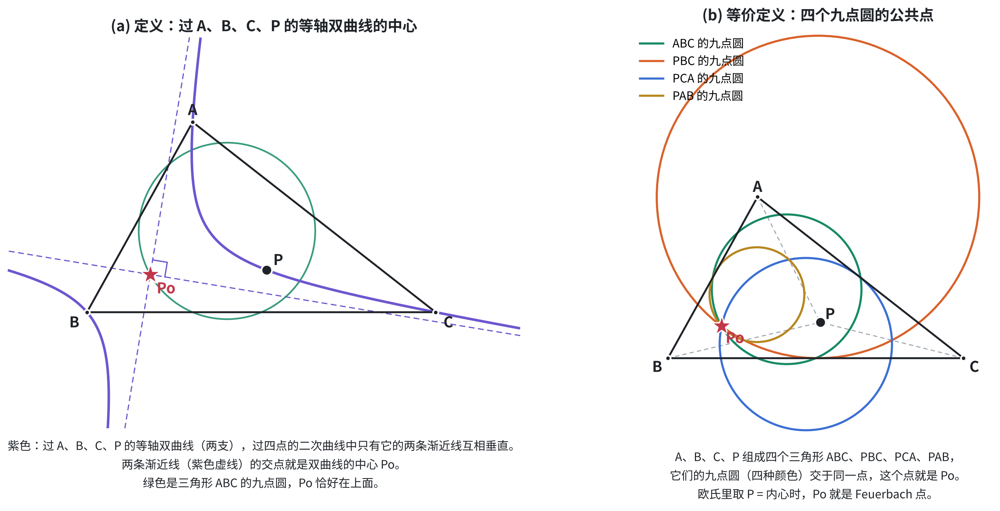

图：表 4 里的 Poncelet 点 Po，两个等价定义。

先说什么是等轴双曲线。双曲线有两条渐近线，一般情况下它们斜交；两条渐近线互相垂直的那种双曲线就叫等轴双曲线。「等轴」是因为此时实轴与虚轴等长（方程可化成 x² − y² = a²），离心率恒为 √2。过平面上一般位置的四个点，二次曲线不止一条而是一整族（椭圆、双曲线、抛物线都可能出现），而其中渐近线互相垂直的恰好只有一条——这个唯一性正是 Po 能被良好定义的原因。

(a) 紫色就是过 A、B、C、P 的那条等轴双曲线（有两支），两条渐近线（紫色虚线）互相垂直，交点即双曲线的中心，这就是 Po。绿色是三角形 ABC 的九点圆，Po 恰好落在它上面——这是表 7 第 1 行。(b) 等价定义：A、B、C、P 四个点组成 ABC、PBC、PCA、PAB 四个三角形，它们的四个九点圆交于同一点，这个点就是 Po。欧氏情形取 P = 内心 I 时，Po 就是 Feuerbach 点 F。

#### 表 5：5 条曲线

| 记号 | 曲线 | 定义 |
|---|---|---|
| Γ | 九点二次曲线 | 过 Ma、Mb、Mc、Ka、Kb 的二次曲线，见附录 B |
| Ω | 外接二次曲线 | Γ 以 P 为中心放大 2 倍；经过 A、B、C |
| | 外接圆 | |
| | 九点圆 | |
| | P 的垂足圆 | 过 Fa、Fb、Fc 的圆 |

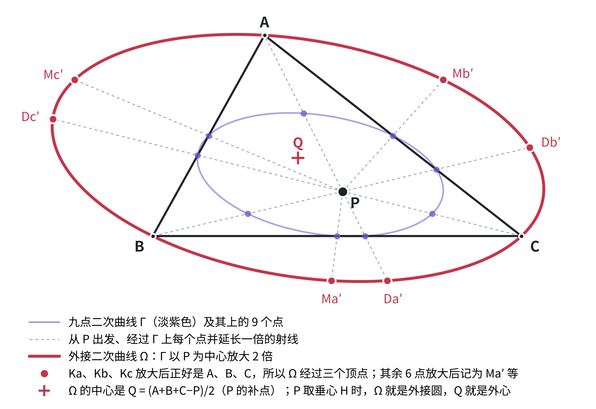

图：表 5 里 Γ 与 Ω 的关系。淡紫色是九点二次曲线 Γ 及其上的 9 个点，从 P 出发经过每个点并延长一倍（灰色虚线），得到的红色曲线就是外接二次曲线 Ω。Ka、Kb、Kc 本是 AP、BP、CP 的中点，放大一倍后正好回到 A、B、C，所以 Ω 必过三个顶点；其余 6 点的像记作 Ma′、Da′ 等。Ω 的中心是 Q = (A+B+C−P)/2，即 P 的补点。P 取垂心 H 时，Γ 就是九点圆、Ω 就是外接圆、Q 就是外心——第一轮那条「以 H 为中心把外接圆缩一半得九点圆」正是这张图的欧氏特例。

#### 表 6：找到的共线（共 25 组）

<b>没有新的共线定理。</b>25 组全部已知。有内容的只有欧拉线；第 2–11 行（12 组）由位似或中点关系直接得到；第 12–15 行（12 组）按作法成立。

| | 共线的点 | 说明 |
|---|---|---|
| 1 | O、H、G、N | <b>欧拉线</b> |
| 2 | G、Po、X4 | 以 G 为中心、比例 −1/2 的位似把外接圆变成九点圆、把 Ω 变成 Γ，所以把 X4 变成 Po |
| 3 | P、G、G4、Q、aP | 都是 P 与 G 的线性组合：G4 = (3G + P)/4，Q = (3G − P)/2，aP = 3G − 2P。这是欧拉线的一般形式，见表 11 |
| 4 | P、O、Pr、PO | Pr、PO 按定义在直线 PO 上 |
| 5 | P、H、PH | PH 是 P 与 H 的中点 |
| 6 | O、G4、PH | G4 是 O 与 PH 的中点 |
| 7 | H、Q、Pr | Q 是 H 与 Pr 的中点 |
| 8 | G、Pr、PH | 以 G 为中心、比例 −1/2 的位似把 Pr 变成 PH |
| 9 | N、G4、PO | G4 是 N 与 PO 的中点 |
| 10 | N、Q、PH | N 是 Q 与 PH 的中点 |
| 11 | Ma、Ka、G4（共 3 组） | 四边形的对边中点连线交于 G4，并被它平分。这是「九点圆直径」的一般形式，见表 11 |
| 12 | A、B、Mc、Dc、Fc、Hc（共 3 组） | 三条边：中点、塞瓦点、垂足本来就取在边上 |
| 13 | A、P、Ka、Da（共 3 组） | 塞瓦线。这是「高」的一般形式，见表 11 |
| 14 | A、H、Ha（共 3 组） | 高 |
| 15 | A、G、Ma（共 3 组） | 中线 |

#### 表 7：找到的共圆（共 19 个圆）

<b>本轮没有发现任何新的共圆定理。</b>19 个圆分三类：已知定理 3 个，可由已知定理换标号得到 3 个，平凡 13 个。

| | 共圆的点 | 名称 | 类别 | 说明 |
|---|---|---|---|---|
| 1 | Ma、Mb、Mc、Ha、Hb、Hc、Po | 九点圆 | 已知定理 | 「Po 在九点圆上」是 Poncelet 点的基本性质（维基百科） |
| 2 | Ma、Kb、Kc、Fa、Po（共 3 个） | 三角形 PBC、PCA、PAB 的九点圆 | 第 1 行换标号 | Ma、Kb、Kc、Fa 共圆只是九点圆定理用在三角形 PBC 上；Po 对 A、B、C、P 对称，把 P 与 A 对调，第 1 行就变成这一行 |
| 3 | Da、Db、Dc、Po | P 的塞瓦圆 | 已知定理 | 即定理 X，见于维基百科「Poncelet point」条目 |
| 4 | Fa、Fb、Fc、Po | P 的垂足圆 | 已知定理 | 维基百科「Poncelet point」条目 |
| 5 | A、B、C、X4 | 外接圆 | 平凡 | X4 按定义取在外接圆上 |
| 6 | A、B、Ha、Hb（共 3 个） | | 平凡 | 以 AB 为直径（直角所对） |
| 7 | A、P、Fb、Fc（共 3 个） | | 平凡 | 以 AP 为直径 |
| 8 | A、O、Mb、Mc（共 3 个） | | 平凡 | 以 AO 为直径 |
| 9 | A、H、Hb、Hc（共 3 个） | | 平凡 | 以 AH 为直径 |

去掉换标号的重复后，有内容的只是 3 条已知定理：Po 在九点圆上、在塞瓦圆上、在垂足圆上。

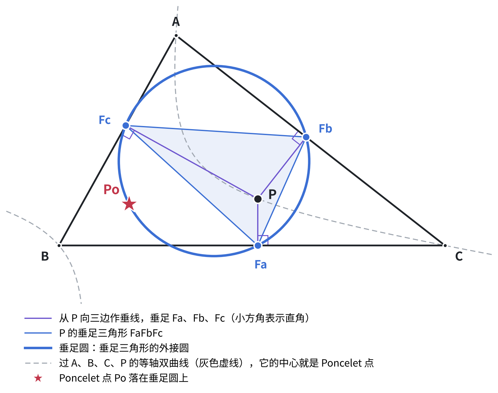

图：表 7 第 4 行。从 P 向三边作垂线，垂足 Fa、Fb、Fc 组成 P 的垂足三角形，它的外接圆叫垂足圆（蓝色）。Poncelet 点 Po 落在这个圆上——Po 的定义是过 A、B、C、P 的等轴双曲线（灰色虚线）的中心，和垂足圆看不出关系，但两者确实相交于此。它和第 1 行「Po 在九点圆上」、第 3 行「Po 在塞瓦圆上」是同一个点的三条性质；P 取垂心 H 时垂足圆就退化成九点圆，三条合为一条。

#### 表 8：点在哪些曲线上

| 曲线 | 经过的点 | 说明 |
|---|---|---|
| 九点二次曲线 Γ | Ma、Mb、Mc、Ka、Kb、Kc、Da、Db、Dc、Po | 前 9 点即九点二次曲线定理（Bôcher 1892）。Po 在上面是平凡的：Γ 正是所有过 A、B、C、P 的二次曲线的中心的轨迹，Po 是其中一条（等轴双曲线）的中心 |
| Ω | A、B、C、X4 | 按定义 |
| 外接圆 | A、B、C、X4 | 按定义 |
| 九点圆 | Ma、Mb、Mc、Ha、Hb、Hc、Po | 同表 7 第 1 行 |
| P 的垂足圆 | Fa、Fb、Fc、Po | 同表 7 第 4 行 |

内心 I、P 的等角共轭点 P*、等截共轭点 Piso 在这一轮里没有出现在任何关系中。

#### 讨论：第二轮的对象与第一轮欧氏对象的对应

第二轮的四个点 A、B、C、P，是第一轮「三角形 ABC 加垂心 H」的一般化。前面第 10 条说过：任给一点 P，总能换一把尺子（换一个二次型），使 P 成为垂心。在这把新尺子下，第二轮里只由 A、B、C、P 作出的对象，每一个都变成第一轮的某个欧氏对象；反过来，把 P 取成 H，第二轮的对象就回到第一轮。下面三张表列出这种对应。

左栏是欧氏情形（P 就是垂心 H），右栏是一般情形（P 任意）。

<b>表 9：点的对应</b>

| 欧氏（P = H） | 一般（P 任意） | 说明 |
|---|---|---|
| 垂心 H | 任意点 P | 在新尺子下，P 就是垂心 |
| 垂心组 A、B、C、H | 四点形 A、B、C、P | |
| 三个垂足 Ha、Hb、Hc | 三个对角点 Da、Db、Dc | 高 AH 与 BC 的交点，对应 AP 与 BC 的交点 |
| Euler 点 Ea、Eb、Ec（AH 等的中点） | Ka、Kb、Kc（AP 等的中点） | |
| 三边中点 Ma、Mb、Mc | 三边中点 Ma、Mb、Mc | 中点不依赖尺子，不变 |
| 重心 G | 重心 G | 不变 |
| 九点圆心 N | 四点重心 G4 = (A + B + C + P)/4 | 欧氏里 N = (A + B + C + H)/4。G4 是九点二次曲线 Γ 的中心 |
| 外心 O | 补点 Q = (A + B + C − P)/2 | 欧氏里 O = (A + B + C − H)/2。Q 是 Ω 的中心 |
| de Longchamps 点 L | 反补点 aP = A + B + C − 2P | 欧氏里 L = A + B + C − 2H |
| 对径点 Aa | 点 B + C − P（不在第二轮点表里） | 欧氏里 Aa = B + C − H |
| 无对应（P = H 时不唯一） | Poncelet 点 Po | P = H 时，过四点的二次曲线全是等轴双曲线，中心铺满整个九点圆 |

<b>表 10：曲线的对应</b>

| 欧氏（P = H） | 一般（P 任意） | 说明 |
|---|---|---|
| 九点圆 | 九点二次曲线 Γ | 9 点对应 9 点：3 个中点不变；3 个 Euler 点对应 Ka、Kb、Kc；3 个垂足对应 Da、Db、Dc |
| 外接圆 | Ω | 外接圆是九点圆以 H 为中心放大 2 倍；Ω 是 Γ 以 P 为中心放大 2 倍 |
| 以 G 为中心、比例 −1/2 的位似把外接圆变成九点圆 | 同一个位似把 Ω 变成 Γ | 这就是表 6 第 2 行（G、Po、X4 共线）的来源 |
| 圆 | 椭圆（P 在三角形内）或双曲线（P 在三角形外） | 新尺子下的「圆」 |
| 过 A、B、C、H 的二次曲线全是等轴双曲线，中心都在九点圆上 | 过 A、B、C、P 的二次曲线有一整族，中心都在 Γ 上 | Brianchon–Poncelet（1821）的一般形式 |

<b>表 11：共线的对应</b>

| 欧氏（P = H） | 一般（P 任意） | 说明 |
|---|---|---|
| 欧拉线 H、G、N、O、L（表 2 第 1 行） | P、G、G4、Q、aP（表 6 第 3 行） | 比例完全一样：HG : GN : NO = PG : GG4 : G4Q |
| 高 A、Ea、H、Ha（表 2 第 10 行） | 塞瓦线 A、Ka、P、Da（表 6 第 13 行） | |
| 九点圆的直径 Ea、N、Ma（表 2 第 6 行） | Ka、G4、Ma（表 6 第 11 行） | EaMa 是九点圆的直径；KaMa 是 Γ 的直径 |
| Aa、Ea、G（表 2 第 4 行） | B + C − P、Ka、G | 以 G 为中心、比例 −1/2 的位似 |
| Aa、H、Ma（表 2 第 5 行） | B + C − P、P、Ma | Ma 是中点 |
| 三条边、三条中线 | 不变 | |

<b>这三张表说明了什么。</b>

1. <b>表 6 里标为「平凡」的第 3、11、13 行，其实是欧拉线、九点圆直径、高的一般形式。</b>在一般情形下，它们只是 P 和 G 的线性组合，所以平凡。反过来看，欧拉线在欧氏几何里的全部内容，就是「外心 O 恰好等于 (A + B + C − H)/2」这一个事实；其余都是线性代数。
2. <b>第二轮的对象有两类。</b>一类只由 A、B、C、P 作出，比如中点、对角点、G4、Q、Γ、Ω，它们都是第一轮欧氏对象的一般形式，彼此之间的关系就是欧氏定理换了尺子，不会有新内容。另一类用到原来的尺子，比如 O、H、N、ABC 的九点圆、外接圆、P 的垂足 Fa 和垂足圆，它们和 P 的关系是「两把尺子之间」的混合关系。
3. <b>第二轮有内容的结果，全部属于混合关系：</b>Po 在 ABC 的九点圆上、在塞瓦圆上、在垂足圆上（表 7 第 1、3、4 行）。这三条都是已知定理。

#### 第二轮小结

<b>第二轮没有发现新定理，所有结果都是已知的或平凡的。</b>

- 共线 25 组：只有欧拉线有内容（第一轮已有），其余都由线性关系或作法得到。
- 共圆 19 个：有内容的是 3 条已知定理（Po 在九点圆、塞瓦圆、垂足圆上），另有 3 个是这些定理换标号的结果，其余 13 个平凡。
- 曲线上的点：九点二次曲线定理是已知定理（Bôcher 1892），其余按定义或平凡。

这一轮的价值不在发现，而在两点：一是验证了方法能把已知结果完整地重新找出来；二是暴露了过滤器要补的规则，即交换 A、B、C、P 角色后相同的关系只算一次。

### 意外得到的结构：一条上游定理统一三条事实

<b>定理 X：</b>P 的塞瓦三角形的外接圆经过 A、B、C、P 的 Poncelet 点（即表 7 第 3 行）。这条定理已知，见于维基百科「Poncelet point」条目。

已知 Feuerbach 双曲线（过 A、B、C、H、I 的等轴双曲线）的中心是 Feuerbach 点 F，并且经过 Gergonne 点和 Nagel 点。把 P 取成这条双曲线上的点：

#### 表 12：定理 X 的特例

| P 取 | 塞瓦三角形的外接圆 | 推出 |
|---|---|---|
| Gergonne 点 | 内切圆 | F 在内切圆上 |
| Nagel 点 | Mandart 圆 | F 在 Mandart 圆上（第一轮找到的那条） |
| 内心 | 内心塞瓦三角形的外接圆 | F 也在这个圆上（已数值验证，是否已有记载待查） |

第一轮里看似孤立的 Mandart 圆，和 Feuerbach 切点在内切圆上，是同一条定理的两个特例。

### 第三轮：内切圆分支（P 的第二种身份）

#### 为什么要做第三轮

第二轮里，P 扮演的是<b>垂心</b> H 的角色：把 H 换成任意点 P，九点圆变成九点二次曲线，欧拉线变成 P、G、G4、Q、aP（表 9–11）。但这样只推广了三角形几何的「垂心分支」（九点圆、欧拉线）。三角形几何还有另一大分支，即「内切圆分支」：内切圆、Gergonne 点、Nagel 点、Nagel 线、Soddy 线，以及连接两大分支的 Feuerbach 定理（九点圆与内切圆相切）。第二轮的点表里没有这一分支的任何对象，所以 Nagel 线、Soddy 线、Feuerbach 定理的推广都不可能被找到。

第三轮把这一分支补上。做法是让 P 以两种身份出现。

<b>身份一：P 当作垂心（换尺子）。</b>按第 10 条，任给 P，总能找到一把尺子（一个二次型 S），使 P 在这把尺子下成为垂心。具体算法是解两个线性方程：

- (B − C) 与 (A − P) 在 S 下垂直：(B − C)ᵀ S (A − P) = 0；
- (C − A) 与 (B − P) 在 S 下垂直：(C − A)ᵀ S (B − P) = 0。

第三个条件 (A − B) ⊥ (C − P) 自动成立。S 有 3 个未知数、2 个方程，相差一个倍数唯一确定。P 在三角形内时 S 是正定的（看起来是一把普通的、但被「压扁」了的尺子）。

在这把尺子下，量出三边的「长度」aQ、bQ、cQ，然后照搬欧氏公式，就得到这把尺子下的内心、切点、Gergonne 点、Nagel 点。下面带下标 Q 的对象都是这样得到的。在这把尺子下，第二轮的对象恰好扮演欧氏对象的角色：Γ 是「九点圆」，Ω 是「外接圆」，Q 是「外心」，aP 是「de Longchamps 点」。

<b>身份二：P 当作透视点（不需要尺子）。</b>欧氏里，内切圆的三个切点和对顶点的连线交于 Gergonne 点，叫内切圆的透视点。反过来，任给一点 P，它的三个塞瓦足 Da、Db、Dc 总是某一条内切二次曲线的三个切点，这条曲线记作 KP。这只用到相切和交点，是仿射概念。同样，以 P 为透视点的外接二次曲线也唯一，记作 CPc。

#### 做法

- <b>构型：</b>30 个随机构型。P 取在三角形内部，保证身份一里的尺子是正定的。
- <b>点：</b>36 个。第二轮的大部分点保留，另加身份一、身份二的新点（表 13）。
- <b>曲线：</b>8 条（表 14）。
- <b>检查：</b>所有三点组合是否共线；每个点是否在每条曲线上；每两条曲线是否相切（共 28 对）。只保留在 30 个构型里全部成立的关系。
- <b>相切的判法：</b>两条二次曲线相切，等价于它们张成的曲线族里有一个退化成员是「二重」的，可以用一个三次方程的判别式等于 0 来检验。

#### 表 13：第三轮的点（36 个）

| 类别 | 记号 | 名称 | 怎么作 |
|---|---|---|---|
| 保留自第二轮 | A、B、C、P、G | | 同表 4 |
| | Ma、Mb、Mc | 三边中点 | |
| | Ka、Kb、Kc | AP 等的中点 | |
| | Da、Db、Dc | 塞瓦足（对角点） | AP 与 BC 的交点，等等 |
| | G4、Q、aP | 四点重心、P 的补点、反补点 | 同表 4 |
| | Piso | P 的等截共轭点 | 同表 4 |
| | Po | Poncelet 点 | 同表 4 |
| | O、H、N、I | 外心、垂心、九点圆心、内心 | 原来的欧氏尺子 |
| 身份二（P 当透视点） | XP | KP 的中心 | 等于 Piso 的补点 |
| | SpP | XP 的补点 | |
| | Va、Vb、Vc | Da 关于 Ma 的对称点，等等 | 「旁切圆切点」的对应物 |
| | CP | CPc 的中心 | |
| 身份一（P 当垂心） | IQ | 尺子 Q 下的内心 | 以 aQ、bQ、cQ 为权的加权平均 |
| | TQa、TQb、TQc | 尺子 Q 下的内切圆切点 | TQa = B + (sQ − bQ)/aQ · (C − B)，sQ 是 Q 下的半周长 |
| | GeQ | 尺子 Q 下的 Gergonne 点 | A–TQa、B–TQb、C–TQc 的交点 |
| | NaQ | 尺子 Q 下的 Nagel 点 | GeQ 的等截共轭点 |
| | SpQ | 尺子 Q 下的 Spieker 点 | IQ 的补点 |

#### 表 14：第三轮的曲线（8 条）

| 记号 | 曲线 | 在尺子 Q 下扮演的角色 |
|---|---|---|
| Γ | 九点二次曲线 | 九点圆 |
| Ω | 外接二次曲线 | 外接圆 |
| IQc | 尺子 Q 下的内切「圆」，在 TQa、TQb、TQc 处与三边相切 | 内切圆 |
| KP | 以 P 为透视点的内切二次曲线，在 Da、Db、Dc 处与三边相切 | 无（与尺子无关） |
| CPc | 以 P 为透视点的外接二次曲线 | 无（与尺子无关） |
| 外接圆、九点圆、内切圆 | 原来欧氏尺子下的三个圆 | 无（属于原来的尺子） |

#### 表 15：找到的共线（共 25 组）

<b>没有新的共线定理。</b>25 组分四类：按作法 15 组，线性组合 6 组，欧氏已知 1 组，有内容的一般形式 3 组。

| | 共线的点 | 类别 | 说明 |
|---|---|---|---|
| 1 | A、B、Mc、Dc、Vc、TQc（共 3 组） | 按作法 | 三条边：这些点都是按定义取在边上的 |
| 2 | A、P、Ka、Da（共 3 组） | 按作法 | 塞瓦线 |
| 3 | A、G、Ma（共 3 组） | 按作法 | 中线 |
| 4 | A、Piso、Va（共 3 组） | 按作法 | 等截共轭的定义：Piso 的塞瓦线经过 Va |
| 5 | A、GeQ、TQa（共 3 组） | 按作法 | Gergonne 点的定义 |
| 6 | P、G、G4、Q、aP | 线性组合 | 欧拉线的一般形式（表 11） |
| 7 | Ma、Ka、G4（共 3 组） | 线性组合 | 九点圆直径的一般形式（表 11） |
| 8 | G、Piso、XP、SpP | 线性组合 | <b>Nagel 线的一般形式（身份二）：</b>XP 是 Piso 的补点，SpP 是 XP 的补点，所以四点都在过 G 的同一条线上，比例 1 : 2。P 取 Gergonne 点时，Piso 是 Nagel 点、XP 是内心、SpP 是 Spieker 点，这正是 Nagel 线 |
| 9 | G、IQ、NaQ、SpQ | 线性组合 | <b>Nagel 线的一般形式（身份一）：</b>就是尺子 Q 下的 Nagel 线。同样只用到补点关系 |
| 10 | G、O、H、N | 欧氏，已知 | 原来尺子下的欧拉线 |
| 11 | aP、IQ、GeQ | 有内容的一般形式 | <b>Soddy 线的一般形式。</b>在尺子 Q 下，aP 是 de Longchamps 点，IQ 是内心，GeQ 是 Gergonne 点，所以这就是尺子 Q 下的 Soddy 线。由换尺子保证成立，但不能化归为线性运算。P = H 时回到欧氏的 Soddy 线 L、I、Ge |
| 12 | Piso、GeQ、NaQ | 有内容的一般形式 | 在尺子 Q 下，Piso 是「垂心的等截共轭点」（欧氏里是 X69），所以这是欧氏事实「X69、Ge、Na 三点共线」的一般形式。这条欧氏事实已收录于 ETC，第一轮扫描 ETC 中心时也找到过 |
| 13 | P、XP、CP | 有内容（仿射） | 透视点 P、以 P 为透视点的内切二次曲线的中心、外接二次曲线的中心，三点共线。P 取类似重心 K 时，外接二次曲线就是外接圆（中心 O），内切二次曲线是 Brocard 内切椭圆（中心 X39），于是 K、X39、O 共线，这是 Brocard 轴的一部分。应为经典结果，未查证 |

#### 表 16：点在哪些曲线上

| 曲线 | 经过的点 | 说明 |
|---|---|---|
| Γ | Ma、Mb、Mc、Ka、Kb、Kc、Da、Db、Dc、Po | 同第二轮 |
| Ω | A、B、C | 按定义 |
| IQc | TQa、TQb、TQc | 按定义 |
| KP | Da、Db、Dc | 按定义 |
| CPc | A、B、C | 按定义 |
| 外接圆 | A、B、C | 按定义 |
| 九点圆 | Ma、Mb、Mc、Po | Po 在九点圆上（同第二轮） |
| 内切圆 | （无） | 点表里没有原来尺子下的切点 |

这张表没有任何意外：每个点只在按定义该在的曲线上。

#### 表 17：曲线之间的相切

28 对曲线里有 3 对相切，其余 25 对都不相切。

| 相切的两条曲线 | 类别 | 说明 |
|---|---|---|
| 九点圆与内切圆 | 欧氏，已知 | Feuerbach 定理本身 |
| Γ 与 IQc | 有内容的一般形式 | <b>Feuerbach 定理的一般形式：</b>四点形 A、B、C、P 的九点二次曲线，与「P 当垂心」那把尺子下的内切「圆」相切。在尺子 Q 下，这两条曲线就是九点圆和内切圆，所以由换尺子保证成立。示意图见 feuerbach_general.png |
| KP 与 CPc | 有内容（仿射） | 以同一点 P 为透视点的内切二次曲线和外接二次曲线，在 P 的三线极线上<b>双重接触</b>：两条曲线有两个切点（可能是虚的），都在这条直线上。已单独数值核对，应为经典结果，未查证 |

几对不相切的组合也值得记下：

| 不相切的两条曲线 | 说明 |
|---|---|
| Γ 与 KP | P 同时当垂心（Γ）和透视点（KP），两条曲线不相切。所以 Feuerbach 定理的推广里，「垂心」和「Gergonne 点」必须是两个不同的点，由同一把尺子联系起来，不能由同一个 P 兼任 |
| Γ 与原来的内切圆 | 两把尺子之间没有这种关系 |
| 原来的九点圆与 IQc | 同上 |

#### 讨论：第三轮的对象与第一轮欧氏对象的对应

和第二轮一样，下表左栏是欧氏情形（第一轮），右栏是第三轮里对应的一般形式。

<b>表 18：内切圆分支的对应</b>

| 欧氏（第一轮） | 一般形式：身份一（P 当垂心，尺子 Q） | 一般形式：身份二（P 当透视点） |
|---|---|---|
| 内切圆 | IQc | KP |
| 内心 I | IQ | XP |
| 内切圆切点 Ta、Tb、Tc | TQa、TQb、TQc | Da、Db、Dc |
| Gergonne 点 Ge | GeQ | P |
| Nagel 点 Na | NaQ | Piso |
| Spieker 点 Sp | SpQ | SpP |
| 旁切圆切点 Ua、Ub、Uc | （未列入） | Va、Vb、Vc |
| Nagel 线 I、G、Sp、Na | G、IQ、NaQ、SpQ（表 15 第 9 行） | G、Piso、XP、SpP（表 15 第 8 行） |
| Soddy 线 L、I、Ge | aP、IQ、GeQ（表 15 第 11 行） | 无 |
| X69、Ge、Na 共线 | Piso、GeQ、NaQ（表 15 第 12 行） | 无 |
| Feuerbach：九点圆与内切圆相切 | Γ 与 IQc 相切（表 17） | 无（Γ 与 KP 不相切） |

<b>这张表说明了什么。</b>

1. <b>Nagel 线在两种身份下都有一般形式，而且都是平凡的。</b>它只用到「中心 = 等截共轭点的补点」这个仿射公式，和度量无关。这和第一轮的判断一致：Nagel 线的内容只在「挑了内切圆」。
2. <b>Soddy 线、Feuerbach 定理只在身份一下有一般形式，而且是有内容的。</b>它们同时用到「垂心」（欧拉线一侧）和「内切圆」，必须由同一把尺子把两者联系起来。身份二没有尺子，所以没有它们的对应物。
3. <b>两大分支的分界线清楚了。</b>只属于内切圆分支、不碰垂心的关系（Nagel 线），是仿射的、平凡的；跨越两大分支的关系（Soddy 线、Feuerbach 定理、X69–Ge–Na），才是欧氏几何里真正有内容的部分。

#### 第三轮小结

<b>第三轮没有发现新定理，所有结果都是已知的、平凡的，或者是已知欧氏定理换了尺子的一般形式。</b>

- 共线 25 组：按作法 15 组，线性组合 6 组（含 Nagel 线的两种一般形式），欧氏已知 1 组（欧拉线），有内容的一般形式 3 组（Soddy 线、X69–Ge–Na 线的一般形式，以及仿射的 P–XP–CP 线）。
- 相切 3 对：Feuerbach 定理本身、Feuerbach 定理的一般形式、内切与外接二次曲线的双重接触。
- 点在曲线上：没有意外。

这一轮的价值有三点：

1. <b>验证了「先推广、再扫描」这条路是通的。</b>Nagel 线、Soddy 线、Feuerbach 定理的一般形式都被程序自动找了出来，没有一条是事先告诉程序的。
2. <b>P 的两种身份对应三角形几何的两大分支。</b>第二轮做了垂心分支，第三轮做了内切圆分支，两轮合起来，第一轮里有内容的结果（欧拉线、Nagel 线、Soddy 线、九点圆、Feuerbach 定理）都有了一般形式。
3. <b>待查的两条仿射结果</b>（表 15 第 13 行、表 17 第 3 行）形式简单，应该是经典结果，需要查文献确认。

### 结论

1. <b>三轮都没有找到新定理。</b>第一轮（三角形的名点）、第二轮（三角形加一点，P 当垂心）、第三轮（P 当垂心或透视点，补上内切圆分支）的结果，全部是已知的、平凡的，或者是已知定理换了尺子的一般形式。表 12 第三行（F 在内心塞瓦圆上）未在标准资料中查到，但它是定理 X 的直接特例，不算新发现。
2. <b>方法本身可靠：</b>已知结果被完整重新发现。第三轮还自动找回了 Nagel 线、Soddy 线、Feuerbach 定理的一般形式，说明「先推广、再扫描」这条路是通的。
3. <b>三角形与圆的名点之间，共线、共圆已被前人挖尽。</b>几百年的人工研究加上 ETC 的计算机扫描，这块地不太可能再有简单的新结果。
4. <b>真正的产出是结构：</b>散落的已知事实可以挂到同一条上游定理之下。系统地做这件事（把一般定理里的 P 依次换成名点，列出特例并与已知事实对照），是网络的主要建设方式。
5. <b>找新定理要换地方：</b>四边形、四面体，二次曲线与三次曲线之间的关系，Cayley–Klein 平面（双曲、闵可夫斯基几何）中的对应版本。网络的作用是指方向：三角形里的某个结构，在这些地方有没有对应物。

## 记号

三角形 ABC。O 为外心，R 为外接圆半径；G 为重心；H 为垂心；I 为内心，r 为内切圆半径；N 为九点圆圆心。

## 关系图

实线表示两条定理之间有不平凡的联系；虚线表示只差一次变换，在网络里算作同一个节点。

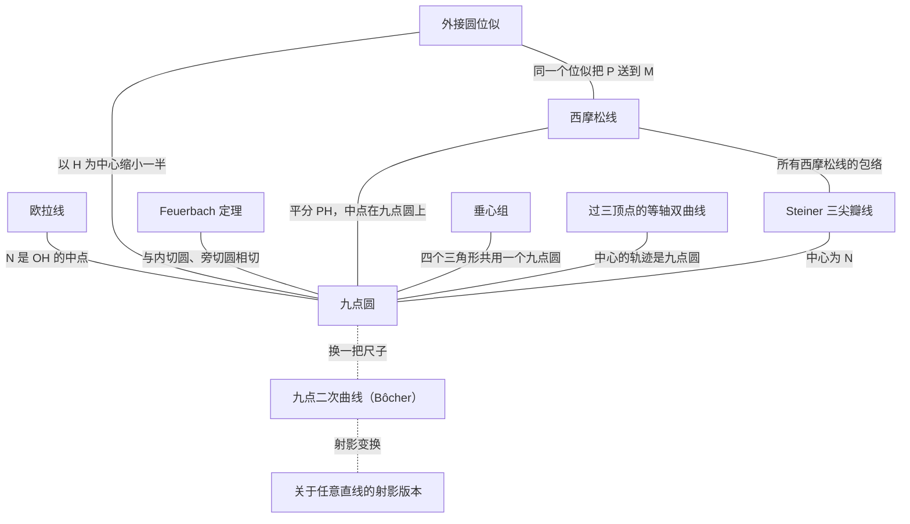

## 一、核心定理

### 1. 九点圆

三角形三边的中点、三条高的垂足、垂心到三个顶点连线的中点，这九个点共圆。

- 历史：Brianchon 与 Poncelet 1821 年证明；Feuerbach 1822 年独立得到。
- 层次：欧氏（相似）层。

### 2. 欧拉线

外心 O、重心 G、垂心 H 三点共线，且 OG : GH = 1 : 2。九点圆圆心 N 是 OH 的中点。

- 历史：Euler，1765 年。
- 与九点圆的联系：九点圆圆心落在欧拉线上，且平分 OH。

### 3. 外接圆与九点圆的位似

以垂心 H 为中心、比例 1/2 的位似，把外接圆变成九点圆，同时把 A、B、C 送到 AH、BH、CH 的中点。以重心 G 为中心、比例 −1/2 的位似也把外接圆变成九点圆。

- 推论：九点圆半径是 R/2。
- 作用：外接圆上任一点 P，经这个位似变成 PH 的中点 M，所以 M 在九点圆上。

### 4. Feuerbach 定理

九点圆与内切圆内切，与三个旁切圆外切。

- 历史：Feuerbach，1822 年。
- 定量形式：NI = R/2 − r。
- 说明：九点圆最深的一个性质，传统证明需要较高技巧。

### 5. 西摩松线

外接圆上任一点 P 到三边（所在直线）的三个垂足共线，这条线叫 P 的西摩松线。

- 历史：以 Robert Simson 命名，实际最早由 William Wallace 于 1797 年发表。
- 与九点圆的联系：P 的西摩松线平分线段 PH，中点 M 落在九点圆上。
- 进一步：P 绕外接圆一周，所有西摩松线的包络是一条三尖瓣线（Steiner 三尖瓣线），中心是 N。

<b>证明（复数法）。</b>以外心为原点、外接圆半径为 1，记 A、B、C、P 为单位圆上的复数 a、b、c、p。

1. 垂心 h = a + b + c，所以 PH 的中点 M = (p + a + b + c)/2。
2. P 到 BC 的垂足 d = (p + b + c − bc/p)/2，所以 d − M = −(ap + bc)/(2p)。
3. 同理，P 到 CA 的垂足 e 满足 e − M = −(bp + ca)/(2p)。
4. 比值 (ap + bc)/(bp + ca) 在单位圆上取共轭后不变，因此是实数，d、e、M 共线。

对第三个垂足同样成立。这一次计算同时证明了：三个垂足共线（西摩松定理），这条线经过 PH 的中点。

### 6. 垂心组

A、B、C、H 中任取三点组成三角形，共四个三角形，每个三角形的垂心是剩下的那个点，四个三角形的九点圆是同一个。

### 7. 过三顶点的等轴双曲线

过 A、B、C 的等轴双曲线一定经过垂心 H；过 A、B、C、H 四点的二次曲线都是等轴双曲线。这些等轴双曲线的中心都落在九点圆上。

- 历史：Brianchon 与 Poncelet 1821 年的论文研究的就是这类双曲线，九点圆正是作为它们中心的轨迹出现的。

## 二、往上升：九点二次曲线

### 8. 九点二次曲线

任取平面上四点 A、B、C、P，两两连线得 6 条线段。这 6 条线段的中点，加上 3 个「对角点」（AP 与 BC、BP 与 CA、CP 与 AB 的交点），共 9 个点，总在同一条二次曲线上。

- 历史：Bôcher，1892 年；Gates（1894）、Minthorn（1912，证明它是过四点的所有二次曲线中心的轨迹）等继续研究。
- P 取垂心时，就是九点圆。
- 曲线类型：四点中有一点落在另三点的三角形内时是椭圆；四点围成凸四边形时是双曲线。
- P 在外接圆上时，是等轴双曲线。

### 9. 射影版本

把「中点」换成「关于直线 ℓ 的调和共轭点」，对任意直线 ℓ，九点仍共二次曲线。ℓ 取无穷远直线时，就是第 8 条。

### 10. Erlangen 视角：九点二次曲线就是换了尺子的九点圆

对任意 P，可以选一个二次型（一把「尺子」），使 PA ⊥ BC、PB ⊥ CA，于是 PC ⊥ AB 自动成立，P 成为垂心。中点是仿射概念，换尺子不变；三个对角点变成三条高的垂足。九点圆定理的证明只用到代数恒等式，对任何非退化二次型都成立，所以 9 个点在新尺子的「圆」上：

- 新尺子是正定的，它的「圆」看起来是椭圆；
- 新尺子是不定的（闵可夫斯基式），它的「圆」看起来是双曲线。

结论：第 8、9 条和第 1 条只差一次变换，在网络里算同一个节点，不算新定理。

## 三、待补充

- 九点圆其他邻居的推广：九点二次曲线有没有对应的「Feuerbach 定理」（与某条内切二次曲线相切）？西摩松线、垂心组、等轴双曲线各有什么对应版本？
- 几何图形：各条定理的示意图。
- 每条定理的出处和原始文献。

## 附录 A：不常见的点

<b>旁心 Ia、Ib、Ic 与旁切圆。</b>A 的内角平分线和 B、C 的外角平分线交于一点 Ia，叫 A 所对的旁心。以 Ia 为圆心的圆与边 BC 相切，并与 AB、AC 的延长线相切，叫旁切圆，它在三角形外面、BC 一侧。三角形有三个旁切圆。

<b>Euler 点 Ea、Eb、Ec。</b>顶点和垂心连线的中点。九点圆的「九点」里就有这三个。

<b>对径点 Aa、Ab、Ac。</b>A 在外接圆上的对径点，即 A 关于外心 O 的对称点。

<b>Gergonne 点 Ge。</b>内切圆与三边的切点是 Ta、Tb、Tc。连 ATa、BTb、CTc，三线交于一点。理由：从一个顶点到内切圆的两条切线等长，所以 BTa = BTc = s − b 等（s 是半周长），代入 Ceva 定理乘积为 1。

<b>Nagel 点 Na。</b>把内切圆切点换成旁切圆切点：Ua 是 A 所对旁切圆与 BC 的切点，连 AUa、BUb、CUc，三线交于一点。Ua 有个简单刻画：从 A 出发沿三角形周长走半圈，停下的点就是 Ua（所以 AUa 也叫「平分周长线」）。

<b>Spieker 点 Sp。</b>中点三角形 MaMbMc 的内心。另一种看法：把三角形的三条边看成密度均匀的细棒，整个「周长框」的重心就是 Sp。它是 I 与 Na 的中点。

<b>类似重心 K。</b>把三条中线分别关于同一顶点的角平分线对称过去，得到的三条线（叫类似中线）交于一点。也说 K 是 G 的等角共轭点。它到三边的距离与边长成正比。

<b>de Longchamps 点 L。</b>垂心 H 关于外心 O 的对称点，在欧拉线上。它还是三角形「力矩圆」的根心：分别以 A、B、C 为圆心、对边长 a、b、c 为半径作三个圆，它们的根心是 L。

<b>Feuerbach 点 F。</b>九点圆与内切圆的切点（Feuerbach 定理说两者内切）。在程序里 F 是这样算的：从 N 出发，沿 N→I 方向走九点圆半径 R/2。所以「F 在九点圆上、F 在 NI 上」是按作法成立的；「F 在内切圆上」才是 Feuerbach 定理。

<b>等角共轭点 P\*。</b>把 AP、BP、CP 分别关于 A、B、C 的角平分线作对称，得到的三条线交于一点，就是 P 的等角共轭点。例如重心的等角共轭点是类似重心 K，外心和垂心互为等角共轭。

<b>等截共轭点。</b>设 AP 交 BC 于 Da，在 BC 上取 Da 关于中点 Ma 的对称点，同样处理另外两边，得到的三条塞瓦线交于一点，就是 P 的等截共轭点。例如 Gergonne 点和 Nagel 点互为等截共轭。

<b>补点、反补点。</b>以重心 G 为中心、比例 −1/2 的位似叫「取补点」，比例 −2 叫「取反补点」。例如 O 是 H 的补点，H 是 O 的反补点。

<b>塞瓦三角形。</b>AP、BP、CP 分别交对边于 Da、Db、Dc，三角形 DaDbDc 叫 P 的塞瓦三角形，它的外接圆叫 P 的塞瓦圆。

<b>垂足三角形。</b>P 在三边上的投影 Fa、Fb、Fc 组成的三角形，它的外接圆叫 P 的垂足圆。P = O 时垂足圆就是九点圆。

<b>Poncelet 点 Po。</b>对四个点 A、B、C、P，过它们的等轴双曲线（两条渐近线互相垂直的双曲线）恰有一条，它的中心叫 Poncelet 点。等价的定义是：三角形 ABC、PBC、PCA、PAB 的四个九点圆交于一点，这个点就是 Po。P = 内心 I 时，Po 就是 Feuerbach 点 F。

## 附录 B：有名的线和圆

<b>欧拉线。</b>过 O、G、H、N、L。

<b>Nagel 线。</b>过 I、G、Sp、Na。

<b>Soddy 线。</b>给三角形的每个顶点画一个圆，使三个圆两两外切（半径分别是 s − a、s − b、s − c）。和这三个圆都相切的圆有两个，叫内、外 Soddy 圆。两个 Soddy 圆心所在的直线叫 Soddy 线，它过 I、Ge、L。

<b>Mandart 圆。</b>旁切圆三切点 Ua、Ub、Uc 所成三角形（叫旁切点三角形）的外接圆。它过 Feuerbach 点 F。

<b>Spieker 圆。</b>中点三角形的内切圆，圆心 Sp，半径 r/2。它是内切圆在以 G 为中心、比例 −1/2 的位似下的像。

<b>九点二次曲线 Γ。</b>四个点 A、B、C、P 两两连线共 6 条，6 条线段的中点，加上 3 个对角点（AP 与 BC、BP 与 CA、CP 与 AB 的交点），共 9 点在一条二次曲线上（Bôcher 1892）。P 在三角形内时是椭圆，在外时是双曲线；P = H 时就是九点圆。它也是所有过 A、B、C、P 的二次曲线的中心的轨迹。

<b>外接二次曲线 Ω。</b>Γ 以 P 为中心放大 2 倍得到的二次曲线，经过 A、B、C。
