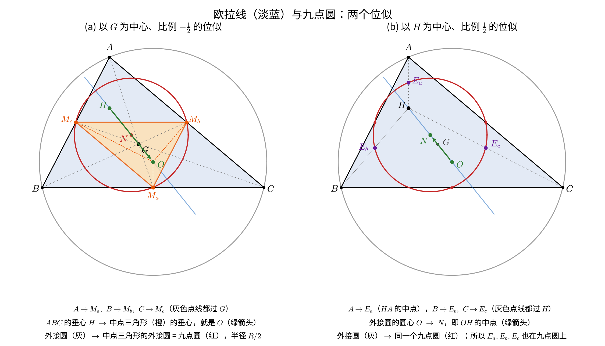
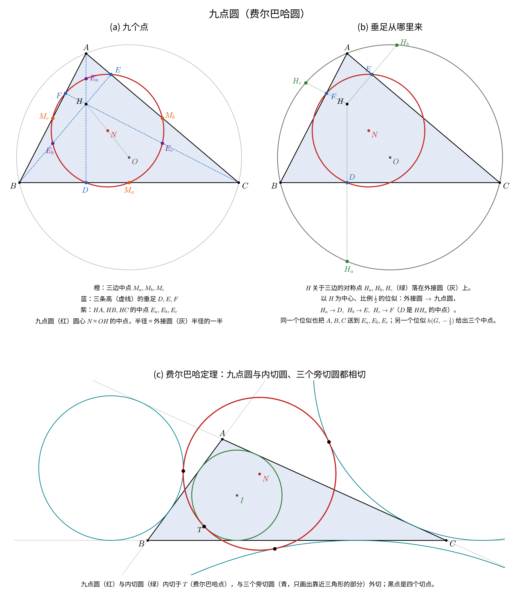

# 从变换群的角度来考虑一些定理

## 0. 出发点：克莱因的观点

克莱因（Erlangen 纲领，1872）说：**一种几何，由一个变换群决定；这种几何研究的，是在这个群下不变的性质。** 群越大，保留下来的性质越少，几何越"粗"。

平面上常用的几层，从小到大：

| 群 | 对应的几何 | 保持什么 | 不保持什么 |
|---|---|---|---|
| 运动群（刚体运动） | 度量几何（严格意义的欧氏几何） | 长度、角度 | — |
| 相似群 | 相似几何（通常说的"欧氏几何"，克莱因的"主群"） | 角度、长度比 | 绝对长度 |
| 仿射群 | 仿射几何 | 直线、平行、同一直线上的长度比、中点、重心 | 垂直、圆 |
| 射影群 | 射影几何 | 直线、交比、二次曲线 | 平行、中点 |
| 反演群（Möbius 群） | 反演几何（又叫 Möbius 几何、圆几何） | "圆或直线"、角度、相切 | 直线本身、圆心 |

几点说明：

- **相似群 vs 欧氏几何。** 严格说，欧氏几何对应运动群（保持长度）。但初等几何的定理几乎都不涉及"绝对长度是多少"，只涉及比例和角度，所以克莱因把相似群称为初等几何的"主群"（Hauptgruppe）。我们平常说的"欧氏平面几何"，按克莱因的标准其实是相似几何。本文三个定理都在这一层。
- **前四个群是一层包一层的：** 运动群 ⊂ 相似群 ⊂ 仿射群 ⊂ 射影群。相似群就是仿射群中保持圆点 I、J 的那部分，仿射群就是射影群中保持 ℓ∞ 的那部分。
- **反演群不在这条链上。** 它包含相似群（相似变换就是保持无穷远点 ∞ 的 Möbius 变换），但不包含仿射群（一般的仿射变换会把圆变成椭圆）。反演几何最好放在"平面 + 一个无穷远点"上看，也就是 Riemann 球面（球极投影）：球面上的圆对应平面上的圆或直线。所以反演几何也可以看成"保持一个球面的三维射影变换"所定义的几何。
- **非欧几何**（球面、双曲）也是射影几何的子几何（Cayley–Klein）：把"ℓ∞ 上的两个圆点"换成一条非退化二次曲线（绝对形），保持这条二次曲线的射影变换就是非欧几何的运动群。

对每一个定理，我们都问同一个问题：**它真正属于哪一层？** 也就是说，往大群放宽时，它在哪一层还成立，在哪一层失效；失效以后，又剩下什么。

射影语言里有一个基本事实，下面反复要用：**欧氏结构 = 射影平面 + 一条无穷远直线 ℓ∞ + ℓ∞ 上的两个虚点 I、J（圆点）。**

- 圆，就是经过 I、J 的二次曲线；
- 两个方向垂直，就是这两个方向（在 ℓ∞ 上的点）关于 I、J 调和共轭（Laguerre）；
- 中点：M 是 AB 的中点，当且仅当 M 和 AB 与 ℓ∞ 的交点关于 A、B 调和共轭。

---

## 1. 欧拉线

**定理。** 三角形的外心 O、重心 G、垂心 H 共线，并且 OG : GH = 1 : 2。

### 1.1 相似群：一个位似就够了

记 h 为以 G 为中心、比例 −1/2 的位似。

- h 把 A、B、C 送到对边中点 M_a、M_b、M_c，即把 ABC 变成中点三角形。
- 中点三角形的高线垂直于它的边，也就垂直于 ABC 的边，并且经过 ABC 的边中点。所以它们就是 ABC 的中垂线，交于 O。也就是说，**中点三角形的垂心是 O。**
- 位似把垂心送到垂心，所以 h(H) = O。于是 O、G、H 共线，并且 GO = ½ GH。

证明只用到一个位似，而位似属于相似群。所以欧拉线是相似几何的定理，用不到"绝对长度"。

*左：h(G, −1/2) 把 ABC 送到中点三角形，把 H 送到 O，这就是上面的证明。右：h(H, 1/2) 把外接圆送到同一个九点圆，把 O 送到 N，见 2.1。*

### 1.2 仿射群：换一种度量照样成立

仿射变换不保持垂直，所以一般的仿射变换会把 O、H 变成别的点，欧拉线本身不是仿射概念。但可以换个问法：**上面的证明到底用了欧氏度量的哪些性质？**

- G、中点、位似都是仿射概念；
- O 是"到三顶点等距"的点，H 是"三条高"的交点，只用到一个对称双线性形式（用来判断等距和正交）。

把欧氏内积换成**任意非退化二次型**（甚至不定的二次型，比如闵可夫斯基度量 x² − y²），按同样方式定义 O、H，证明一字不改，结论仍然成立。

所以欧拉线的真正层次是：**仿射几何 + 一个度量（一个二次型）。** 它并不依赖欧氏度量是正定的。

### 1.3 射影群：欧拉线需要什么数据

在射影语言里，"仿射 + 度量"就是"一条直线 ℓ + ℓ 上的一对点 I、J"（等价地，ℓ 上的一个对合）：

- G 只依赖 ℓ（重心是仿射概念）；
- O 是经过 A、B、C、I、J 的那条二次曲线的中心（ℓ 的极点）；
- H 是三条"高"的交点，高 = 过顶点、方向与对边关于 I、J 调和共轭的直线。

欧拉线定理在射影群下的形式是：**对任意三角形、任意直线 ℓ、ℓ 上任意一对点 I、J，这样定义的 O、G、H 共线。**

单纯的射影几何（没有 ℓ）里，G、O、H 都无从定义，所以欧拉线不是纯射影定理。

### 1.4 非欧几何：失效

在球面几何里：

- 重心（三条中线的交点）、外心、垂心都有定义；
- 但三者一般不在同一个大圆上。数值检验：大三角形上，三点的行列式为 0.38；小三角形上偏差变小，趋于欧氏的情形。

原因是：球面上没有位似，1.1 的证明无从下手。所以欧拉线是"有位似的几何"的定理。（双曲几何里同样没有位似，文献中的"双曲欧拉线"都要修改某个点的定义，有待查证。）

### 小结

> 欧拉线 = 一个位似（h(G, −1/2)）的推论。它活在"仿射 + 任意度量"这一层：比欧氏几何宽，比射影几何窄，在非欧几何里失效。

---

## 2. 费尔巴哈圆（九点圆）

**定理。**

- (a) 三边中点、三条高的垂足、HA、HB、HC 的中点（欧拉点）共九点共圆，圆心 N 是 OH 的中点，半径 R/2。
- (b)（费尔巴哈）这个圆与内切圆、三个旁切圆都相切。

*(a) 九个点；(b) 垂足的来历：H 关于三边的对称点在外接圆上，h(H, 1/2) 把它们送到垂足（2.1）；(c) 费尔巴哈相切（2.4）。*

(a) 和 (b) 属于完全不同的层次，这正是变换群观点的好处。

### 2.1 相似群：两个位似

- h(G, −1/2) 把外接圆变成中点三角形的外接圆，它过三边中点；
- h(H, 1/2) 把外接圆变成过 E_a、E_b、E_c 的圆；
- 两个位似都把 O 送到 N（OH 的中点），把半径 R 变成 R/2，所以是**同一个圆**；
- H 关于各边的对称点在外接圆上，用 h(H, 1/2) 送过去，就是三个高线垂足。

所以 (a) 的九个点，都是外接圆在两个位似下的像。

### 2.2 仿射群：九点二次曲线

去掉度量，只留仿射结构。任取一点 P，考虑完全四点形 {A, B, C, P}：

- 六条连线 AB、BC、CA、PA、PB、PC 的中点；
- 三个对角点 AP∩BC、BP∩CA、CP∩AB；

这九点在一条二次曲线上，叫**九点二次曲线**。它还有一个漂亮的刻画：**经过 A、B、C、P 的所有二次曲线组成一个线束，这些曲线的中心的轨迹，就是九点二次曲线。**

取 P = H 时：

- 对角点就是三条高的垂足，P 与顶点连线的中点就是欧拉点；
- {A, B, C, H} 是垂心组，过这四点的二次曲线全是等轴双曲线（Brianchon–Poncelet）；
- 这时九点二次曲线恰好是一个圆，也就是九点圆。

所以：**"九点"是仿射现象，"共圆"才用到垂心组的度量性质。** 换句话说，九点圆 = 垂心组的九点二次曲线；也等于所有过 A、B、C 的等轴双曲线的中心轨迹。

### 2.3 射影群：十一点二次曲线

再把无穷远直线换成任意一条直线 ℓ："中点"换成"与 ℓ 上交点调和共轭的点"，"中心"换成"ℓ 的极点"。

这时，过 A、B、C、P 的二次曲线束中，各曲线关于 ℓ 的极点的轨迹仍是一条二次曲线（Bôcher 的**十一点二次曲线**）。它经过：

- 3 个对角点；
- 6 个调和共轭点；
- 线束中与 ℓ 相切的两条曲线的切点（它们在 ℓ 上）。

这就是九点圆在纯射影几何里的"祖先"。

### 2.4 反演群：费尔巴哈定理的真正位置

(b) 讲的是**相切**，而相切在反演下不变。这提示 (b) 应该在反演群里理解。

**经典的反演证明。** 设内切圆、A-旁切圆与 BC 切于 D、D′。以 BC 中点 M_a 为中心、M_aD（= |b − c|/2）为半径作反演：

- 内切圆和 A-旁切圆都与反演圆正交，所以各自不变；
- 九点圆经过反演中心 M_a，被变成一条直线，可以算出这条直线就是 BC 关于 ∠A 平分线的对称直线，也就是两圆的另一条内公切线；
- 直线与两圆相切，反演回去，九点圆与两圆相切。

**更彻底的反演观点：Hart 定理（1861）。** 任给三个圆，与三者都相切的圆一般有 8 个（Apollonius 问题）。Hart 定理说：这 8 个圆可以分成若干组，每组 4 个，同时与另一个圆相切。

把三个圆换成三角形的三条边（直线是过无穷远点的"圆"），与三边都相切的圆就是内切圆和三个旁切圆，与它们都相切的那个圆就是九点圆。

所以：**费尔巴哈定理是 Hart 定理的退化情形。Hart 定理是纯反演几何的定理，里面没有直线、中点、圆心这些概念。**

### 2.5 非欧几何：(a) 失效，(b) 保留

在球面上：

- (a) 失效：三边中点和三个高线垂足一般不共圆（数值检验：偏差在 10⁻⁴ 到 10⁻² 量级，取决于三角形大小）；
- (b) 应当保留：球面通过球极投影与平面反演几何等价，大圆和小圆都变成平面上的圆。Hart 定理在反演下不变，所以球面三角形的内切圆、三个旁切圆仍有一个公共切圆。这个圆只是不再经过"九个点"了。

这和 (a)、(b) 的层次完全吻合。

### 小结

> 九点圆身上叠了三层东西：
> - "九个点在一条二次曲线上"——仿射（射影版本是十一点二次曲线）；
> - "这条二次曲线是圆"——要用垂心组的度量性质；
> - "与内切圆、旁切圆相切"——反演几何（Hart 定理），连非欧几何都保留。

---

## 3. 西姆松线

**定理。** 从点 P 向三角形三边（所在直线）作垂线，三个垂足共线，当且仅当 P 在外接圆上。这条线叫 P 的西姆松线。

### 3.1 相似群：面积公式与包络

更一般地，对任意点 P，垂足三角形 DEF 的面积是

> [DEF] = |R² − OP²| / (4R²) · [ABC]。

面积为 0 当且仅当 OP = R，西姆松定理就是它的特例。同一个公式还说明：垂足三角形面积为定值的点，构成以 O 为圆心的同心圆（Gergonne–Steiner）。这是一个只用到相似群的刻画。

西姆松线还和九点圆连在一起：

- P 的西姆松线平分 PH，PH 的中点在九点圆上。这又是位似 h(H, 1/2) 把外接圆送到九点圆的结果；
- P 沿外接圆转动时，西姆松线以一半的速度、沿相反方向转动；
- 所有西姆松线的包络是 Steiner 三尖瓣线（deltoid），它的中心是 N，九点圆是它的内切圆。

### 3.2 仿射群：换度量 / 斜投影

和欧拉线一样，把"垂直"换成任意二次型下的"正交"，证明照样成立。结论是：P 沿这个度量的"垂直"方向向三边作投影，三个投影点共线，当且仅当 P 在这个度量下的"外接圆"上（一条过 A、B、C 的二次曲线）。

经典的特殊情形是 **Carnot 的推广**：过 P 作与三边成同一定角 θ 的直线，交三边于三点，三点共线当且仅当 P 在外接圆上。θ = 90° 时就是西姆松线。

### 3.3 射影群

用 1.3 的语言："过 P 作 BC 的垂线"就是"连接 P 和 BC 方向关于 I、J 的共轭点"。于是西姆松定理的射影形式是：

> 给定直线 ℓ、ℓ 上的点对 I、J，以及经过 A、B、C、I、J 的二次曲线 Γ。对每条边，取它与 ℓ 的交点关于 I、J 的共轭点 X，连 PX 交这条边于一点。三点共线，当且仅当 P 在 Γ 上。

它和欧拉线处在同一层：需要一条直线和其上的一对点。

### 3.4 反演群：等价于一个关于三个圆的定理

以 P 为中心作反演（P 在外接圆上）：

- 外接圆变成一条直线，三顶点的像 A′、B′、C′ 在这条直线上；
- 三条边变成三个经过 P 的圆（PB′C′、PC′A′、PA′B′）；
- 从 P 向直线作的垂足，变成 P 在对应圆上的对径点；
- 垂足共线，变成三个对径点与 P 共圆。对径点是圆心关于 P 的 2 倍位似像，所以等价于**三个圆心与 P 共圆**。

于是西姆松定理等价于：

> **三个圆经过同一点 P，它们两两的另一个交点共线，当且仅当三个圆心与 P 共圆。**

（数值检验：交点共线时偏差 10⁻¹⁶；不共线时偏差为 O(1)。）

这个叙述里没有三角形、没有垂直，只有圆。但它不是纯反演定理，因为"圆心"不是反演不变量；它属于"反演 + 相似"的混合层次。

### 3.5 非欧几何：失效

球面上，P 在外接圆上时，三个垂足一般不在同一个大圆上（数值检验：行列式约 10⁻³ 量级，不为 0）。原因和欧拉线类似：面积公式和位似都依赖欧氏结构。

### 小结

> 西姆松线和欧拉线同层：它活在"仿射 + 度量"里，Carnot 的定角推广说明它不依赖直角；它通过 h(H, 1/2) 和九点圆相连；在非欧几何中失效。它的反演形式是"三圆共点"定理。

---

## 4. 三个定理放在一起

| | 相似 | 仿射 + 任意度量 | 仿射（无度量） | 射影 | 反演 | 球面 |
|---|---|---|---|---|---|---|
| 欧拉线 | ✓（位似） | ✓ | 无定义 | 需 ℓ 和 I、J | ✗ | ✗ |
| 九点共二次曲线 | ✓ | ✓ | ✓（九点二次曲线） | ✓（十一点二次曲线） | ✗ | ✗ |
| 九点共圆 | ✓ | ✓（共"度量圆"） | ✗ | 需 ℓ 和 I、J | ✗ | ✗ |
| 费尔巴哈相切 | ✓ | — | — | — | ✓（Hart 定理） | ✓ |
| 西姆松线 | ✓ | ✓（Carnot 定角推广） | 无定义 | 需 ℓ 和 I、J | 等价于"三圆共点"定理 | ✗ |

几条观察：

1. **位似 h(G, −1/2) 和 h(H, 1/2) 是共同的引擎。** 欧拉线、九点圆、西姆松线平分 PH，都是它们的推论。所以这三个定理只能活在有位似的几何里。
2. **同一个定理的不同部分，可以属于不同的群。** 九点圆最明显："九点"是仿射的，"共圆"是度量的，"相切"是反演的。
3. **放宽群，往往得到更一般、也更自然的定理**：九点二次曲线、十一点二次曲线、Hart 定理、Carnot 的定角推广。

## 5. 下一步可以做的

- **对 lab 的意义：** 我们的扫描都是在"欧氏 + 一个具体的度量"下做的。可以换一个群再扫一次（比如在任意二次型下、在球面上、在反演群里），看哪些关系活下来。活下来的关系层次更"深"，失效的关系则说明它依赖哪个结构。
- **待查证：** 双曲几何中欧拉线、西姆松线的已知推广（Akopyan 等）；球面费尔巴哈定理的文献。
- **可以接着讨论的定理：** 蝴蝶定理（射影）、Miquel 定理（反演）、Morley 定理（只在相似群里成立，在仿射下失效的典型例子）、Pascal 定理（纯射影）。
