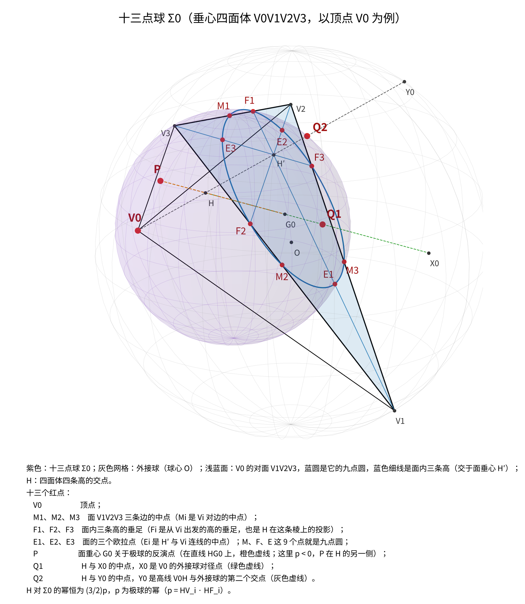
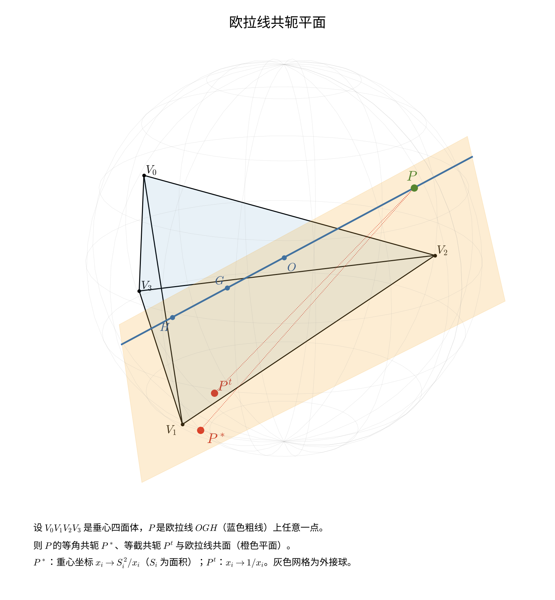
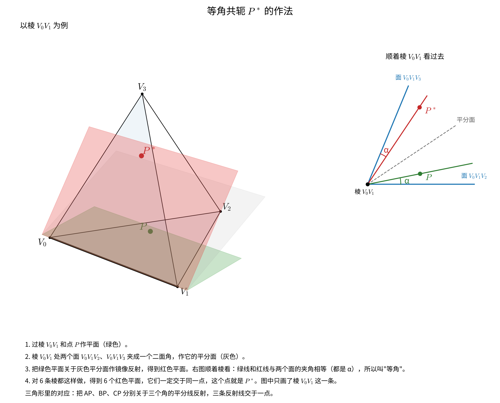
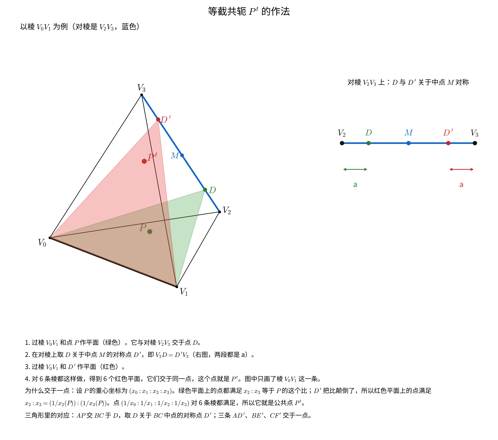
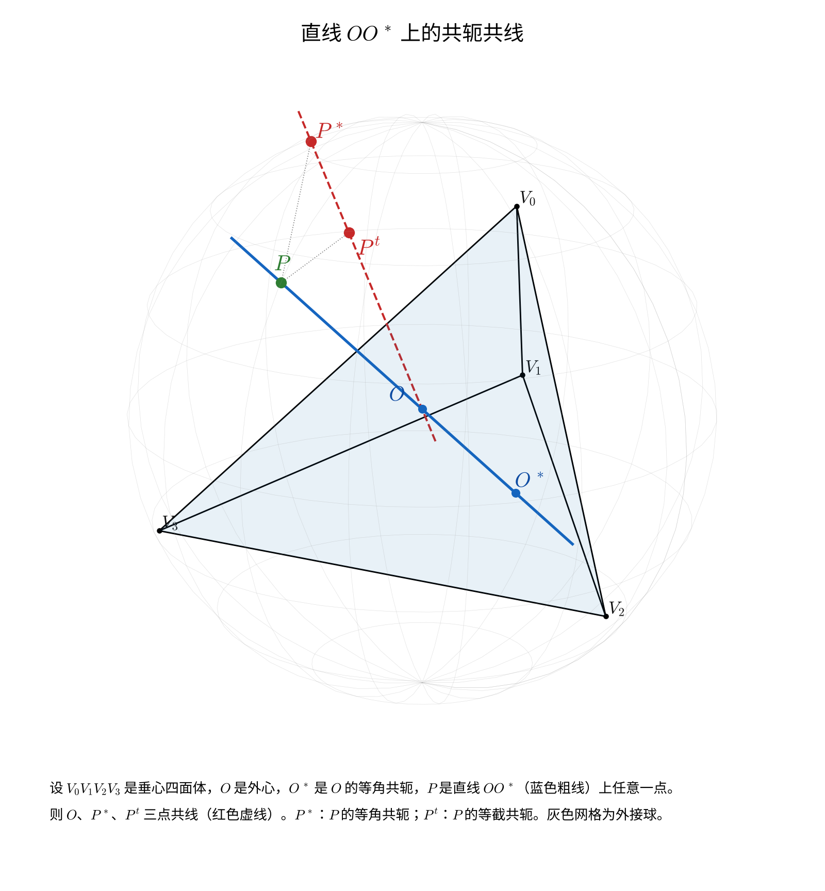
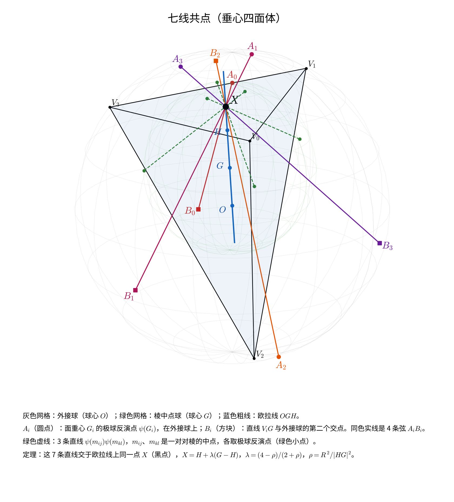
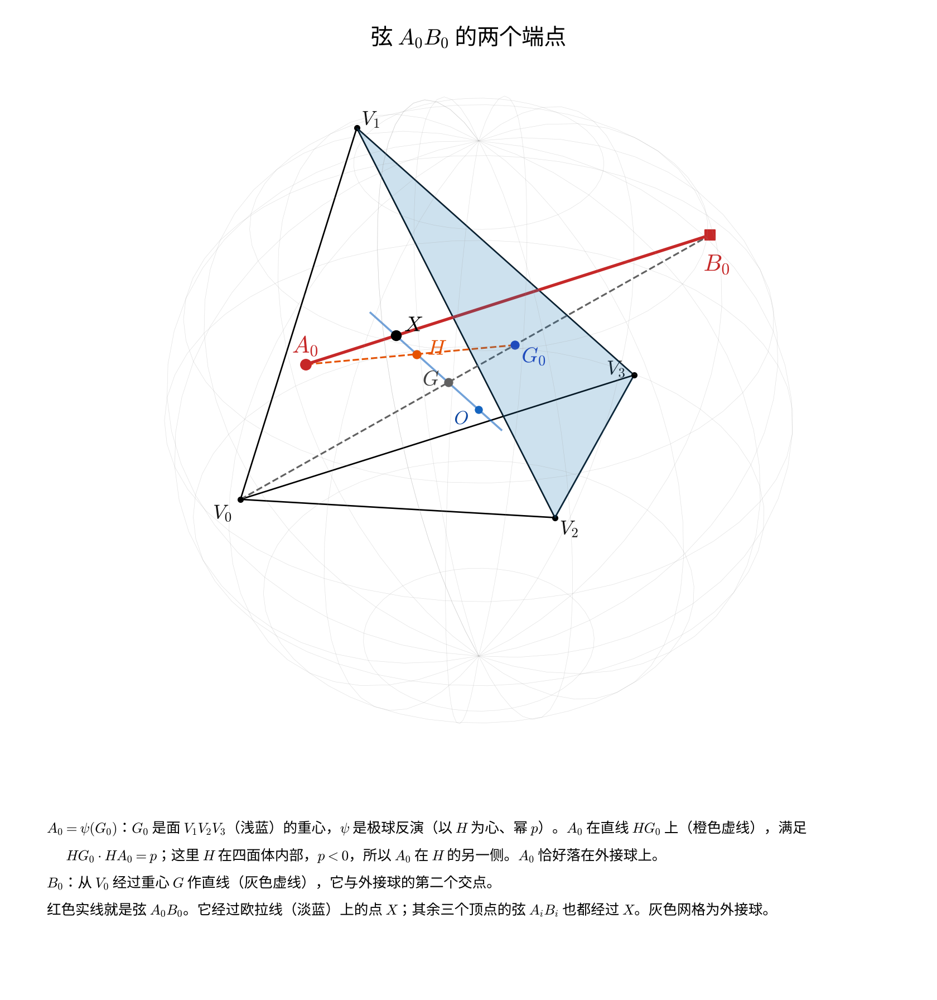
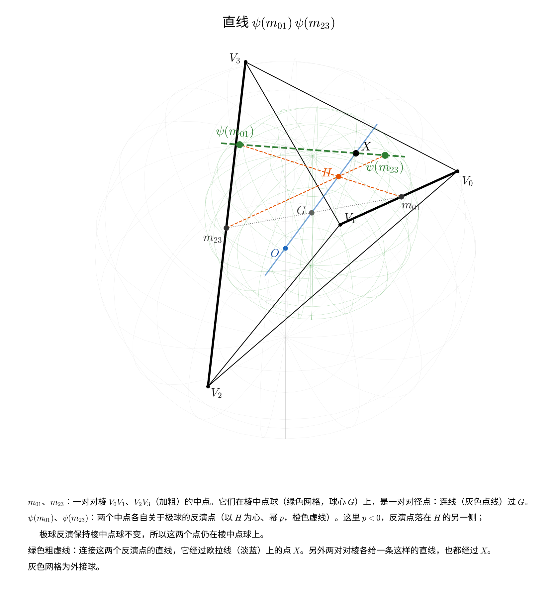
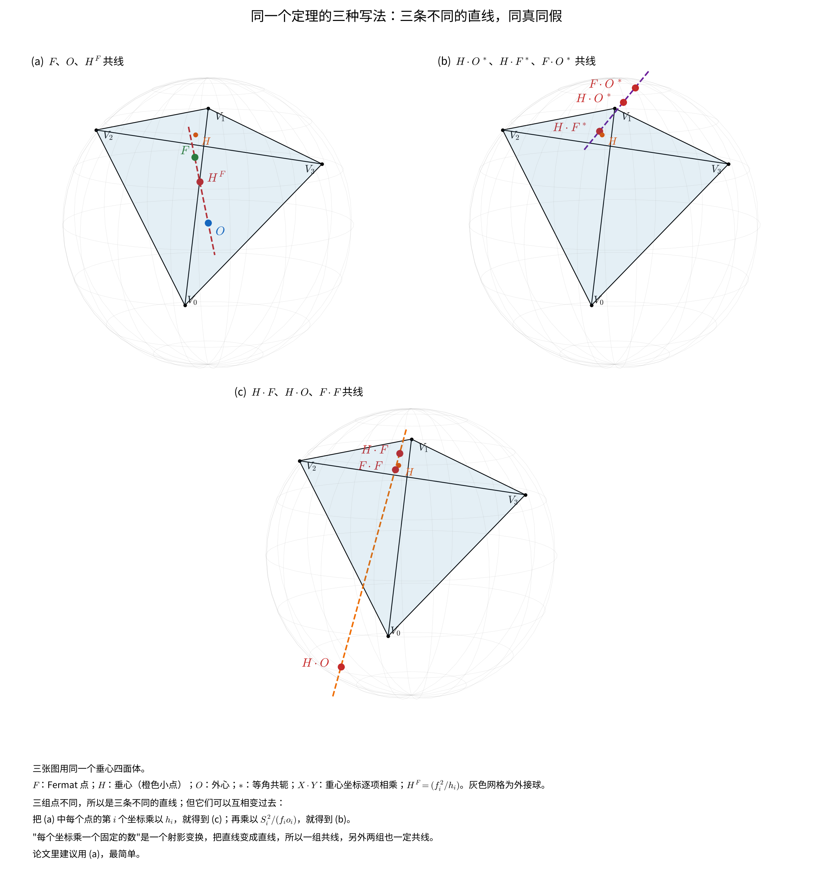
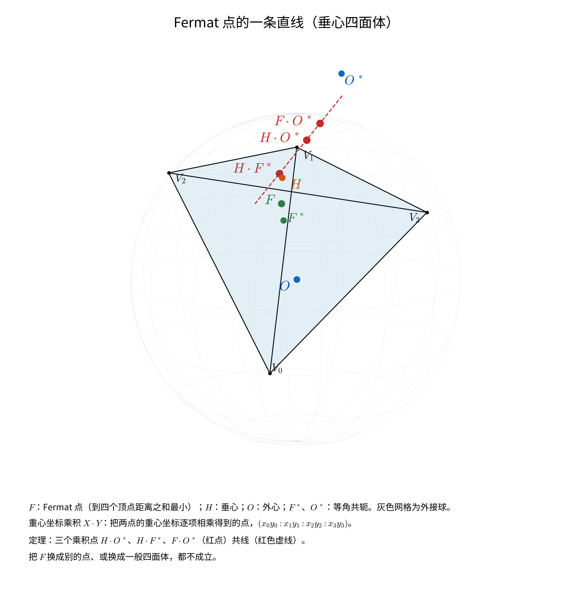

# 垂心四面体的六条定理

《[垂心四面体定理扫描](垂心四面体定理扫描.md)》四层扫描（共线、共面、共圆、共球）筛到最后、而且已经证明的六条关系，从那篇报告里单独拉出来，逐条写成完整的陈述、证明和文献核查。整理于 2026 年 10 月 20 日。

六条在一般四面体里都<b>不成立</b>，都用到「对棱垂直」这个条件。

| | 定理 | English | 来自 |
|---|---|---|---|
| 一 | 十三点球 Σ_d | The Thirteen-Point Sphere | 共球扫描 |
| 二 | 欧拉线共轭平面 | The Euler-Line Conjugate Plane | 共面扫描 |
| 三 | 第二欧拉线上的共轭共线 | Conjugate Collinearity on the Second Euler Line | 共线扫描 |
| 四 | 面类似重心在过高的平面上（待搬） | The Face Symmedian Point Lies in a Plane Through the Altitude | 共面扫描 |
| 五 | 七线共点 | Seven Concurrent Lines | 共线、共圆扫描 |
| 六 | 过 Fermat 点的一条共线 | A Collinearity Through the Fermat Point | 共线扫描 |

<b>记号</b>：垂心四面体 V0V1V2V3，三对对棱互相垂直，四条高交于垂心 H（在垂心四面体里 Monge 点就是 H）。外接球球心 O、半径 R，重心 G。顶点 V_i 对面的那个面记作面 i，它的外心、垂心、重心记作 O_i、H_i、G_i；从 V_i 出发的高的垂足就是面 i 的垂心 H_i，下文直接称它为高足 H_i（F 留给十三点球里面内三条高的垂足）。

<b>极球</b>：H 到顶点与 H 到对应垂足的向量内积，对四个顶点同为一个常数

> p = HV_i · HH_i

以 H 为中心、p 为幂的反演叫极球反演，记作 ψ。H 在四面体内部时 p < 0，极球是虚球，反演照样有定义。ψ 把顶点送到垂足，把十二点球送到外接球；H 关于外接球的幂是 3p，关于棱中点球（球心 G，过 6 个棱中点和 6 个公垂线垂足）的幂是 p。

<b>代数</b>：把 H 放在原点，记 v_i = HV_i，则 v_i·v_j = p（i ≠ j）。令 a_i = |v_i|² − p（= V_iH · V_iH_i），则

> p = −1 / Σ(1/a_i)，　H 的重心坐标 ∝ 1/a_i，　G ∝ 1，　O = 2G − H，
> 棱长平方 d_ij² = a_i + a_j，　4S_i² = 其余三个 a 的两两乘积之和。

下面的符号计算都在这套参数下进行：任给四个正数 a_i，上面的 Gram 矩阵 v_i·v_j = p + a_i·δ_ij 就确定一个垂心四面体（相差一个刚体运动），所以结论化成 a_0, …, a_3 的恒等式。

---

## 一、十三点球　The Thirteen-Point Sphere

### 定理

<b>先说清楚哪一半是免费的。</b>　过一个圆的球构成一族（球束），再给一个不在圆平面上的点，就唯一确定其中一个。所以「过 V_d 和对面九点圆的球」<b>对任意四面体都存在且唯一</b>——这是 Σ_d 的<b>定义</b>，不是结论，和垂心性质无关，甚至和「九点圆」无关：换成面上任何一个圆都一样。同理，九点圆上那 9 个点里只有 3 个是独立的（三点定圆），其余 6 个由九点圆定理本身给出，也不是这里的新内容。

把这些扣掉，<b>真正的结论只有四条</b>：这个被 4 个条件（一个圆 + 一个顶点）完全定死的球，还恰好过另外三个有名字的点，而且 H 对它的幂是一个与形状无关的常数。

<b>定理一（十三点球）</b>　设 V0V1V2V3 是垂心四面体，取顶点 V_d，记 Σ_d 为过 V_d 和对面三角形九点圆的那个球（如上所述，它总是存在且唯一）。再记 X_d 为 V_d 在外接球上的对径点，Y_d 为高线 V_dH 与外接球的第二个交点。则：

> (1) 对面重心的极球反演点 ψ(G_d) 在 Σ_d 上；
> (2) HX_d 的中点在 Σ_d 上；
> (3) HY_d 的中点在 Σ_d 上；
> (4) <b>H 对 Σ_d 的幂恒等于 (3/2)p</b>，与四面体的形状无关。

四个顶点各给出一个这样的球。把定义里免费的点和结论里的三个点合起来，球上一共有 13 个有名字的点，所以叫它十三点球——但要记住这个数字里有 10 个是免费的。

下面取 d = 0，把对面 V1V2V3 的三个顶点记作 V1、V2、V3，列出球上全部 13 个点，记号与插图一致（前四行是定义里就有的，后三行 P、Q1、Q2 才是结论）：

| 记号 | 点 | 个数 |
|---|---|---|
| V0 | 顶点本身 | 1 |
| M1、M2、M3 | 对面三条边的中点（M_i 是 V_i 对边的中点） | 3 |
| F1、F2、F3 | 对面三条高的垂足（F_i 是面内从 V_i 出发的高的垂足；在垂心四面体里它同时就是 <b>H 在这条棱上的投影</b>，也是这条棱与对棱的公垂线垂足） | 3 |
| E1、E2、E3 | 对面的三个欧拉点（E_i 是面垂心与 V_i 连线的中点） | 3 |
| P | 对面重心的极球反演点 ψ(G_0)，在直线 HG_0 上 | 1 |
| Q1 | HX0 的中点（X0：V0 在外接球上的对径点） | 1 |
| Q2 | HY0 的中点（Y0：高线 V0H 与外接球的第二个交点） | 1 |

M、F、E 这 9 个点就是对面那个三角形的九点圆，和 V0 一起把 Σ_0 定死；P、Q1、Q2 是多出来的三个。Q1 与 Q2 成对：X0 和 Y0 都在外接球上，它们与 H 的中点都落在 Σ_0 上。

图：以 V0 为例的十三点球 Σ0（紫色）。灰色网格是外接球（球心 O），浅蓝面是 V0 的对面 V1V2V3，蓝色粗圆是它的九点圆，蓝色细线是面内三条高（交于面垂心 H′）——<b>Σ0 与这个面的交线正好就是九点圆</b>，所以圆上的 9 个点 M1–M3、F1–F3、E1–E3 全在球上，它们和 V0 一起把 Σ0 定死。三条辅助线对应结论里多出来的三个点：橙色虚线是直线 HG0，极球幂 p < 0，所以反演点 P 落在 H 的另一侧；绿色虚线连 H 与 V0 的外接球对径点 X0，中点是 Q1；灰色虚线是高线 V0H，它与外接球的第二个交点 Y0 和 H 的中点是 Q2。

13 个点里只有 P 的作法不直观，下图单独画出极球反演怎么把面重心 G0 送到 P：

 0）与在四面体内（p < 0）两种情形" width="900">

图：P = ψ(G0) 的作法。四条高交于 H，每条高上 HV_i · HH_i 都等于同一个数 p（H0–H3 是四面体的四个高足，即各面的垂心）。(a) H 在四面体外，p > 0，极球是以 H 为心、半径 √p 的实球（橙色），P 在射线 HG0 上，HG0 · HP = p。(b) H 在四面体内，p < 0，极球是虚球；先关于半径 √|p| 的辅助球（紫色虚线）作普通反演得到 G0∗，再关于 H 作中心对称得到 P，所以 P 落在 H 的另一侧。上面十三点球的插图属于情形 (b)。

### 和经典的 24 点球是什么关系

四面体里已经有一个和九点圆有关的经典球：垂心四面体的<b>四个面的九点圆共球</b>，球心是 G，就是棱中点球（6 个棱中点 + 6 个公垂线垂足，再加每个面的九点圆各贡献 3 个点，合计 24 点，Altshiller-Court 把它叫作第二类 Feuerbach 球）。

Σ_d 不是它。两者的关系可以说得很干净：

> 过面 d 的九点圆的那一族球里，<b>24 点球是 H 的幂为 p 的那一个，Σ_d 是 H 的幂为 (3/2)p 的那一个</b>（也就是过对面顶点 V_d 的那一个）。

所以经典结果是「一个球同时过四个面的九点圆」，这里是「每个面的九点圆各配一个球，还穿过对面的顶点」，是同一族球里的另一个成员。

### 证明

把 H 放在原点，设球的方程是 |x|² − 2c·x + d = 0，其中 c 是球心、d 就是 H 对球的幂。记 u_i = c·v_i。

<b>第一步：面 d 的三条边中点在球上。</b>　对 i、j ≠ d，边中点是 (v_i + v_j)/2，代入得

> (|v_i|² + 2v_i·v_j + |v_j|²)/4 − (u_i + u_j) + d = 0。

用 |v_i|² = a_i + p、v_i·v_j = p 化简为 (a_i + a_j)/4 + p = u_i + u_j − d。三条边给出三个方程，解出

> u_i = a_i/4 + (p + d)/2，　i ≠ d。

<b>第二步：V_d 在球上。</b>　|v_d|² − 2u_d + d = 0，即 a_d + p − 2u_d + d = 0，于是

> u_d = (a_d + p + d)/2。

<b>第三步：用 H 的重心坐标。</b>　H 的重心坐标 ∝ 1/a_i 且 H 在原点，所以 Σ v_i/a_i = 0，两边与 c 作内积得 Σ u_i/a_i = 0。把第一、二步的 u_i 代进去：

> Σ_{i≠d} [ 1/4 + (p+d)/(2a_i) ] + [ 1/2 + (p+d)/(2a_d) ] = 3/4 + 1/2 + (p+d)/2 · Σ_i 1/a_i。

<b>第四步：</b>　再用 Σ 1/a_i = −1/p，上式等于 5/4 − (p+d)/(2p) = 0，解得

> <b>d = (3/2)p。</b>

球心 c 由 u_0, …, u_3 唯一确定（v_i 张成三维空间），所以 Σ_d 的方程已经完全写出来了。

<b>第五步：其余各点。</b>　三条边中点已经定出了面 d 上的九点圆——球与面 d 所在平面的交线是一个圆，它过这三个中点，而过三点的圆唯一，所以这个交圆就是面 d 的九点圆，九点圆上的点（三条高的垂足、三个欧拉点）因此全部自动在球上。剩下的三个点逐个代入球方程 |x|² − 2c·x + (3/2)p = 0。代入时用到 δ = (3/2)p 时 u_i = a_i/4 + 5p/4（i ≠ d）、u_d = a_d/2 + 5p/4，并记 Σ′ 为对 i ≠ d 求和：

- <b>Q1</b>：O = 2G = ½Σv_i，所以 X_d = 2O − V_d = Σ′v_i，Q1 = ½Σ′v_i。|Q1|² = (Σ′a + 9p)/4，2c·Q1 = Σ′u_i = Σ′a/4 + 15p/4，代入得 (9 − 15 + 6)p/4 = 0。
- <b>Q2</b>：Y_d 在直线 HV_d 上，记 Y_d = t·v_d；H 对外接球的幂是 3p，所以 t·|v_d|² = t(a_d + p) = 3p。Q2 = (t/2)v_d，代入得 (t²/4)(a_d + p) − t·u_d + 3p/2 = t·(3p/4 − a_d/2 − 5p/4) + 3p/2 = −(t/2)(a_d + p) + 3p/2 = 0。
- <b>P = ψ(G_d)</b>：ψ(x) = p·x/|x|²，所以 ψ(x) 在球上 ⇔ p − 2c·x + (3/2)|x|² = 0。取 x = G_d = ⅓Σ′v_i：c·x = Σ′a/12 + 5p/4，|x|² = (Σ′a + 9p)/9，代入得 p − Σ′a/6 − 5p/2 + Σ′a/6 + 3p/2 = 0。∎

<b>扫描器看到的形态</b>：共球扫描的点库里没有面的欧拉点，所以它报出来的是一个 8 点球——V_d、对面三条边中点、对面三条高的垂足、ψ(G_d)。补全九点圆之后才数到 13。

### 推论：另外两个球

扫描里另外两个 8 点球都是 Σ_d 的像：

<b>推论 1（以 H 为中心放大 2 倍）。</b>　位似像 2Σ_d 上 H 的幂是 4 · (3/2)p = <b>6p</b>，球上有：X_d、Y_d、H 关于面 d 三条边中点的对称点（3 个）、H 关于面 d 三条边的对称点（3 个）。

<b>推论 2（极球反演像）。</b>　ψ(Σ_d) 上 H 的幂是 p²/((3/2)p) = <b>(2/3)p</b>，球上有：面 d 的重心和垂心、面 d 三条边中点的极球反演点（3 个）。此外 <b>H 在过 V_d 的三条棱上的投影</b>也在这个球上——这一条不是反演直接给出的，单独验证：ψ(Σ_d) 的方程是 |y|² − (4/3)c·y + (2/3)p = 0；H 在棱 V_dV_j 上的投影是 y = (a_j v_d + a_d v_j)/(a_d + a_j)，|y|² = a_da_j/(a_d + a_j) + p，c·y = (3a_da_j/4)/(a_d + a_j) + 5p/4，代入恒为 0。

### 验证

- 6 个随机垂心四面体上，13 个点共球，残差 10⁻¹⁵ 量级（相对球半径平方）；H 的幂除以 p 恒为 1.500000000000。
- 两个推论同样验证过：幂分别为 6.000000000000 和 0.666666666667 倍的 p。
- 符号计算见上。

### 文献

- 经典的是另一个球：四个面的九点圆共球（球心 G 的 24 点球 / 第二类 Feuerbach 球），见 Altshiller-Court《Modern Pure Solid Geometry》§797–802、Thébault 1946《Sur une nouvelle sphère du tétraèdre orthocentrique》；2012 年 Hang Lung Mathematics Awards 有一篇学生论文给出九点圆共球的充要条件。
- n 维的几种九点圆推广也查过：Buba-Brzozowa《Analogues of the nine-point circle for orthocentric n-simplexes》（J. Geom. 81 (2004) 21–29）、《The Monge point and the 3(n+1) point sphere of an n-simplex》（J. Geom. Graph. 9 (2005) 31–36）、Martini 等关于 Minkowski 空间的 2(d+1) 点 Feuerbach 球（arXiv:1602.06144 定理 4.3）——全部属于「面重心 + Monge 点分点」那一族、以欧拉线上一点为心的球，没有按顶点分成四个的球。
- 「thirteen-point sphere」这个名字在四面体几何里检索不到。
- Altshiller-Court 垂心四面体一章（§795–834）逐条读过，没有这个球。
- <b>结论：没有查到。</b>没能直接打开的来源：Court 1942《On the theory of the tetrahedron》（BAMS，站点 403）、Buba-Brzozowa 2004 全文（付费墙，只看到摘要和引用它的论文的转述），以及没有数字化索引的老期刊（Couderc–Balliccioni 1935、Mathesis、Nouvelles Annales）。

---

## 二、欧拉线共轭平面　The Euler-Line Conjugate Plane

### 定理

<b>两种共轭。</b>　四面体中一点 P 的齐次重心坐标记作 (x_0 : x_1 : x_2 : x_3)（x_i 与 P 到面 i 的有向距离乘面 i 的面积成正比）。和三角形一样定义：

> 等截共轭 Pᵗ = (1/x_0 : 1/x_1 : 1/x_2 : 1/x_3)，　等角共轭 P∗ = (S_0²/x_0 : S_1²/x_1 : S_2²/x_2 : S_3²/x_3)，

S_i 是面 i 的面积。两者都有几何作法（见下面两张图）。重心 G 的等截共轭是它自己，等角共轭是类似重心（Lemoine 点）K——这与 Прасолов《立体几何问题集》8.82、8.83 一致。

<b>定理二（欧拉线共轭平面）</b>　设 V0V1V2V3 是垂心四面体，P 是欧拉线 OGH 上任意一点。则 P 的等角共轭 P∗、等截共轭 Pᵗ 与欧拉线共面。

几点说明：

- <b>平面随 P 转动。</b>欧拉线确定的是一族平面（绕这条线转一圈），定理说 P∗ 和 Pᵗ 落在同一张里，但不同的 P 对应不同的平面，不是一张固定的平面。
- <b>两个特殊位置是平凡的。</b>P = G 时 Pᵗ = G 本身就在欧拉线上；P = H 时 H∗ 是 H 的补点（Altshiller-Court §803），也在欧拉线上。这两处「一条线加一个点」必然共面，没有内容。真正有内容的例子是 P = O：<b>O∗、Oᵗ 与欧拉线共面</b>。
- <b>一般四面体里不成立</b>，偏差在 10⁻² 量级（见验证）。
- <b>三角形里没有对应</b>：平面上所有点本来就共面。这是三维才有的现象。

图：欧拉线共轭平面。蓝色粗线是欧拉线（H、G、O，在垂心四面体里 G 是 HO 的中点），绿点 P 是线上任取的一点，红点是它的等角共轭 P∗ 和等截共轭 Pᵗ，橙色是过欧拉线和这两点的平面。P 沿欧拉线移动时，这张平面绕欧拉线转动，但 P∗、Pᵗ 始终同在一张上。

这条定理里的两种共轭，作法如下（定理三、六也要用）。

图：<b>等角共轭 P∗ 的作法</b>。取一条棱（图中是 V0V1），过这条棱和点 P 作平面（绿色）；棱处两个面 V0V1V2、V0V1V3 夹成一个二面角，作它的平分面（灰色）；把绿色平面关于平分面作镜像反射，得到红色平面。右图是顺着棱看过去的截面：绿线和红线与两个面的夹角相等（都是 α），这就是「等角」的含义。对 6 条棱各做一次得到 6 个平面，它们必交于一点，这点就是 P∗（图中只画了 V0V1 这一条）。三角形里的对应作法是把 AP、BP、CP 分别关于三个角的平分线反射，三条反射线交于一点。

图：<b>等截共轭 Pᵗ 的作法</b>。同样以棱 V0V1 为例，它的对棱是 V2V3。过棱 V0V1 和点 P 作平面（绿色），它与对棱交于 D；在对棱上取 D 关于中点 M 的对称点 D′（即 V2D = D′V3，右图里两段都是 a）；再过棱 V0V1 和 D′ 作平面（红色）。对 6 条棱各做一次，6 个红色平面交于一点，就是 Pᵗ。这里能直接看出为什么交于一点：设 P 的重心坐标是 (x_0 : x_1 : x_2 : x_3)，绿色平面上的点的 x_2 : x_3 都等于 P 的这个比，而 D′ 把这个比颠倒过来，所以红色平面上的点满足 x_2 : x_3 = (1/x_2) : (1/x_3)；点 (1/x_0 : 1/x_1 : 1/x_2 : 1/x_3) 对 6 条棱同时满足，它就是公共点。三角形里的对应作法是：AP 交 BC 于 D，取 D 关于 BC 中点的对称点 D′，三条 AD′、BE′、CF′ 交于一点。

两张图并排看，区别一眼可见：<b>等角共轭靠二面角平分面作反射</b>，要用到角度，所以公式里带面积 S_i；<b>等截共轭靠对棱中点作对称</b>，只用到长度的比，所以公式只是取倒数。

### 证明

沿用开头「代数」一段的参数：a_i = |HV_i|² − p，记 e_1, e_2, e_3 为 a_0, …, a_3 的初等对称式，A = a_0a_1a_2a_3。

<b>第一步：欧拉线的重心坐标。</b>　G ∝ 1，H ∝ 1/a_i。所以欧拉线上的点正好是重心坐标落在 {1, 1/a_i} 张成的二维空间里的点。（O 在其中：O ∝ e_3 − 2A/a_i。）把欧拉线上一点写成

> x_i = c − d/a_i，　c、d 是常数（随 P 变化）。

<b>第二步：Pᵗ。</b>　1/x_i = a_i/(c·a_i − d) = (1/c)·[1 + d/(c·a_i − d)]（c = 0 即 P = H 时直接有 1/x_i ∝ a_i，下面的论证照样成立）。所以 Pᵗ 的坐标落在 {1, 1/(c·a_i − d)} 张成的空间里。

<b>第三步：面积。</b>　开头已有 4S_i² = 其余三个 a 的两两乘积之和 = e_2 − a_i·e_1 + a_i²。

<b>第四步：P∗，关键一步。</b>　P∗ 的坐标 ∝ S_i²/x_i = a_i(a_i² − e_1a_i + e_2) / (c·a_i − d)。每个 a_i 都是多项式 (x − a_0)(x − a_1)(x − a_2)(x − a_3) = x⁴ − e_1x³ + e_2x² − e_3x + A 的根（Vieta），所以

> a_i³ − e_1a_i² + e_2a_i = e_3 − A/a_i，

于是 S_i²/x_i ∝ (e_3a_i − A) / (a_i(c·a_i − d))。部分分式：

> (e_3a_i − A) / (a_i(c·a_i − d)) = (A/d)·(1/a_i) + (e_3 − Ac/d)·1/(c·a_i − d)。

（d = 0 即 P = G，是上面说的平凡情形。）

<b>第五步：</b>　四个点 G、H、Pᵗ、P∗ 的重心坐标都落在三维空间 span{1, 1/a_i, 1/(c·a_i − d)} 里（i 跑 0..3 时看作 ℝ⁴ 中的向量），所以它们的 4×4 行列式为 0，即四点共面。G、H 张出欧拉线，P∗ 和 Pᵗ 就和欧拉线在同一平面上。∎

垂心性质用在两处：欧拉线的重心坐标是 {1, 1/a_i} 这么简单的形式，以及 S_i² 是 a_i 的二次式、能被 Vieta 关系降次。一般四面体里两者都没有。

<b>机器核对</b>：按上面的参数直接写出 G、O、Pᵗ、P∗ 四行，用 sympy 展开 4×4 行列式，恒为 0（不到一秒）。扫描报告里原来的证明就是这个行列式展开（代码 proof_sym.py），上面的 Vieta 论证是把它拆开后的手算版本。

### 验证

- 6 个随机垂心四面体上，P 取欧拉线上任意参数，四点共面的残差 10⁻¹⁶ 量级；50 位有效数字下行列式恰好为 0。
- 随机一般四面体上不成立，偏差 10⁻² 到 10⁻³ 量级。
- P 取欧拉线上不同位置时，平面的法向确实在变（不是固定平面）。

### 文献

- 四面体的等角、等截共轭在 Rabinowitz 2020（IJCDM 5, 13–41）和 Cheung–Ko 2018 里都有，但只用在「面中心的塞瓦线是否共点」上，没有「欧拉线上一点的两种共轭与欧拉线共面」这类命题。
- Altshiller-Court《Modern Pure Solid Geometry》垂心四面体一章（§795–834）、Прасолов–Шарыгин《立体几何问题集》的等角共轭、欧拉线两节（含 §8.13 第二欧拉线）都逐条看过，没有这一条。
- <b>结论：没有查到。</b>没有数字化索引的老期刊（Couderc–Balliccioni 1935、Mathesis、Nouvelles Annales）还没查。

---

## 三、第二欧拉线上的共轭共线　Conjugate Collinearity on the Second Euler Line

### 定理

<b>第二欧拉线。</b>　四面体的高不一定共点，所以「欧拉线」有不止一种推广。上一节用的是过 O 和重心 G 的那条。另一条是：三角形里垂心是外心的等角共轭，于是把外心 O 和它的等角共轭 O∗ 连起来。这两条线一般不重合。

Прасолов《Задачи по стереометрии》第 8 章 §13 给了这两条线名字——过 O 和重心的叫<b>第一欧拉线</b>，过 O 和 O∗ 的叫<b>第二欧拉线</b>（原文：「Вторая прямая Эйлера тетраэдра ABCD — это прямая, проходящая через центр описанной сферы O и точку O′, изогонально сопряжённую с точкой O.」）。<b>需要说明</b>：这个叫法目前只在这本书里见到，俄文、英文的其它文献中没有检索到，所以它是该书的术语，不是学界通用名称；本文沿用它只是因为比「直线 OO∗」好读。

<b>定理三（第二欧拉线上的共轭共线）</b>　设 V0V1V2V3 是垂心四面体，O∗ 是外心 O 的等角共轭，P 是第二欧拉线 OO∗ 上任意一点。则

> <b>O、P∗、Pᵗ 三点共线。</b>

几点说明：

- <b>和定理二是同一类现象，但结论的形状不同。</b>定理二是「一条线上的点，两种共轭与这条线共面」；这里是「一条线上的点，两种共轭与<b>一个定点 O</b> 共线」。后者更强：共线比共面少一个自由度，而且 O 不随 P 变。
- <b>取 P = O 就得到一条干净的推论</b>：O∗ 是 O 的等角共轭，O 的等截共轭 Oᵗ 也在同一条线上，即 <b>O、O∗、Oᵗ 三点共线</b>——第二欧拉线同时装着 O 的两种共轭。
- <b>扫描里的 3 类候选直线都是它的特例</b>。例如取 P 为切线四面体的外心：这个点在一般四面体里本来就落在直线 OO∗ 上，于是它的两种共轭与 O 共线。
- <b>三角形里不成立</b>。三角形里 O∗ 就是垂心 H，第二欧拉线退化成普通欧拉线；但在随机三角形上取欧拉线上的 P，O、P∗、Pᵗ 的共线残差是 10⁻² 量级，并不共线。所以这不是平面结果的搬运，是三维特有的。
- <b>一般四面体里也不成立</b>，偏差 0.04–0.4。

图：蓝色粗线是第二欧拉线 OO∗（O 是外心，O∗ 是它的等角共轭），绿点 P 是线上任取的一点，它的等角共轭 P∗ 与等截共轭 Pᵗ（红点）和 O 落在同一条红色虚线上。灰色网格是外接球。和上一节的图对照着看，两条定理的差别一眼就能看出来：那里两个共轭点与整条欧拉线<b>共面</b>（平面随 P 转动），这里两个共轭点与<b>一个定点 O</b> 共线——红线随 P 转动，但始终穿过 O。

### 证明

沿用开头「代数」一段的参数，并记 e_1、e_2、e_3 为 a_0, …, a_3 的初等对称式，A = a_0a_1a_2a_3。为了书写方便令

> u_i = e_3·a_i − A，　w_i = e_3·a_i − 2A，　于是 u_i = w_i + A。

<b>第一步：O 和 O∗ 的坐标。</b>　上一节已有 O ∝ e_3 − 2A/a_i = w_i/a_i。又 4S_i² = a_i² − e_1a_i + e_2，而 Vieta 关系（每个 a_i 都是 x⁴ − e_1x³ + e_2x² − e_3x + A 的根）给出

> a_i(a_i² − e_1a_i + e_2) = e_3 − A/a_i = u_i/a_i。　(★)

于是等角共轭 O∗_i ∝ S_i²/O_i ∝ a_i(a_i²−e_1a_i+e_2)/w_i = u_i/(a_i w_i)。

<b>第二步：直线上的点。</b>　齐次重心坐标下，直线 OO∗ 上的点就是 O 与 O∗ 的线性组合：

> P_i = λ·w_i/a_i + μ·u_i/(a_i w_i) = N_i / (a_i w_i)，　其中 <b>N_i = λw_i² + μ·u_i</b>。

<b>第三步：两种共轭。</b>　直接代入，并再次用 (★)：

> Pᵗ_i ∝ 1/P_i = a_i w_i / N_i，　　P∗_i ∝ S_i²/P_i ∝ a_i(a_i²−e_1a_i+e_2)·w_i/N_i = u_i w_i/(a_i N_i)。

<b>第四步：把列化简。</b>　把 O、Pᵗ、P∗ 三行排成 3×4 矩阵，共线就是它的秩 ≤ 2。给第 i 列乘上非零因子 a_i/w_i（列乘非零数不改变秩），三行变成

> O → 1，　Pᵗ → a_i²/N_i，　P∗ → u_i/N_i。

<b>第五步：关键的恒等式。</b>　把 N_i 按 a_i 展开（用 w_i = e_3a_i − 2A、u_i = w_i + A）：

> N_i = λ(e_3a_i − 2A)² + μ(e_3a_i − A) = λe_3²·a_i² + (μ − 4λA)·(e_3a_i − A) = <b>λe_3²·a_i² + (μ − 4λA)·u_i</b>。

两边同除 N_i：

> λe_3²·(a_i²/N_i) + (μ − 4λA)·(u_i/N_i) = 1，　对每个 i 都成立。

这正好说明第四步的三行线性相关，所以秩 ≤ 2，<b>O、Pᵗ、P∗ 共线</b>。∎

系数 λe_3² 与 μ − 4λA 不依赖 i，这是全部关键：N_i 作为 a_i 的二次式，它的常数项与一次项<b>恰好</b>按 u_i = e_3a_i − A 的比例配好（常数项是 −A·(μ−4λA)，一次项是 e_3·(μ−4λA)），所以 N_i 落在 {a_i², u_i} 张成的二维空间里。换一条直线（例如第一欧拉线）这个配比就不成立了。

垂心性质用在两处，和定理二一样：O 的重心坐标是 w_i/a_i 这种简单形状，以及 S_i² 是 a_i 的二次式、能用 Vieta 降次成 (★)。

<b>这条证明取代了原先的概率论证。</b>扫描报告里最初只做到：3×4 矩阵的 4 个 3×3 子式在 40 组随机有理点上精确为 0，按 Schwartz–Zippel 引理失败概率小于 10⁻¹⁰⁰（完整符号展开当时算了 50 分钟没完成）。上面的写法把子式展开绕开了，现在是真正的证明。

### 验证

- 恒等式 N_i = λe_3²a_i² + (μ − 4λA)u_i 在有理数 a = (2, 3, 5, 7) 与多组 (λ, μ) 上<b>精确成立</b>（分数运算，四个 i 全部相等）。
- 3 个随机垂心四面体、每个取 6 个随机的 (λ, μ)：O、P∗、Pᵗ 的共线残差 10⁻¹⁵ 量级（用叉积的归一化模长度量）。
- 随机三角形上同样的构形不成立，残差 10⁻² 量级。
- 随机一般四面体上不成立，偏差 0.04–0.4。

### 文献

- 第二欧拉线这条线本身在 Прасолов 书第 8 章 §13 里有定义和名字，但该节只有一道题（8.75，讲的是第一欧拉线），关于第二欧拉线除定义外没有任何结论；这个名字也没在别处检索到。
- 同书的等角共轭一节（8.68–8.74）、Rabinowitz 2020、Cheung–Ko 2018 里的共轭都只用在「面中心的塞瓦线是否共点」上。
- <b>结论：没有查到。</b>未查的范围同前：没有数字化索引的老期刊。

---

## 五、七线共点　Seven Concurrent Lines

### 定理

<b>三个映射。</b>　先把要用的三个映射摆出来，它们都把某个球送到某个球：

| | 映射 | 作用 |
|---|---|---|
| ψ | 极球反演（以 H 为心、幂 p） | 外接球 ↔ 十二点球（经典：H 对外接球的幂是 3p，所以 ψ 把它按 p/3p = 1/3 缩到以 H 为心的 1/3 位似像，那正是十二点球） |
| h | 以 G 为心、比例 −1/3 的位似 | 外接球 → 十二点球（经典，Прасолов 8.76(a)） |
| γ | 以 G 为心、幂为「G 对外接球的幂」的反演 | 外接球 → 自身；它把顶点 V_i 送到直线 V_iG 与外接球的第二个交点 |

于是 <b>τ = ψ∘h</b> 和 <b>γ</b> 都是外接球到自身的映射。对每个顶点取两个点：

> <b>A_i = τ(V_i) = ψ(G_i)</b>，面重心 G_i 的极球反演点；　<b>B_i = γ(V_i)</b>，直线 V_iG 与外接球的第二个交点。

<b>定理五（七线共点）</b>　在垂心四面体中，4 条直线 A_iB_i，加上 3 条直线 ψ(m_ij)ψ(m_kl)（m_ij 是棱中点，每对对棱的两个中点各取极球反演点），<b>一共 7 条直线交于欧拉线上同一点 X</b>。X 的位置是

> X = H + λ·(G − H)，　λ = (4 − ρ)/(2 + ρ)，　ρ = R²/|HG|²。

而且以 X 为心的两个反演分别保持外接球和棱中点球不变：前者交换每一对 A_i、B_i，后者交换每一对 ψ(m_ij)、ψ(m_kl)。也就是

> XA_i · XB_i = X 对外接球的幂，　　Xψ(m_ij) · Xψ(m_kl) = X 对棱中点球的幂。

图：七条线交于黑点 X。灰色网格是外接球（球心 O），绿色网格是棱中点球（球心 G），蓝色粗线是欧拉线 OGH，X 落在它上面。四条同色实线是弦 A_iB_i：圆点 A_i 是面重心 G_i 的极球反演点（在外接球上），方块 B_i 是直线 V_iG 与外接球的第二个交点。三条绿色虚线是 ψ(m_ij)ψ(m_kl)，端点（绿色小点）是每对对棱的两个中点各自的极球反演点。注意两组线的「球」不同：前四条的两端都在外接球上，后三条的两端都在棱中点球上——这也是为什么两组各自对应一个保持该球的反演，而它们的中心重合是这条定理剩下的那个巧合。

七条线逐条列出（记 m_ij 为棱 V_iV_j 的中点，ψ 为极球反演）：

| | 直线 | 一端 | 另一端 | 两端所在的球 | 图中 |
|---|---|---|---|---|---|
| 1 | A₀B₀ | A₀ = ψ(G₀)，面 V1V2V3 重心的极球反演点 | B₀ = 直线 V₀G 与外接球的第二个交点 | 外接球 | 红 |
| 2 | A₁B₁ | A₁ = ψ(G₁)，面 V0V2V3 重心的极球反演点 | B₁ = 直线 V₁G 与外接球的第二个交点 | 外接球 | 品红 |
| 3 | A₂B₂ | A₂ = ψ(G₂)，面 V0V1V3 重心的极球反演点 | B₂ = 直线 V₂G 与外接球的第二个交点 | 外接球 | 橙 |
| 4 | A₃B₃ | A₃ = ψ(G₃)，面 V0V1V2 重心的极球反演点 | B₃ = 直线 V₃G 与外接球的第二个交点 | 外接球 | 紫 |
| 5 | ψ(m₀₁)ψ(m₂₃) | 棱 V₀V₁ 中点的极球反演点 | 对棱 V₂V₃ 中点的极球反演点 | 棱中点球 | 绿虚线 |
| 6 | ψ(m₀₂)ψ(m₁₃) | 棱 V₀V₂ 中点的极球反演点 | 对棱 V₁V₃ 中点的极球反演点 | 棱中点球 | 绿虚线 |
| 7 | ψ(m₀₃)ψ(m₁₂) | 棱 V₀V₃ 中点的极球反演点 | 对棱 V₁V₂ 中点的极球反演点 | 棱中点球 | 绿虚线 |

前四条按顶点编号，一个顶点一条；后三条按对棱配对，三对对棱各一条。七条线各自的两端满足

> 第 1–4 条：XA_i · XB_i = X 对<b>外接球</b>的幂（四条的值相同）；
> 第 5–7 条：Xψ(m_ij) · Xψ(m_kl) = X 对<b>棱中点球</b>的幂（三条的值相同）。

两个值一般不相等——它们是 X 对两个不同球的幂；共点的是直线，不是幂。

表里的第 1 条单独画出来看得更清楚：

图：弦 A₀B₀（红色实线）的两个端点各怎么来。<b>A₀</b>：取面 V1V2V3（浅蓝）的重心 G₀，沿直线 HG₀（橙色虚线）作极球反演，HG₀ · HA₀ = p；图中 H 在四面体内部，p < 0，所以 A₀ 落在 H 的另一侧——而它恰好落在外接球上，这是第三节里「ψ 把十二点球送到外接球」的一个实例（G₀ 在十二点球上）。<b>B₀</b>：从 V₀ 过重心 G 作直线（灰色虚线），取它与外接球的第二个交点。红线穿过欧拉线（淡蓝）上的 X；另外三个顶点的弦 A_iB_i 也都过这同一个 X。

后三条里的第 5 条同样单独画一张：

图：直线 ψ(m₀₁)ψ(m₂₃)（绿色粗虚线）。m₀₁、m₂₃ 是一对对棱 V₀V₁、V₂V₃（加粗）的中点，它们在棱中点球（绿色网格，球心 G）上，而且是<b>一对对径点</b>——连线（灰色点线）过 G。两个中点各自沿橙色虚线作极球反演（以 H 为心、幂 p，这里 p < 0 所以落在 H 的另一侧）；因为极球反演<b>保持棱中点球不变</b>（H 对棱中点球的幂恰好是 p），两个反演点仍在棱中点球上。连接它们的绿色粗虚线过欧拉线上的 X；另外两对对棱各给一条，也都过 X。

把这两张图并排看就是后文的论证：第 5–7 条的端点是棱中点球上的<b>对径对</b>经 ψ 送过去的像，「取对径点」本身是一个以 G 为心的反演，用 ψ 共轭之后还是反演，于是三条线自动共点；第 1–4 条则是外接球上一族弦里的四条。两边各自成立，巧的是两个中心重合。

### 它其实是「一整球面的弦共点」

四条线共点看着像巧合，但把 A_i、B_i 的来历写成映射之后，可以看出四条线只是一族弦里的四条。记

> <b>φ = τ∘γ = ψ∘h∘γ</b>　（外接球 → 外接球）。

因为 γ 是对合，A_i = τ(V_i) = φ(γ(V_i)) = φ(B_i)，所以每条 A_iB_i 都是「Y 与 φ(Y) 的连线」这种弦，只不过取了 Y = B_i 这四个特殊位置。而下一节会证明：

> <b>φ 是对合，而且在外接球上反定向</b>。

反定向的对合型共形自映射必定是某个点的「点反演」（调和同调），所以<b>所有</b>弦 Yφ(Y) 都过同一点——这个点就是 X。四条 A_iB_i 的共点因此不是四条线的巧合，而是整张外接球面上一族弦的共点，四个顶点只是取了其中四条。

后 3 条线同理，而且更直接：极球反演 ψ 保持棱中点球不变（H 对棱中点球的幂恰好是 p），m_ij 与 m_kl 是棱中点球的一对对径点，而「取对径点」就是以球心 G 为心、幂 −r² 的反演；把它用 ψ 共轭一下仍是一个反演，反演中心就是这 3 条线的公共点。

所以两半各自都有结构上的理由。<b>两个中心确实是同一个点 X</b>，见下面的证明 (三)：两个中心都是 H、G 的加权平均，权重相等恰好等价于 R² = |OG|² + 3r²（r 是棱中点球半径），也就是「H 对外接球的幂 3p 是它对棱中点球的幂 p 的 3 倍」这条经典事实。

（注意 τ = ψ∘h 本身<b>不是</b>对合——数值上 τ² 离恒等映射差了 O(1)，它的弦也不共点。对合的是 τ∘γ。）

### 证明

<b>(一) 四条 A_iB_i 共点。</b>　只用两条垂心四面体的经典事实：<b>G 是 OH 的中点</b>，以及 <b>H 对外接球的幂等于 3p</b>。

<b>第一步：γ 的意义。</b>　记 k_G = G 对外接球的幂 = |GO|² − R²，令 γ = 以 G 为心、幂 k_G 的反演。它保持外接球不变；又因为 V_i、G 与直线 V_iG 的第二交点共线且 GV_i · GB_i = k_G，所以 <b>γ(V_i) = B_i</b>。

<b>第二步：把位似拆成两个反演。</b>　同一个中心的两个反演复合成位似，比例是两个幂之商。令 ι = 以 G 为心、幂 −k_G/3 的反演，则

> ι ∘ γ = 以 G 为心、比例 (−k_G/3)/k_G = −1/3 的位似 = <b>h</b>。

于是（γ 是对合，γ∘γ = id）

> <b>φ = τ∘γ = ψ∘h∘γ = ψ∘ι∘γ∘γ = ψ∘ι。</b>

也就是说，φ 其实就是<b>两个反演的复合</b>：以 H 为心、幂 p 的极球反演 ψ，和以 G 为心、幂 −k_G/3 的反演 ι。

<b>第三步：这两个反演球正交。</b>　两个球（中心 C₁、幂 k₁）与（中心 C₂、幂 k₂）正交的条件是 |C₁C₂|² = k₁ + k₂。这里要验的是

> |GH|² = p − k_G/3。

因为 G 是 OH 的中点，|GO| = |GH|，所以 k_G = |GH|² − R²，上式等价于 3|GH|² = 3p − |GH|² + R²，即

> 4|GH|² = R² + 3p，　亦即　|HO|² − R² = 3p。

而左边正是 <b>H 对外接球的幂</b>，它恒等于 3p——这就是第三节那条经典事实。所以 Σ_ψ ⟂ Σ_ι。

<b>第四步：所以 φ 是对合。</b>　在正交的两个球里作反演是<b>可交换</b>的，于是

> φ² = ψιψι = ψψιι = id。

<b>第五步：φ 在外接球上反定向。</b>　这一步不能跳过。球面上的对合有<b>两类</b>：反定向的（调和同调，弦共点）和保定向的（半圈旋转，有两个不动点，弦不共点而是都与一条固定轴相交）。要的是前一类，所以得先定出定向。

关键是 <b>φ(G) = H</b>：ι 把它的中心 G 送到无穷远，ψ 再把无穷远送到它的中心 H。记 Ω 为外接球。注意 G 永远在 Ω 内，而 k_G < 0，所以 ι 的幂 −k_G/3 > 0，ι 是实球反演，<b>反转 ℝ³ 的定向</b>。分两种情形：

- <b>p < 0</b>（H 在四面体内，极球是虚球）：负幂反演 = 实球反演 ∘ 中心对称，两者都反定向，所以 ψ <b>保持</b> ℝ³ 的定向，于是 φ = ψ∘ι 反转 ℝ³ 的定向。又 H 对 Ω 的幂是 3p < 0，H 在 Ω 内，而 φ(G) = H，所以 φ <b>保持</b> Ω 的内外（内点仍到内点）。
- <b>p > 0</b>（H 在四面体外，极球是实球）：ψ 反定向，ι 也反定向，所以 φ <b>保持</b> ℝ³ 的定向。但此时 3p > 0，H 在 Ω 外，φ(G) = H 把内点送到外点，所以 φ <b>交换</b> Ω 的内外。

球面的定向 = ℝ³ 的定向加上外法向。两种情形里「ℝ³ 定向」与「内外」恰好一个变一个不变，所以<b>两种情形下 φ|Ω 都是反定向的</b>。

<b>第六步：反定向对合 ⟹ 共点。</b>　球面上反定向的对合型共形自映射必是<b>调和同调</b>：存在一点 X（可以在无穷远），使得对球面上每个 Y，X、Y、φ(Y) 共线，且 XY · Xφ(Y) 等于 X 对该球的幂。取 Y = B_i 即得四条弦 A_iB_i = B_iφ(B_i) 全过 X，四个乘积都等于 X 对外接球的幂。∎

<b>(二) 三条 ψ(m_ij)ψ(m_kl) 共点。</b>　极球反演保持棱中点球不变（H 对棱中点球的幂恰好是 p，第三节）。记 a 为棱中点球上的对径映射，它就是以球心 G 为心、幂 −r² 的反演（r 是棱中点球半径）。对 Y = ψ(m_ij)，另一端是

> ψ(m_kl) = ψ(a(m_ij)) = (ψ∘a∘ψ)(Y)，

而<b>用反演共轭一个反演仍是反演</b>——σ = ψ∘a∘ψ 就是在球 ψ(Σ_a) 里的反演。于是所有弦 Yσ(Y) 都过 ψ(Σ_a) 的中心，三条线共点，乘积等于该中心对棱中点球的幂。∎

<b>(三) 两个中心是同一个点。</b>　(一)(二) 各自给出一个共点，但没有说明两个中心重合。下面把两个中心都具体算出来。

<b>工具：把球看成向量（五球坐标）。</b>球 |x|² − 2c·x + δ = 0 看成它的方程，球的线性组合就是方程的线性组合；组合 αΣ₁ + βΣ₂ 的球心是 (αc₁ + βc₂)/(α + β)。取内积

> ⟨Σ₁, Σ₂⟩ = (ρ₁ + ρ₂ − |c₁ − c₂|²)/2　（ρ 是半径平方，即「幂」，可以为负），

则 ⟨Σ, Σ⟩ = ρ，两球正交 ⇔ 内积为 0，<b>在球 Σ 里的反演就是向量的反射</b> x ↦ x − 2⟨x, Σ⟩/⟨Σ, Σ⟩·Σ。记 g = |HG| = |GO|，r 为棱中点球半径。由开头的代数参数直接算出 R² = p + Σa/4、g² = p + Σa/16、r² = Σa/16，所以

> 4g² − R² = 3p（H 对外接球的幂），　g² − r² = p（H 对棱中点球的幂），　合起来 <b>R² = g² + 3r²</b>。

<b>第一组的中心。</b>记 Ψ（心 H，ρ = p）、I（心 G，ρ = −k_G/3，k_G = g² − R²）为 ψ、ι 的球，Ω 为外接球。

1. ⟨Ψ, I⟩ = (p − k_G/3 − g²)/2 = 0，就是 (一) 第三步的正交。
2. <b>Ω = 2I − Ψ</b>：两边都是首项系数为 1 的球方程，球心 2G − H = O；常数项一比，用到的还是 4g² − R² = 3p。所以外接球就在 Ψ、I 张成的球束里。
3. φ = ψ∘ι 是两个正交向量的反射之积：在平面 Π = span(Ψ, I) 上是 −1，在 Π^⊥ 上是 +1。在 Π 里取与 Ω 正交的向量 Ξ = −2k_G·Ψ + 3p·I（验证：⟨Ξ, Ω⟩ = 2k_G·p − 2p·k_G = 0）。Ξ 与 Ω 正交且张成同一个 Π，所以「在 Ξ 里反射再在 Ω 里反射」也是在 Π 上 −1、在 Π^⊥ 上 +1，即
   > <b>φ = (以 Ξ 为反演球的反演) ∘ (关于外接球的反演)。</b>

   后者在外接球上是恒等映射，所以 φ 在外接球上就是以 Ξ 的球心为心、与外接球正交的反演。由此直接得到 (一) 的结论（每条弦 Yφ(Y) 过这个球心），不需要第五、六步的定向讨论。
4. 球心 <b>X₁ = (−2k_G·H + 3p·G)/(3p − 2k_G) = (2(R² − g²)·H + 3p·G)/(2g² + R²)</b>。

<b>第二组的中心。</b>对径映射 a 是在球 A（心 G，ρ = −r²）里的反演。σ = ψ∘a∘ψ 是在 ψ(A) = A − 2⟨A, Ψ⟩/p·Ψ 里的反演；⟨A, Ψ⟩ = (−r² + p − g²)/2 = −r²，所以 ψ(A) = A + (2r²/p)·Ψ，球心

> <b>X₂ = (2r²·H + p·G)/(2r² + p) = (6r²·H + 3p·G)/(6r² + 3p)。</b>

<b>比较。</b>G 的权重都是 3p，H 的权重一个是 2(R² − g²)，一个是 6r²；两者相等 ⇔ <b>R² = g² + 3r²</b>，上面已证。所以 X₁ = X₂ = X。∎

把 X₁ 写成 H + λ(G − H)：λ = 3p/(3p − 2k_G) = (4g² − R²)/(2g² + R²) = (4 − ρ)/(2 + ρ)，ρ = R²/g²，就是定理里的公式。

所以七线共点<b>已经完整证明</b>，而且全程手算。两个中心之所以重合，归结为 R² = |OG|² + 3r² 这一条——即 H 对外接球的幂恰好是它对棱中点球的幂的 3 倍。

值得记一笔的是证明 (一) 用到的东西有多少：只有「G 是 OH 的中点」和「H 对外接球的幂是 3p」两条，都是垂心四面体的基本性质；一般四面体里 Monge 点虽然还在，但这两条的配合不再成立，正交条件 4|GH|² = R² + 3p 也就没有了。

### 验证

- 3 个随机垂心四面体：4 条线共点残差 10⁻¹⁶；X 落在欧拉线上残差 10⁻¹⁶；λ 与公式 (4−ρ)/(2+ρ) 相差 10⁻¹⁶。
- 3 条棱中点线过同一个 X，残差 10⁻¹⁶；三个乘积 Xψ(m_ij)·Xψ(m_kl) 彼此相等并等于 X 对棱中点球的幂（小数点后 6 位完全一致）。
- 四个乘积 XA_i·XB_i 彼此相等并等于 X 对外接球的幂。
- φ = ψ∘h∘γ 在外接球上随机取点，|φ²(Y) − Y| ≤ 1.4×10⁻¹⁵；任意弦 Yφ(Y) 到 X 的偏离 ≤ 5×10⁻¹⁶。
- 证明里的几步分别核对过：h = ι∘γ 与 φ = ψ∘ι 的误差 10⁻¹⁶；正交条件 |GH|² = p − k_G/3 两边小数点后 12 位一致，等价式 4|GH|² − R² − 3p 的残差 10⁻¹⁶；负幂（p < 0）时两个反演仍可交换，单独测过。
- 第五步的定向判断：p < 0 与 p > 0 各取 5 个四面体检验，与上面两种情形的结论一致。
- X 不是点库里的任何点。扫描第六节的第 1–4 类共圆都由它推出。

### 文献

- 组成它的三件零件都是经典的：极球反演把十二点球送到外接球（Altshiller-Court §805）、以 G 为心 −1/3 的位似把外接球送到十二点球（Прасолов 8.76(a)）、以 G 为心保外接球的反演。
- 但「这三者复合成对合、因而给出一个共点」这条没有查到；Прасолов 书的垂心四面体一节、Altshiller-Court 第九章、Rabinowitz 2020 都没有。
- <b>结论：没有查到。</b>

---

## 六、过 Fermat 点的一条共线　A Collinearity Through the Fermat Point

### 预备

<b>重心坐标就是四个权重。</b>　给四个顶点各配一个数 x_0、x_1、x_2、x_3，就得到<b>一个</b>点

> X = (x_0V_0 + x_1V_1 + x_2V_2 + x_3V_3) / (x_0 + x_1 + x_2 + x_3)。

四个数同时乘以一个非零常数，点不变，所以只看比例，记作 X = (x_0 : x_1 : x_2 : x_3)。几个熟面孔：重心是 (1 : 1 : 1 : 1)，内心是 (S_0 : S_1 : S_2 : S_3)（S_i 是面 i 的面积），垂心是 (1/a_0 : 1/a_1 : 1/a_2 : 1/a_3)。

<b>Fermat 点。</b>　F 是使 Σ|FV_i| 最小的那一点，记 <b>d_i = |FV_i|</b>。只要 F 不落在顶点上，极值条件 Σ(V_i − F)/d_i = 0 给出

> F = (1/d_0 : 1/d_1 : 1/d_2 : 1/d_3)。

<b>a_i。</b>　记号一节已有：a_i = V_iH · V_iH_i，顶点到垂心、顶点到对面垂足这两段的乘积。

### 定理

<b>定理六</b>　在垂心四面体中，给四个顶点配上权重

> <b>w_i = a_i / d_i²</b>

（分子是垂心那一段乘积，分母是 Fermat 点到该顶点距离的平方），得到<b>一个</b>点

> <b>W = (w_0V_0 + w_1V_1 + w_2V_2 + w_3V_3) / (w_0 + w_1 + w_2 + w_3)。</b>

则 <b>F、O、W 三点共线</b>（F 是 Fermat 点，O 是外心）。

<b>一共就三个点</b>：Fermat 点、外心，以及上面这个加权平均点 W。定理说它们在一条直线上。

<b>退化条件。</b>　1. F 不落在顶点上；2. H 不落在顶点上（即没有直三面角顶点）；3. O 不在任何一个面所在的平面上；4. F ≠ O。前三条保证 d_i、a_i、以及下面要用的 o_i 都不为 0，权重有定义；第 4 条保证「直线 FO」确实是一条直线——正四面体就是反例，那里 F、O、H、G 以及 W 全重合成一点。

几点说明：

- <b>W 没有作图意义。</b>权重里既有垂心的量 a_i，又有 Fermat 距离 d_i，W 是算出来的，没有尺规作法。这是本条与前五条最大的不同：前五条都能画，这条只能算。
- <b>不是平凡的代数恒等式。</b>把 F 换成别的点，或者换成一般四面体，都不成立。
- <b>W 在 FO 上的位置不固定。</b>写 W = F + t(O − F)，取很偏的形状时 t 在 0.357 到 0.425 之间变化，没有「W 三等分 FO」这类更强的结论。

### 和前面两节的关系（可跳过）

用重心坐标写，W = (a_0/d_0² : … : a_3/d_3²)。把 F = (1/d_i)、H = (1/a_i) 代进去，这个权重正好是 f_i²/h_i——也就是说，如果把「以 F 为不动点的等共轭」X = (x_i) ⟼ (f_i²/x_i) 叫作 Fermat 共轭（和第二节的等截共轭 (1/x_i)、等角共轭 (S_i²/x_i) 是同一个家族，只是不动点从重心、内心换成了 Fermat 点），那么

> W = H 在这个共轭下的像。

于是本条与第二、三节成为同一类命题：「某个共轭把某个中心送到某条特殊直线上」。这只是换一种说法，<b>定理本身不需要这套术语</b>，上面那三个点就是全部内容。

扫描报告里最初记的是另一个等价形式，绕得多：三个乘积点（坐标逐项相乘）H·O∗、H·F∗、F·O∗ 共线（∗ 是等角共轭）。三种形式的换算都是「矩阵第 i 列同乘一个非零数不改变秩」：

| | 陈述 | 三行坐标 |
|---|---|---|
| (a) | F、O、W 三点共线（本节采用） | (1/d_i)、(o_i)、(a_i/d_i²) |
| (b) | H·O∗、H·F∗、F·O∗ 共线 | h_iS_i²/o_i、h_iS_i²/f_i、f_iS_i²/o_i |
| (c) | H·F、H·O、F·F 共线 | (h_i f_i)、(h_i o_i)、(f_i²) |

(b) → (c)：第 i 列同乘 f_i o_i/S_i²。(c) → (a)：第 i 列同乘 1/h_i。

图：同一个垂心四面体上，三种写法各画一遍（灰色网格是外接球）。<b>(a)</b> 本节采用的形式：F、O 与加权平均点共线（图中把这个点标作 H^F，就是正文的 W）。<b>(b)</b> 扫描报告最初记的形式：三个乘积点 H·O∗、H·F∗、F·O∗ 共线。<b>(c)</b> 中间形式：H·F、H·O、F·F 共线。

要注意的是：<b>三组点不同，所以是三条不同的直线</b>——不是同一条线的三种叫法。它们之所以同真同假，是因为可以互相变过去：把 (a) 中每个点的第 i 个坐标乘以 h_i 就得到 (c)，再乘以 S_i²/(f_i o_i) 就得到 (b)。而「每个坐标乘一个固定的数」在重心坐标下是一个<b>射影变换</b>，把直线变成直线，所以一组共线，另外两组一定共线。

(b) 里 H·F∗ 和 H 挨得很近，只是这个形状下的巧合。三种写法里 (a) 最简单，正文采用它。

(b) 单独放大一张（上图右上角那个面板，这里换一个四面体）：

图：绿点是 Fermat 点 F 与它的等角共轭 F∗，蓝点是外心 O 与 O∗，橙点是垂心 H。三个红点是乘积点 <b>H·O∗、H·F∗、F·O∗</b>（坐标逐项相乘），红色虚线是它们所在的直线，这个四面体上的共线误差 3×10⁻¹⁶。灰色网格为外接球。注意这里也出现同一个巧合：H·F∗ 落得离 H 很近。

### 等价改写

<b>第一步：消去面积。</b>　如上表 (b) → (c)。

<b>第二步：代入垂心四面体的坐标。</b>　把 H 放在原点，v_i = HV_i，v_i·v_j = p（i ≠ j），a_i = |v_i|² − p。则

> h_i = k/a_i，其中 k = 1/Σ(1/a_j)（注意 p = −k）；　O = 2G − H，所以 o_i = 2·¼ − h_i = ½ − h_i。

<b>第三步：再消一次列因子。</b>　第 i 列同乘非零数 a_i d_i²/(ck)，(c) 的三行依次化为

> (a_i)、　(d_i)、　(d_i²(½ − k/a_i))。

所以定理等价于：存在不全为 0 的 α、β、γ，使得对 i = 0, 1, 2, 3 都有

> α·a_i + β·d_i + γ·d_i²(½ − k/a_i) = 0。

### 用 d_i 参数化

把 F = Σ f_j V_j 代入 d_i² = |V_i − F|²，利用 v_i·v_j = p + a_i δ_ij，得

> d_i² = a_i(1 − 2f_i) + C，　C = Σ a_j f_j²。

因为 1 − 2f_i = (d_i − 2c)/d_i，反解得

> a_i = d_i(d_i² − C)/(d_i − 2c)。

把它代回 C 的定义，得到关于 C 的<b>一次</b>方程

> C·(1 + c²·Σ 1/(d_j(d_j − 2c))) = c²·Σ d_j/(d_j − 2c)，

所以 C、a_i、k 都是 d_0, …, d_3 的有理函数。

<b>齐次性。</b>　d_i → t·d_i 时 c → tc、C → t²C、a_i → t²a_i、k → t²k，三行各自乘同一个因子，秩不变，所以可以取 d_0 = 1。

<b>参数化的使用方向。</b>　这里只用「四面体 → d_i」这一个方向：每个满足假设的垂心四面体，它的 a_i 都由自己的 d_i 按上式给出。所以只要结论是 d_i 的有理函数恒等式，它就对所有这样的四面体成立。分母 d_i − 2c = 0 的情形由两边连续取极限得到。

### 证明

<b>第一步：化成「四个 d_i 是一个四次式的根」。</b>　把等价改写里的关系式除以 d_i，代入 d_i²/a_i = d_i(d_i − 2c)/(d_i² − C)，再乘以 (d_i − 2c)(d_i² − C)，取 γ = 1，关系式化为

> P(x) = α(x² − C)² + (β + x/2)(x − 2c)(x² − C) − k(x − 2c)²

在 x = d_0, d_1, d_2, d_3 处都等于 0（−k = p）。记 D(x) = (x − d_0)(x − d_1)(x − d_2)(x − d_3) = x⁴ − σ₁x³ + σ₂x² − σ₃x + σ₄。P 的首项系数是 α + ½，所以定理等价于

> 存在 α、β，使　P(x) = (α + ½)·D(x)。

<b>第二步：化成两个条件。</b>　取 s 使 s² = C（C < 0 时 s 是虚数，不影响下面的代数）。P 在三个点上的值很简单：P(s) = p(s − 2c)²，P(−s) = p(s + 2c)²，P(2c) = α(4c² − C)²。令 μ = α + ½，β 由 x³ 项的系数确定，则 P − μD 的次数 ≤ 2；只要它在 s、−s、2c 三点为 0，它就恒为 0。所以只需证

> (I)　D(s)(s + 2c)² = D(−s)(s − 2c)²，
> (II)　μ·D(2c) = (μ − ½)(4c² − C)²，其中 μ = p(s − 2c)²/D(s)。

<b>第三步：c、C、p 的定义各给出一个关系。</b>　用 Σ_j 1/(d_j − x) = −D′(x)/D(x)：

- c 的定义 Σ1/d_j = 1/c，即 <b>σ₃ = σ₄/c</b>。
- C 的定义 C = Σa_jf_j² = c²Σa_j/d_j²。部分分式 a_j/d_j² = (d_j² − C)/(d_j(d_j − 2c)) = 1 + (C/2c)/d_j + ((4c² − C)/2c)/(d_j − 2c)，求和得 c(4c² − C)D′(2c) = (8c² − C)D(2c)。展开并用 σ₃ = σ₄/c，它是 σ 的<b>线性</b>关系
  > (R2)　σ₄ − 4c²σ₂ + (4c³ + cC)σ₁ − 4c²C = 0。
- p 的定义 Σ1/a_j = −1/p。部分分式 1/a_j = (d_j − 2c)/(d_j(d_j² − C)) = (2c/C)/d_j + ((s − 2c)/2C)/(d_j − s) − ((s + 2c)/2C)/(d_j + s)，求和得
  > (R3)　2/C − (s − 2c)D′(s)/(2C·D(s)) + (s + 2c)D′(−s)/(2C·D(−s)) = −1/p。

<b>第四步：(I) 就是 (R2)。</b>　把 D(±s) 写成 E ∓ s·L₁，其中 E = C² + σ₂C + σ₄，L₁ = σ₁C + σ₃。(I) 展开为 4cE = (C + 4c²)L₁；乘以 c、代入 σ₃ = σ₄/c，左减右等于 −C 乘以 (R2) 的左边。

<b>第五步：(II) 由 (R2)、(R3) 推出。</b>　由 (I)，D(±s) = E(s ∓ 2c)²/(C + 4c²)，于是 μ = p(C + 4c²)/E，(II) 化为

> p(C + 4c²)[D(2c) − (4c² − C)²] = −½E(4c² − C)²。

另一方面，写 D′(±s) = ±sK − L₂（K = 4C + 2σ₂，L₂ = 3σ₁C + σ₃），代入 (R3)，两项通分合并为

> 1/p = [(C + 4c²)(CK − 2cL₂) − 2E(C − 4c²)] / (C·E·(C − 4c²))。

把它代进 (II)，两边之差恰好等于 <b>2C(4c² − 3C)</b> 乘以 (R2) 的左边，所以为 0。∎

退化情形（C = 0、C = ±4c²、E = 0、某个 d_i = 2c 或 d_i² = C）由连续性得到：共线是闭条件，在一个稠密开集上成立就处处成立。

所以这条定理的本质是：

> <b>四个 Fermat 距离 d_0, …, d_3 恰好是一个由 c、C、p 构造出来的四次多项式的四个根</b>；而这件事归结为 c、C、p 三个定义式给出的、关于 σ₁、σ₂、σ₄ 的线性代数。

<b>仍然缺的。</b>　证明是完整的，但它是代数的：为什么权重恰好是 a_i/d_i²，还没有几何上的解释。

### 验证

- 6 个样本上成立（Fermat 点数值求解，误差 10⁻¹⁰ 量级）；用 50 位有效数字求出 Fermat 点后，偏差 10⁻⁶²。
- 上面第五步的因式分解另用 sympy 核对过；四个 3×3 子式写成 d_1、d_2、d_3 的有理函数（取 d_0 = 1）也直接展开为 0。
- 朴素形式单独核对过：按权重 a_i/d_i² 作加权平均（Fermat 点用 Weiszfeld 迭代求出），所得点到直线 FO 的叉积残差 10⁻¹⁵；形状取得很偏（a = (1,1,1,8)、(1,2,4,20)、(1,1,30,30)、(0.3,1,3,9)）时同样成立，而分点比例 t 在 0.357–0.425 间变化。
- 重述 (a) 单独核对过：4 个随机垂心四面体，Fermat 点用 Weiszfeld 迭代求出，F、O、H^F 三行的 σ₃/σ₁ 在 10⁻¹⁶ 量级；在笛卡尔坐标里直接算 F、O、H^F 的叉积，残差 10⁻¹⁵。
- 把 F 换成随机点不成立；一般四面体上不成立。

### 文献

- 四面体 Fermat–Torricelli 点的现代文献（Hajja 等、Chakerian–Ghandehari 1985、arXiv:2307.00034、arXiv:2405.08004）讨论的是存在性、内点判别、显式解，没有与 H、O 的共线命题。
- Altshiller-Court 书里的「Fermat 点」（§879）是另一个概念：「等角四面体」中顶点与内切球切点连线的交点。
- <b>结论：没有查到。</b>

---

## 还没搬过来的一条

<b>定理四（面类似重心在过高的平面上）</b>：顶点 V0、垂心 H、类似重心 K、面 0 的类似重心四点共面。它的陈述、证明（很短，见那里）和文献核查暂时还在《[垂心四面体定理扫描](垂心四面体定理扫描.md)》第八节。
