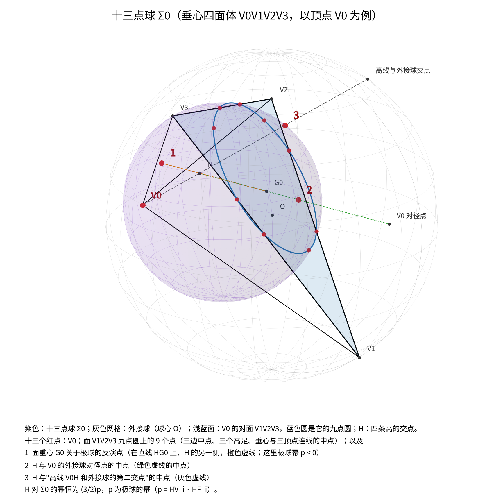
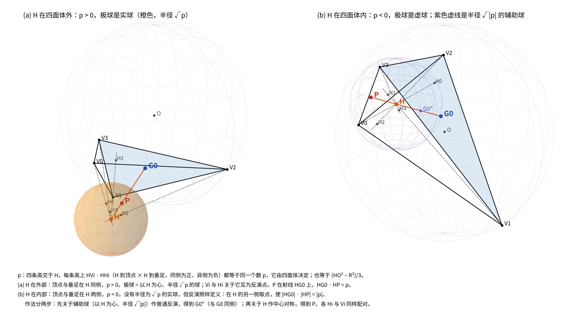

# 垂心四面体的六条定理

《[垂心四面体定理扫描](垂心四面体定理扫描.md)》四层扫描（共线、共面、共圆、共球）筛到最后、而且已经证明的六条关系，从那篇报告里单独拉出来，逐条写成完整的陈述、证明和文献核查。整理于 2026 年 10 月 20 日。

六条在一般四面体里都<b>不成立</b>，都用到「对棱垂直」这个条件。

| | 定理 | 来自 |
|---|---|---|
| 一 | 十三点球 Σ_d | 共球扫描 |
| 二 | 欧拉线共轭平面 | 共面扫描 |
| 三 | 第二欧拉线上的共轭共线 | 共线扫描 |
| 四 | 面类似重心在过高的平面上 | 共面扫描 |
| 五 | 七线共点 | 共线、共圆扫描 |
| 六 | Fermat 点的一条直线 | 共线扫描 |

<b>记号</b>：垂心四面体 V0V1V2V3，三对对棱互相垂直，四条高交于垂心 H（在垂心四面体里 Monge 点就是 H）。外接球球心 O、半径 R，重心 G。顶点 V_i 对面的那个面记作面 i，它的外心、垂心、重心记作 O_i、H_i、G_i；从 V_i 出发的高的垂足就是面 i 的垂心 H_i，下文直接称它为高足 H_i（F 留给十三点球里面内三条高的垂足）。

<b>极球</b>：H 到顶点与 H 到对应垂足的向量内积，对四个顶点同为一个常数

> p = HV_i · HH_i

以 H 为中心、p 为幂的反演叫极球反演，记作 ψ。H 在四面体内部时 p < 0，极球是虚球，反演照样有定义。ψ 把顶点送到垂足，把十二点球送到外接球；H 关于外接球的幂是 3p，关于棱中点球（球心 G，过 6 个棱中点和 6 个公垂线垂足）的幂是 p。

<b>代数</b>：把 H 放在原点，记 v_i = HV_i，则 v_i·v_j = p（i ≠ j）。令 a_i = |v_i|² − p（= V_iH · V_iH_i），则

> p = −1 / Σ(1/a_i)，　H 的重心坐标 ∝ 1/a_i，　G ∝ 1，　O = 2G − H，
> 棱长平方 d_ij² = a_i + a_j，　4S_i² = 其余三个 a 的两两乘积之和。

下面的符号计算都在这套参数下进行：任给四个正数 a_i，上面的 Gram 矩阵 v_i·v_j = p + a_i·δ_ij 就确定一个垂心四面体（相差一个刚体运动），所以结论化成 a_0, …, a_3 的恒等式。

---

## 一、十三点球

### 定理

<b>先说清楚哪一半是免费的。</b>　过一个圆的球构成一族（球束），再给一个不在圆平面上的点，就唯一确定其中一个。所以「过 V_d 和对面九点圆的球」<b>对任意四面体都存在且唯一</b>——这是 Σ_d 的<b>定义</b>，不是结论，和垂心性质无关，甚至和「九点圆」无关：换成面上任何一个圆都一样。同理，九点圆上那 9 个点里只有 3 个是独立的（三点定圆），其余 6 个由九点圆定理本身给出，也不是这里的新内容。

把这些扣掉，<b>真正的结论只有四条</b>：这个被 4 个条件（一个圆 + 一个顶点）完全定死的球，还恰好过另外三个有名字的点，而且 H 对它的幂是一个与形状无关的常数。

<b>定理一（十三点球）</b>　设 V0V1V2V3 是垂心四面体，取顶点 V_d，记 Σ_d 为过 V_d 和对面三角形九点圆的那个球（如上所述，它总是存在且唯一）。再记 X_d 为 V_d 在外接球上的对径点，Y_d 为高线 V_dH 与外接球的第二个交点。则：

> (1) 对面重心的极球反演点 ψ(G_d) 在 Σ_d 上；
> (2) HX_d 的中点在 Σ_d 上；
> (3) HY_d 的中点在 Σ_d 上；
> (4) <b>H 对 Σ_d 的幂恒等于 (3/2)p</b>，与四面体的形状无关。

四个顶点各给出一个这样的球。把定义里免费的点和结论里的三个点合起来，球上一共有 13 个有名字的点，所以叫它十三点球——但要记住这个数字里有 10 个是免费的。

下面取 d = 0，把对面 V1V2V3 的三个顶点记作 V1、V2、V3，列出球上全部 13 个点，记号与插图一致（前四行是定义里就有的，后三行 P、Q1、Q2 才是结论）：

| 记号 | 点 | 个数 |
|---|---|---|
| V0 | 顶点本身 | 1 |
| M1、M2、M3 | 对面三条边的中点（M_i 是 V_i 对边的中点） | 3 |
| F1、F2、F3 | 对面三条高的垂足（F_i 是面内从 V_i 出发的高的垂足；在垂心四面体里它同时就是 <b>H 在这条棱上的投影</b>，也是这条棱与对棱的公垂线垂足） | 3 |
| E1、E2、E3 | 对面的三个欧拉点（E_i 是面垂心与 V_i 连线的中点） | 3 |
| P | 对面重心的极球反演点 ψ(G_0)，在直线 HG_0 上 | 1 |
| Q1 | HX0 的中点（X0：V0 在外接球上的对径点） | 1 |
| Q2 | HY0 的中点（Y0：高线 V0H 与外接球的第二个交点） | 1 |

M、F、E 这 9 个点就是对面那个三角形的九点圆，和 V0 一起把 Σ_0 定死；P、Q1、Q2 是多出来的三个。Q1 与 Q2 成对：X0 和 Y0 都在外接球上，它们与 H 的中点都落在 Σ_0 上。

图：以 V0 为例的十三点球 Σ0（紫色）。灰色网格是外接球（球心 O），浅蓝面是 V0 的对面 V1V2V3，蓝色粗圆是它的九点圆，蓝色细线是面内三条高（交于面垂心 H′）——<b>Σ0 与这个面的交线正好就是九点圆</b>，所以圆上的 9 个点 M1–M3、F1–F3、E1–E3 全在球上，它们和 V0 一起把 Σ0 定死。三条辅助线对应结论里多出来的三个点：橙色虚线是直线 HG0，极球幂 p < 0，所以反演点 P 落在 H 的另一侧；绿色虚线连 H 与 V0 的外接球对径点 X0，中点是 Q1；灰色虚线是高线 V0H，它与外接球的第二个交点 Y0 和 H 的中点是 Q2。

13 个点里只有 P 的作法不直观，下图单独画出极球反演怎么把面重心 G0 送到 P：

 0）与在四面体内（p < 0）两种情形" width="900">

图：P = ψ(G0) 的作法。四条高交于 H，每条高上 HV_i · HH_i 都等于同一个数 p（H0–H3 是四面体的四个高足，即各面的垂心）。(a) H 在四面体外，p > 0，极球是以 H 为心、半径 √p 的实球（橙色），P 在射线 HG0 上，HG0 · HP = p。(b) H 在四面体内，p < 0，极球是虚球；先关于半径 √|p| 的辅助球（紫色虚线）作普通反演得到 G0*，再关于 H 作中心对称得到 P，所以 P 落在 H 的另一侧。上面十三点球的插图属于情形 (b)。

### 和经典的 24 点球是什么关系

四面体里已经有一个和九点圆有关的经典球：垂心四面体的<b>四个面的九点圆共球</b>，球心是 G，就是棱中点球（6 个棱中点 + 6 个公垂线垂足，再加每个面的九点圆各贡献 3 个点，合计 24 点，Altshiller-Court 把它叫作第二类 Feuerbach 球）。

Σ_d 不是它。两者的关系可以说得很干净：

> 过面 d 的九点圆的那一族球里，<b>24 点球是 H 的幂为 p 的那一个，Σ_d 是 H 的幂为 (3/2)p 的那一个</b>（也就是过对面顶点 V_d 的那一个）。

所以经典结果是「一个球同时过四个面的九点圆」，这里是「每个面的九点圆各配一个球，还穿过对面的顶点」，是同一族球里的另一个成员。

### 证明

把 H 放在原点，设球的方程是 |x|² − 2c·x + d = 0，其中 c 是球心、d 就是 H 对球的幂。记 u_i = c·v_i。

<b>第一步：面 d 的三条边中点在球上。</b>　对 i、j ≠ d，边中点是 (v_i + v_j)/2，代入得

> (|v_i|² + 2v_i·v_j + |v_j|²)/4 − (u_i + u_j) + d = 0。

用 |v_i|² = a_i + p、v_i·v_j = p 化简为 (a_i + a_j)/4 + p = u_i + u_j − d。三条边给出三个方程，解出

> u_i = a_i/4 + (p + d)/2，　i ≠ d。

<b>第二步：V_d 在球上。</b>　|v_d|² − 2u_d + d = 0，即 a_d + p − 2u_d + d = 0，于是

> u_d = (a_d + p + d)/2。

<b>第三步：用 H 的重心坐标。</b>　H 的重心坐标 ∝ 1/a_i 且 H 在原点，所以 Σ v_i/a_i = 0，两边与 c 作内积得 Σ u_i/a_i = 0。把第一、二步的 u_i 代进去：

> Σ_{i≠d} [ 1/4 + (p+d)/(2a_i) ] + [ 1/2 + (p+d)/(2a_d) ] = 3/4 + 1/2 + (p+d)/2 · Σ_i 1/a_i。

<b>第四步：</b>　再用 Σ 1/a_i = −1/p，上式等于 5/4 − (p+d)/(2p) = 0，解得

> <b>d = (3/2)p。</b>

球心 c 由 u_0, …, u_3 唯一确定（v_i 张成三维空间），所以 Σ_d 的方程已经完全写出来了。

<b>第五步：其余各点。</b>　三条边中点已经定出了面 d 上的九点圆——球与面 d 所在平面的交线是一个圆，它过这三个中点，而过三点的圆唯一，所以这个交圆就是面 d 的九点圆，九点圆上的点（三条高的垂足、三个欧拉点）因此全部自动在球上。剩下的三个点（P = ψ(G_d)，以及两个中点 Q1、Q2）把坐标代入球方程，用上面的 u_i 和 Σ 1/a_i = −1/p 化简，都恒为 0。

符号计算的代码是 `proof_sph8.py`，13 个点逐项化简为 0。∎

<b>扫描器看到的形态</b>：共球扫描的点库里没有面的欧拉点，所以它报出来的是一个 8 点球——V_d、对面三条边中点、对面三条高的垂足、ψ(G_d)。补全九点圆之后才数到 13。

### 推论：另外两个球

扫描里另外两个 8 点球都是 Σ_d 的像：

<b>推论 1（以 H 为中心放大 2 倍）。</b>　位似像 2Σ_d 上 H 的幂是 4 · (3/2)p = <b>6p</b>，球上有：X_d、Y_d、H 关于面 d 三条边中点的对称点（3 个）、H 关于面 d 三条边的对称点（3 个）。

<b>推论 2（极球反演像）。</b>　ψ(Σ_d) 上 H 的幂是 p²/((3/2)p) = <b>(2/3)p</b>，球上有：面 d 的重心和垂心、面 d 三条边中点的极球反演点（3 个）。此外 <b>H 在过 V_d 的三条棱上的投影</b>也在这个球上——这一条不是反演直接给出的，另外证明过。

### 验证

- 6 个随机垂心四面体上，13 个点共球，残差 10⁻¹⁵ 量级（相对球半径平方）；H 的幂除以 p 恒为 1.500000000000。
- 两个推论同样验证过：幂分别为 6.000000000000 和 0.666666666667 倍的 p。
- 符号计算见上。

### 文献

- 经典的是另一个球：四个面的九点圆共球（球心 G 的 24 点球 / 第二类 Feuerbach 球），见 Altshiller-Court《Modern Pure Solid Geometry》§797–802、Thébault 1946《Sur une nouvelle sphère du tétraèdre orthocentrique》；2012 年 Hang Lung Mathematics Awards 有一篇学生论文给出九点圆共球的充要条件。
- n 维的几种九点圆推广也查过：Buba-Brzozowa《Analogues of the nine-point circle for orthocentric n-simplexes》（J. Geom. 81 (2004) 21–29）、《The Monge point and the 3(n+1) point sphere of an n-simplex》（J. Geom. Graph. 9 (2005) 31–36）、Martini 等关于 Minkowski 空间的 2(d+1) 点 Feuerbach 球（arXiv:1602.06144 定理 4.3）——全部属于「面重心 + Monge 点分点」那一族、以欧拉线上一点为心的球，没有按顶点分成四个的球。
- 「thirteen-point sphere」这个名字在四面体几何里检索不到。
- Altshiller-Court 垂心四面体一章（§795–834）逐条读过，没有这个球。
- <b>结论：没有查到。</b>没能直接打开的来源：Court 1942《On the theory of the tetrahedron》（BAMS，站点 403）、Buba-Brzozowa 2004 全文（付费墙，只看到摘要和引用它的论文的转述），以及没有数字化索引的老期刊（Couderc–Balliccioni 1935、Mathesis、Nouvelles Annales）。

---

## 二、欧拉线共轭平面

### 定理

<b>两种共轭。</b>　四面体中一点 P 的齐次重心坐标记作 (x_0 : x_1 : x_2 : x_3)（x_i 与 P 到面 i 的有向距离乘面 i 的面积成正比）。和三角形一样定义：

> 等截共轭 Pᵗ = (1/x_0 : 1/x_1 : 1/x_2 : 1/x_3)，　等角共轭 P* = (S_0²/x_0 : S_1²/x_1 : S_2²/x_2 : S_3²/x_3)，

S_i 是面 i 的面积。两者都有几何作法（见下面两张图）。重心 G 的等截共轭是它自己，等角共轭是类似重心（Lemoine 点）K——这与 Прасолов《立体几何问题集》8.82、8.83 一致。

<b>定理二（欧拉线共轭平面）</b>　设 V0V1V2V3 是垂心四面体，P 是欧拉线 OGH 上任意一点。则 P 的等角共轭 P*、等截共轭 Pᵗ 与欧拉线共面。

几点说明：

- <b>平面随 P 转动。</b>欧拉线确定的是一族平面（绕这条线转一圈），定理说 P* 和 Pᵗ 落在同一张里，但不同的 P 对应不同的平面，不是一张固定的平面。
- <b>两个特殊位置是平凡的。</b>P = G 时 Pᵗ = G 本身就在欧拉线上；P = H 时 H* 是 H 的补点（Altshiller-Court §803），也在欧拉线上。这两处「一条线加一个点」必然共面，没有内容。真正有内容的例子是 P = O：<b>O*、Oᵗ 与欧拉线共面</b>。
- <b>一般四面体里不成立</b>，偏差在 10⁻² 量级（见验证）。
- <b>三角形里没有对应</b>：平面上所有点本来就共面。这是三维才有的现象。

图：欧拉线共轭平面。蓝色粗线是欧拉线（H、G、O，在垂心四面体里 G 是 HO 的中点），绿点 P 是线上任取的一点，红点是它的等角共轭 P* 和等截共轭 Pᵗ，橙色是过欧拉线和这两点的平面。P 沿欧拉线移动时，这张平面绕欧拉线转动，但 P*、Pᵗ 始终同在一张上。

这条定理里的两种共轭，作法如下（定理三、六也要用）。

图：<b>等角共轭 P* 的作法</b>。取一条棱（图中是 V0V1），过这条棱和点 P 作平面（绿色）；棱处两个面 V0V1V2、V0V1V3 夹成一个二面角，作它的平分面（灰色）；把绿色平面关于平分面作镜像反射，得到红色平面。右图是顺着棱看过去的截面：绿线和红线与两个面的夹角相等（都是 α），这就是「等角」的含义。对 6 条棱各做一次得到 6 个平面，它们必交于一点，这点就是 P*（图中只画了 V0V1 这一条）。三角形里的对应作法是把 AP、BP、CP 分别关于三个角的平分线反射，三条反射线交于一点。

图：<b>等截共轭 Pᵗ 的作法</b>。同样以棱 V0V1 为例，它的对棱是 V2V3。过棱 V0V1 和点 P 作平面（绿色），它与对棱交于 D；在对棱上取 D 关于中点 M 的对称点 D′（即 V2D = D′V3，右图里两段都是 a）；再过棱 V0V1 和 D′ 作平面（红色）。对 6 条棱各做一次，6 个红色平面交于一点，就是 Pᵗ。这里能直接看出为什么交于一点：设 P 的重心坐标是 (x_0 : x_1 : x_2 : x_3)，绿色平面上的点的 x_2 : x_3 都等于 P 的这个比，而 D′ 把这个比颠倒过来，所以红色平面上的点满足 x_2 : x_3 = (1/x_2) : (1/x_3)；点 (1/x_0 : 1/x_1 : 1/x_2 : 1/x_3) 对 6 条棱同时满足，它就是公共点。三角形里的对应作法是：AP 交 BC 于 D，取 D 关于 BC 中点的对称点 D′，三条 AD′、BE′、CF′ 交于一点。

两张图并排看，区别一眼可见：<b>等角共轭靠二面角平分面作反射</b>，要用到角度，所以公式里带面积 S_i；<b>等截共轭靠对棱中点作对称</b>，只用到长度的比，所以公式只是取倒数。

### 证明

沿用开头「代数」一段的参数：a_i = |HV_i|² − p，记 e_1, e_2, e_3 为 a_0, …, a_3 的初等对称式，A = a_0a_1a_2a_3。

<b>第一步：欧拉线的重心坐标。</b>　G ∝ 1，H ∝ 1/a_i。所以欧拉线上的点正好是重心坐标落在 {1, 1/a_i} 张成的二维空间里的点。（O 在其中：O ∝ e_3 − 2A/a_i。）把欧拉线上一点写成

> x_i = c − d/a_i，　c、d 是常数（随 P 变化）。

<b>第二步：Pᵗ。</b>　1/x_i = a_i/(c·a_i − d) = (1/c)·[1 + d/(c·a_i − d)]（c = 0 即 P = H 时直接有 1/x_i ∝ a_i，下面的论证照样成立）。所以 Pᵗ 的坐标落在 {1, 1/(c·a_i − d)} 张成的空间里。

<b>第三步：面积。</b>　开头已有 4S_i² = 其余三个 a 的两两乘积之和 = e_2 − a_i·e_1 + a_i²。

<b>第四步：P*，关键一步。</b>　P* 的坐标 ∝ S_i²/x_i = a_i(a_i² − e_1a_i + e_2) / (c·a_i − d)。每个 a_i 都是多项式 (x − a_0)(x − a_1)(x − a_2)(x − a_3) = x⁴ − e_1x³ + e_2x² − e_3x + A 的根（Vieta），所以

> a_i³ − e_1a_i² + e_2a_i = e_3 − A/a_i，

于是 S_i²/x_i ∝ (e_3a_i − A) / (a_i(c·a_i − d))。部分分式：

> (e_3a_i − A) / (a_i(c·a_i − d)) = (A/d)·(1/a_i) + (e_3 − Ac/d)·1/(c·a_i − d)。

（d = 0 即 P = G，是上面说的平凡情形。）

<b>第五步：</b>　四个点 G、H、Pᵗ、P* 的重心坐标都落在三维空间 span{1, 1/a_i, 1/(c·a_i − d)} 里（i 跑 0..3 时看作 ℝ⁴ 中的向量），所以它们的 4×4 行列式为 0，即四点共面。G、H 张出欧拉线，P* 和 Pᵗ 就和欧拉线在同一平面上。∎

垂心性质用在两处：欧拉线的重心坐标是 {1, 1/a_i} 这么简单的形式，以及 S_i² 是 a_i 的二次式、能被 Vieta 关系降次。一般四面体里两者都没有。

<b>机器核对</b>：按上面的参数直接写出 G、O、Pᵗ、P* 四行，用 sympy 展开 4×4 行列式，恒为 0（不到一秒）。扫描报告里原来的证明就是这个行列式展开（代码 proof_sym.py），上面的 Vieta 论证是把它拆开后的手算版本。

### 验证

- 6 个随机垂心四面体上，P 取欧拉线上任意参数，四点共面的残差 10⁻¹⁶ 量级；50 位有效数字下行列式恰好为 0。
- 随机一般四面体上不成立，偏差 10⁻² 到 10⁻³ 量级。
- P 取欧拉线上不同位置时，平面的法向确实在变（不是固定平面）。

### 文献

- 四面体的等角、等截共轭在 Rabinowitz 2020（IJCDM 5, 13–41）和 Cheung–Ko 2018 里都有，但只用在「面中心的塞瓦线是否共点」上，没有「欧拉线上一点的两种共轭与欧拉线共面」这类命题。
- Altshiller-Court《Modern Pure Solid Geometry》垂心四面体一章（§795–834）、Прасолов–Шарыгин《立体几何问题集》的等角共轭、欧拉线两节（含 §8.13 第二欧拉线）都逐条看过，没有这一条。
- <b>结论：没有查到。</b>没有数字化索引的老期刊（Couderc–Balliccioni 1935、Mathesis、Nouvelles Annales）还没查。

---

## 三、第二欧拉线上的共轭共线

### 定理

<b>第二欧拉线。</b>　四面体的高不一定共点，所以「欧拉线」有不止一种推广。上一节用的是过 O 和重心 G 的那条。另一条是：三角形里垂心是外心的等角共轭，于是把外心 O 和它的等角共轭 O* 连起来。这两条线一般不重合。

Прасолов《Задачи по стереометрии》第 8 章 §13 给了这两条线名字——过 O 和重心的叫<b>第一欧拉线</b>，过 O 和 O* 的叫<b>第二欧拉线</b>（原文：「Вторая прямая Эйлера тетраэдра ABCD — это прямая, проходящая через центр описанной сферы O и точку O′, изогонально сопряжённую с точкой O.」）。<b>需要说明</b>：这个叫法目前只在这本书里见到，俄文、英文的其它文献中没有检索到，所以它是该书的术语，不是学界通用名称；本文沿用它只是因为比「直线 OO*」好读。

<b>定理三（第二欧拉线上的共轭共线）</b>　设 V0V1V2V3 是垂心四面体，O* 是外心 O 的等角共轭，P 是第二欧拉线 OO* 上任意一点。则

> <b>O、P*、Pᵗ 三点共线。</b>

几点说明：

- <b>和定理二是同一类现象，但结论的形状不同。</b>定理二是「一条线上的点，两种共轭与这条线共面」；这里是「一条线上的点，两种共轭与<b>一个定点 O</b> 共线」。后者更强：共线比共面少一个自由度，而且 O 不随 P 变。
- <b>取 P = O 就得到一条干净的推论</b>：O* 是 O 的等角共轭，O 的等截共轭 Oᵗ 也在同一条线上，即 <b>O、O*、Oᵗ 三点共线</b>——第二欧拉线同时装着 O 的两种共轭。
- <b>扫描里的 3 类候选直线都是它的特例</b>。例如取 P 为切线四面体的外心：这个点在一般四面体里本来就落在直线 OO* 上，于是它的两种共轭与 O 共线。
- <b>三角形里不成立</b>。三角形里 O* 就是垂心 H，第二欧拉线退化成普通欧拉线；但在随机三角形上取欧拉线上的 P，O、P*、Pᵗ 的共线残差是 10⁻² 量级，并不共线。所以这不是平面结果的搬运，是三维特有的。
- <b>一般四面体里也不成立</b>，偏差 0.04–0.4。

### 证明

沿用开头「代数」一段的参数，并记 e_1、e_2、e_3 为 a_0, …, a_3 的初等对称式，A = a_0a_1a_2a_3。为了书写方便令

> u_i = e_3·a_i − A，　w_i = e_3·a_i − 2A，　于是 u_i = w_i + A。

<b>第一步：O 和 O* 的坐标。</b>　上一节已有 O ∝ e_3 − 2A/a_i = w_i/a_i。又 4S_i² = a_i² − e_1a_i + e_2，而 Vieta 关系（每个 a_i 都是 x⁴ − e_1x³ + e_2x² − e_3x + A 的根）给出

> a_i(a_i² − e_1a_i + e_2) = e_3 − A/a_i = u_i/a_i。　(★)

于是等角共轭 O*_i ∝ S_i²/O_i ∝ a_i(a_i²−e_1a_i+e_2)/w_i = u_i/(a_i w_i)。

<b>第二步：直线上的点。</b>　齐次重心坐标下，直线 OO* 上的点就是 O 与 O* 的线性组合：

> P_i = λ·w_i/a_i + μ·u_i/(a_i w_i) = N_i / (a_i w_i)，　其中 <b>N_i = λw_i² + μ·u_i</b>。

<b>第三步：两种共轭。</b>　直接代入，并再次用 (★)：

> Pᵗ_i ∝ 1/P_i = a_i w_i / N_i，　　P*_i ∝ S_i²/P_i ∝ a_i(a_i²−e_1a_i+e_2)·w_i/N_i = u_i w_i/(a_i N_i)。

<b>第四步：把列化简。</b>　把 O、Pᵗ、P* 三行排成 3×4 矩阵，共线就是它的秩 ≤ 2。给第 i 列乘上非零因子 a_i/w_i（列乘非零数不改变秩），三行变成

> O → 1，　Pᵗ → a_i²/N_i，　P* → u_i/N_i。

<b>第五步：关键的恒等式。</b>　把 N_i 按 a_i 展开（用 w_i = e_3a_i − 2A、u_i = w_i + A）：

> N_i = λ(e_3a_i − 2A)² + μ(e_3a_i − A) = λe_3²·a_i² + (μ − 4λA)·(e_3a_i − A) = <b>λe_3²·a_i² + (μ − 4λA)·u_i</b>。

两边同除 N_i：

> λe_3²·(a_i²/N_i) + (μ − 4λA)·(u_i/N_i) = 1，　对每个 i 都成立。

这正好说明第四步的三行线性相关，所以秩 ≤ 2，<b>O、Pᵗ、P* 共线</b>。∎

系数 λe_3² 与 μ − 4λA 不依赖 i，这是全部关键：N_i 作为 a_i 的二次式，它的常数项与一次项<b>恰好</b>按 u_i = e_3a_i − A 的比例配好（常数项是 −A·(μ−4λA)，一次项是 e_3·(μ−4λA)），所以 N_i 落在 {a_i², u_i} 张成的二维空间里。换一条直线（例如第一欧拉线）这个配比就不成立了。

垂心性质用在两处，和定理二一样：O 的重心坐标是 w_i/a_i 这种简单形状，以及 S_i² 是 a_i 的二次式、能用 Vieta 降次成 (★)。

<b>这条证明取代了原先的概率论证。</b>扫描报告里最初只做到：3×4 矩阵的 4 个 3×3 子式在 40 组随机有理点上精确为 0，按 Schwartz–Zippel 引理失败概率小于 10⁻¹⁰⁰（完整符号展开当时算了 50 分钟没完成）。上面的写法把子式展开绕开了，现在是真正的证明。

### 验证

- 恒等式 N_i = λe_3²a_i² + (μ − 4λA)u_i 在有理数 a = (2, 3, 5, 7) 与多组 (λ, μ) 上<b>精确成立</b>（分数运算，四个 i 全部相等）。
- 3 个随机垂心四面体、每个取 6 个随机的 (λ, μ)：O、P*、Pᵗ 的共线残差 10⁻¹⁵ 量级（用叉积的归一化模长度量）。
- 随机三角形上同样的构形不成立，残差 10⁻² 量级。
- 随机一般四面体上不成立，偏差 0.04–0.4。

### 文献

- 第二欧拉线这条线本身在 Прасолов 书第 8 章 §13 里有定义和名字，但该节只有一道题（8.75，讲的是第一欧拉线），关于第二欧拉线除定义外没有任何结论；这个名字也没在别处检索到。
- 同书的等角共轭一节（8.68–8.74）、Rabinowitz 2020、Cheung–Ko 2018 里的共轭都只用在「面中心的塞瓦线是否共点」上。
- <b>结论：没有查到。</b>未查的范围同前：没有数字化索引的老期刊。

---

## 四至六

其余三条先留在《[垂心四面体定理扫描](垂心四面体定理扫描.md)》第八节，陈述、证明和文献核查都在那里，接下来逐条搬到这里展开。
